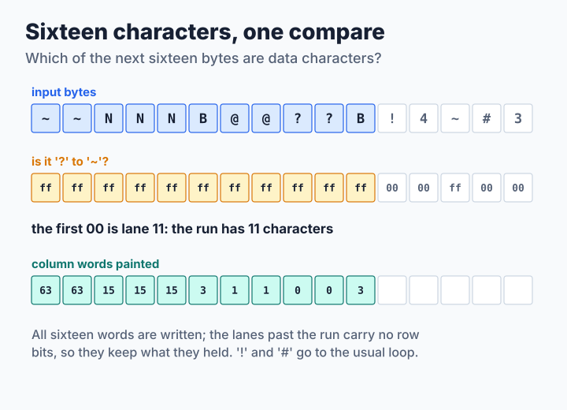

# Paint Sixteen Characters at Once

The decoder's inner loop, unchanged since the [word decoder](word-decoder.md), paints one data character per turn and leaves as soon as a character that is not data arrives. A run of data characters can be two characters long or two hundred, so the processor cannot know when the loop will end. This chapter looks at sixteen bytes with one vector compare, which says how many of them are data, and paints that many columns at once. The encoder is the [vector-lanes](vector-lanes.md) chapter's, and the stream is still the [packing](packing.md) chapter's. The source is [`code/literal-lanes.c`](code/literal-lanes.c).

**You will learn:**

- how one compare and a bit scan find the end of a run,
- how interleaving spreads sixteen characters over sixteen column words,
- why a fixed amount of work can be slower than a loop for short runs.

## How long is the run?

The compare is the one of the [vector lanes](vector-lanes.md) chapter, with a range instead of a single value: a lane is data when its byte lies from `?` to `~`. `v_movemask()` squeezes the sixteen answers into one number, and the first zero bit is the end of the run:



```c
v128 c = v_load(p);
int n = ctz32(~v_movemask(v_data(c)) | 0x10000);   /* 16 if all are data */
```

The `| 0x10000` makes the answer 16 when all sixteen bytes are data, so the loop goes on with the next sixteen.

## Sixteen column words at once

A column word holds the six pixels of a column, one byte each, as in the [word decoder](word-decoder.md). To paint a character, every byte whose row bit is set takes the color. With vectors, each character first has to fill the eight bytes of its column word. Interleaving a vector with itself doubles every byte; after three rounds each byte has become eight, which is the [transpose](transpose.md) chapter's zipper run the other way:

```c
v128 lo = v_zip8(c), hi = v_zip8hi(c);              /* each byte twice */
v128 quads[4] = { v_zip16(lo), v_zip16hi(lo), v_zip16(hi), v_zip16hi(hi) };
v128 pair = v_zip32(quads[0]);                      /* columns 0 and 1 */
v128 m = v_eq(v_and(pair, bit), bit);               /* bytes to paint */
v_store(col, v_or(v_andnot(m, v_load(col)), v_and(m, color)));
```

`bit` holds the row weights 1, 2, 4, … 128 in the eight bytes of each word, so `m` marks exactly the bytes whose row bit is set. Row bits 6 and 7 never occur, so the two spare bytes of a word are never painted. The lanes past the end of the run are cleared before the interleaving: they carry no row bits and leave their columns as they were. That way all sixteen words can be written without asking which of them belong to the run.

A fixed amount of work is not free. A run of one or two characters would pay for sixteen columns, so runs shorter than four characters go to the scalar loop, and so do the last fifteen bytes of the input and the columns at the right edge.

## Where this idea came from

libsixel's parallel decoder workers paint literal runs sixteen bytes at a time with NEON since 2026, in [`decoder-parallel.c`](../../../src/decoder-parallel.c); its serial parser keeps them scalar, as its [vector band-word paths](../../decoder/pipeline/README.md#vector-band-word-paths) explain. Whether an earlier SIXEL decoder did this is not known.

> **Try it.** Change the threshold of four in `paint_block()` to one and to eight, and measure the photograph and random noise. Where does each picture want it?

## How fast is it?

<!-- measurements:begin:literal-lanes -->
| Input | Encode | Speed-up | Decode | Speed-up | Stream |
| --- | --- | --- | --- | --- | --- |
| Photograph, 600×450 | 1.91 ms | 1.0× | 0.59 ms | 0.9× | 328,750 bytes |
| Photograph, 1920×1080 | 8.68 ms | 1.0× | 2.79 ms | 1.0× | 1,663,155 bytes |
| Two colors, 1920×1080 | 1.79 ms | 1.0× | 0.55 ms | 1.5× | 692,322 bytes |
| Random noise, 1920×1080 | 66.0 ms | 1.0× | 13.5 ms | 1.0× | 9,316,560 bytes |
<!-- measurements:end -->

The two-color pattern decodes 1.5 times faster, because its runs of data characters are as long as the picture is wide. The photographs and random noise get slightly slower: their runs are short, most of them go to the scalar loop anyway, and the compare that decides so is extra work. Like the [vector-lanes](vector-lanes.md) chapter, this one shows that vectors pay only where the data has long stretches of the same kind. The encoder has not changed.

Previous: [Read a number in one load](number-load.md) · Next: [Write a node in wide stores](wide-stores.md)
