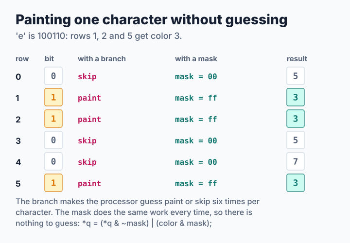

# Store with Masks Instead of Branches

After [fewer questions](fewer-questions.md), the decoder still asks six questions about every character: is pin 0 pushed, is pin 1 pushed, and so on. This chapter answers them without asking. The memory layout stays the same and no special instructions are needed, yet decoding a dithered photograph becomes 2.3 times faster. The encoder is the [packing](packing.md) chapter's. The source is [`code/masks.c`](code/masks.c).

**You will learn:**

- how a processor guesses the answer of an `if`, and what a wrong guess costs,
- how a mask replaces an `if`,
- why the same change speeds up one picture and slows down another.

## Painting without guessing

A processor works on many instructions at once, so at an `if` it cannot wait for the answer. It guesses which way the program will go and carries on. A right guess costs almost nothing. A wrong guess throws away the work done since the guess.

The inner loop asks `if (bits >> r & 1)` six times per character. In a dithered photograph those bits look random, so the processor cannot guess them well. A **mask** does the same job without asking. `0u - bit` is `0` when the bit is 0 and all ones when it is 1, and `(old & ~mask) | (color & mask)` then keeps the old value or takes the color:



```c
for (int r = 0; r < 6; r++, dst += cv.width) {
    mask = 0u - ((unsigned int)bits >> r & 1u);
    *dst = (unsigned char)((*dst & ~mask) | ((unsigned int)color & mask));
}
```

The mask version always reads and writes all six rows, so it does more memory work than the `if` for a character with few pins pushed. Whether that trade pays depends on the picture, as the numbers below show.

## Where this idea came from

Replacing a branch with a mask is a general technique of branch-free programming, much older than SIXEL. Which SIXEL decoder first used it to paint a character is not known.

> **Try it.** Change the mask back to an `if` in a copy of `masks.c`, as in `fewer-questions.c`, and measure both on the photograph and on the two-color pattern:
>
> ```sh
> ./first-codec synth two 1920 1080 > two.ppm
> ./masks bench photo.ppm 1 10
> ./masks bench two.ppm 1 10
> ./fewer-questions bench two.ppm 1 10
> ```
>
> Which picture prefers which version? Can you predict it from the stream, before you measure?

## How fast is it?

<!-- measurements:begin:masks -->
| Input | Encode | Speed-up | Decode | Speed-up | Stream |
| --- | --- | --- | --- | --- | --- |
| Photograph, 600×450 | 3.79 ms | 1.0× | 0.75 ms | 2.3× | 328,750 bytes |
| Photograph, 1920×1080 | 22.2 ms | 1.0× | 4.30 ms | 2.3× | 1,663,155 bytes |
| Two colors, 1920×1080 | 2.37 ms | 1.0× | 1.50 ms | 0.6× | 692,322 bytes |
| Random noise, 1920×1080 | 152.2 ms | 1.0× | 18.9 ms | 1.4× | 9,316,560 bytes |
<!-- measurements:end -->

On the photograph and on random noise the masks win clearly. On the two-color pattern they make the decoder *slower*: its bits follow a regular pattern that the processor can guess, so the extra memory work buys nothing. That fits the explanation above, although this tutorial did not count wrong guesses directly.

Splitting the last two chapters shows how their ideas work together. The table gives decode times in milliseconds; the second row is the full decoder with masks for single characters and no inner loop:

<!-- measurements:begin:attribution -->
| Decoder | Photograph, 1920×1080 | Two colors, 1920×1080 | Random noise, 1920×1080 |
| --- | --- | --- | --- |
| full-decoder | 10.4 | 2.19 | 30.5 |
| full-decoder with masks for single characters | 5.61 | 2.08 | 24.0 |
| fewer-questions (inner loop, no masks) | 9.93 | 0.94 | 25.6 |
| masks (inner loop and masks) | 4.30 | 1.50 | 18.9 |
<!-- measurements:end -->

Masks alone nearly halve the photograph's time, and the inner loop alone saves little, but together they are faster than either. Once the bits no longer cost wrong guesses, the questions about each byte are what remains. The [measurement record](measurements.md) has the method.

Previous: [Ask fewer questions](fewer-questions.md) · Next: [Find the next node without a search](next-node.md)
