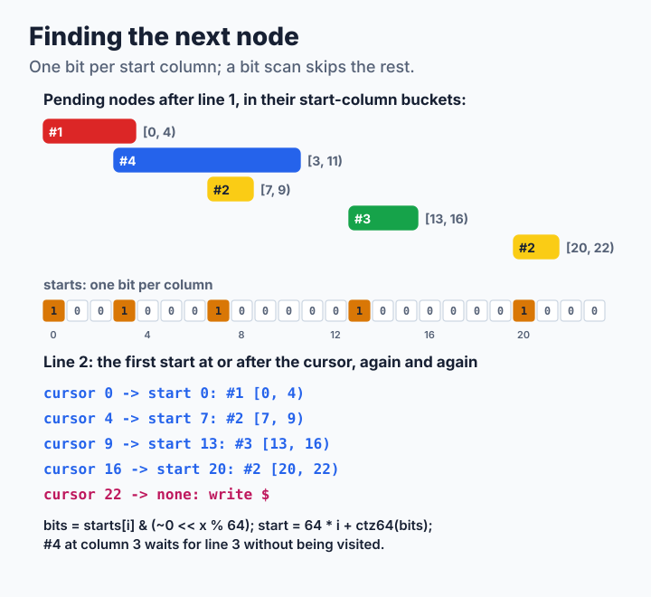

# Find the Next Node Without a Search

The [packing](packing.md) encoder keeps its nodes in one list and walks the whole list for every graphics line, skipping the nodes that start left of the cursor. A band with thousands of nodes and many lines repeats that walk many times. This chapter finds the next node for a line with one bit scan instead, and writes exactly the same bytes. The decoder is the [masks](masks.md) chapter's. The source is [`code/next-node.c`](code/next-node.c).

**You will learn:**

- how a row of bits, one per column, answers "where is the next one?",
- how `ctz64()` jumps past empty columns without looking at them,
- why the result is byte for byte the same as the list walk.

## Buckets and a row of bits

The nodes stay in their start-column buckets, longest first, instead of being joined into one list. One more thing is kept: a row of bits, one per column, set when that column's bucket is not empty. Sixty-four of those bits fit in one `uint64_t`, and `ctz64()` ("count trailing zeros") jumps straight to the lowest set bit. So the next node on a line is the longest one in the first non-empty bucket at or after the cursor:



```c
static int next_start(uint64_t const *starts, size_t words, int width, int x)
{
    if (x >= width) return -1;
    size_t i = (size_t)x / 64;
    uint64_t bits = starts[i] & (~UINT64_C(0) << (x % 64));     /* columns >= x */
    while (bits == 0) {
        if (++i == words) return -1;
        bits = starts[i];
    }
    return (int)(i * 64) + ctz64(bits);
}
```

When there is no start at or after the cursor, the line is finished: the encoder writes `$` and starts again from column 0. Taking a node out of its bucket clears the column's bit when the bucket becomes empty.

## The same nodes in the same order

The list walk takes, at each cursor position, the first remaining node that starts at or after the cursor. In a list sorted by start column, longest first, that is the longest node of the leftmost non-empty bucket at or after the cursor, which is exactly what the bit scan finds. So this encoder picks the same nodes in the same order, and [`code/check.sh`](code/check.sh) confirms that the stream does not change by a single byte. libsixel keeps [start-column buckets and a bitset](../../encoder/output/encode-policy/README.md) in the same way.

## Where this idea came from

Bitmaps with a count-trailing-zeros jump are a general technique, used for example in schedulers and allocators. Which SIXEL encoder first used one to find the next node is not known.

> **Try it.** Count how many nodes the list walk of `packing.c` visits per band, and how many the bit scan of `next-node.c` visits, for the photograph and for random noise. Where does the difference come from?

## How fast is it?

<!-- measurements:begin:next-node -->
| Input | Encode | Speed-up | Decode | Speed-up | Stream |
| --- | --- | --- | --- | --- | --- |
| Photograph, 600×450 | 3.43 ms | 1.1× | 0.79 ms | 0.9× | 328,750 bytes |
| Photograph, 1920×1080 | 20.8 ms | 1.1× | 4.28 ms | 1.0× | 1,663,155 bytes |
| Two colors, 1920×1080 | 2.22 ms | 1.1× | 1.50 ms | 1.0× | 692,322 bytes |
| Random noise, 1920×1080 | 102.9 ms | 1.5× | 18.8 ms | 1.0× | 9,316,560 bytes |
<!-- measurements:end -->

Random noise encodes 1.5 times faster, because writing its stream now takes 43 ms instead of 95 ms. The photograph barely changes: its bands have few enough lines that the walk was not expensive. The [measurement record](measurements.md#encoder-phases) lists the time of each phase.

A larger cost is now in plain view. Cutting nodes takes 14 ms of the photograph's 21 ms, because the encoder scans every slot of every color present in a band, and most of those slots are empty. The [next chapter](occupancy.md) records where each color appears, so that the encoder can stop looking at empty slots.

Previous: [Store with masks instead of branches](masks.md) · Next: [Remember where each color is](occupancy.md)
