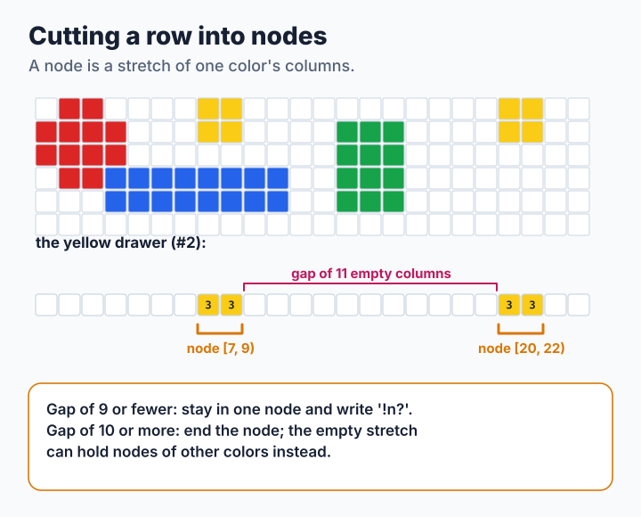

# Read Each Pixel Once

The [first codec](first-codec.md) walks over a band once per color. With 216 colors, it reads every pixel 216 times, and 215 of those visits find nothing. This chapter changes only the encoder's plan: read the band once and sort its pixels by color, then write each color that is present on a line of its own. The decoder is still the first codec's. The source is [`code/nodes.c`](code/nodes.c).

**You will learn:**

- how to sort pixels into one row per color in a single pass,
- what a *node* is and why a long gap ends it,
- why a better plan beats every later trick.

## Sorting pixels into drawers

Picture a chest of drawers with one drawer per color. Each drawer has one slot per column. Walk over the six rows of the band once. For every pixel, open the drawer of its color and add the pixel's row value to the slot of its column:

![An eight by six band is read once. Each pixel ORs its row weight into map[color][x], giving one row of column values per color](figures/nodes-classify.svg)

When the band is done, every slot holds exactly the number you computed by hand in the first chapter: the sum of the row values of that color in that column. Add 63 and it is the sixel character. Each pixel was looked at once, no matter how many colors there are. In C the chest is one array `map` with `w` bytes per color, and "add the row value" is `|=`:

```c
for (int r = 0; r < 6 && y + r < h; r++) {
    unsigned char const *row = img->pixels + (size_t)(y + r) * w;
    for (int x = 0; x < w; x++) {
        map[row[x] * w + x] |= (unsigned char)(1 << r);
        used[row[x]] = 1;
    }
}
```

`used[c]` remembers which colors appeared in this band, so the encoder can skip the empty drawers.

## Cutting a drawer into nodes

Most colors of a photograph appear in a few places of a band, not everywhere. A **node** is one stretch of one color: it starts at a column where the color appears and ends after the last one. Short gaps stay inside the node and cost a few `?` characters. A long gap ends the node:



The rule is: a gap of up to nine empty columns stays inside the node. A node is written as two numbers, its first column `sx` and the column `mx` just after its end, so the node `[7, 9)` covers columns 7 and 8.

```c
for (int sx = 0, mx, cursor = 0; sx < w; sx = mx) {
    while (sx < w && row[sx] == 0) sx++;        /* skip empty columns */
    if (sx == w) break;
    mx = sx + 1;
    for (int x = mx; x < w && x - mx <= NODE_GAP; x++)
        if (row[x] != 0) mx = x + 1;            /* the node grows */
    buf_putrun(out, '?', sx - cursor);          /* blank columns */
    put_span(out, row, sx, mx);
    memset(row + sx, 0, (size_t)(mx - sx));     /* empty the drawer */
    cursor = mx;
}
```

In this chapter the nodes of one color still go on that color's own line, one after another, so a node changes no byte of the output yet. It is the unit that the [next chapter](packing.md) moves around. Writing a node also clears its slots, so the chest is empty again when the band is done, without a separate clearing pass.

Compared with the first codec, the stream loses only the lines of colors that do not appear in a band. Everything else is byte for byte the same, which makes the new plan easy to check: [`code/check.sh`](code/check.sh) requires that the stream decodes to the same pixels and is never longer than the first codec's.

## Where this idea came from

Sorting a band into one map per color and cutting the maps into nodes is the design of kmiya's `sixel` encoder, by the author of the RLogin terminal; its earliest preserved version is dated 2014-03-02, and libsixel [started from it](../../project-history.md#kmiyas-sixel). gnuplot's `sixelgd` terminal of 2016 is another descendant. The [implementation history](../../sixel-format/implementation-history.md#kmiyas-sixel-and-the-node-method) lists the sources.

> **Try it.** Count the graphics lines of the first band of a photograph in both streams:
>
> ```sh
> ./first-codec encode ../../../../images/snake.ppm | cut -d- -f1 | tr -cd '$' | wc -c
> ./nodes encode ../../../../images/snake.ppm | cut -d- -f1 | tr -cd '$' | wc -c
> ```
>
> Then change `NODE_GAP` in `nodes.c` to 0 and to 50, rebuild, and look at the stream. Why does the size not change at all? (Put the value back afterwards.)

## How fast is it?

<!-- measurements:begin:nodes -->
| Input | Encode | Speed-up | Decode | Speed-up | Stream |
| --- | --- | --- | --- | --- | --- |
| Photograph, 600×450 | 3.27 ms | 7.7× | 7.50 ms | 1.0× | 346,872 bytes |
| Photograph, 1920×1080 | 20.2 ms | 9.0× | 58.1 ms | 1.0× | 1,677,105 bytes |
| Two colors, 1920×1080 | 2.19 ms | 0.8× | 2.15 ms | 1.0× | 692,322 bytes |
| Random noise, 1920×1080 | 65.1 ms | 4.2× | 172.3 ms | 1.0× | 9,942,096 bytes |
<!-- measurements:end -->

The speed-up compares each chapter with the one before it. The photograph now encodes 9 times faster, and random noise about 4 times. The two-color pattern gets slightly slower: the first codec already made only two passes there, and the drawers cost a little bookkeeping. This is the largest single gain of the whole tutorial, and it comes from a better plan, not from a clever instruction.

The decoder has not changed, and it is now the slower half. Its time grows with every column the stream crosses, including the long runs of blank columns before each node. [Packing](packing.md) removes most of them.

Previous: [A first encoder and decoder](first-codec.md) · Next: [Pack nodes onto shared lines](packing.md)
