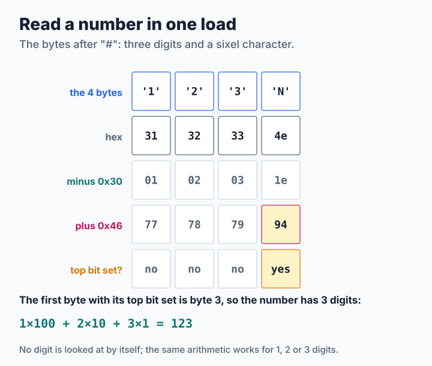

# Read a Number in One Load

Nearly every `#` and `!` in a stream is followed by one to three digits. Since the [fewer questions](fewer-questions.md) chapter, the decoder reads them on the spot, one digit per turn of a small loop. That loop runs once, twice or three times, depending on the number, and the processor has to guess each time when it ends. This chapter reads four bytes at once and finds where the number ends with arithmetic instead of a loop. The encoder is the [vector-lanes](vector-lanes.md) chapter's, and the stream is still the [packing](packing.md) chapter's. The source is [`code/number-load.c`](code/number-load.c).

**You will learn:**

- how ordinary integer arithmetic can work on four bytes at once,
- how to find the first byte that is not a digit without looking at each byte,
- why removing one hard-to-guess loop helps some pictures much more than others.

## Four bytes in one number

A 32-bit integer is four bytes side by side. Load the four bytes after a `#` into one `uint32_t` with `memcpy()`, and on a little-endian processor, which today means nearly every one, the first byte lands in the lowest eight bits. Arithmetic on the integer then works on all four bytes together, as long as no byte carries into its neighbor. This is called **SWAR**, *SIMD within a register*.

Two operations tell digits from everything else:



- Subtracting `0x30`, the code of `'0'`, from every byte leaves the value of each digit, 0 to 9. A byte below `'0'` borrows, which sets its top bit.
- Adding `0x46` to every byte makes `'9'` exactly `0x7f`, so every byte above `'9'` reaches `0x80` and sets its top bit.

A byte that is not a digit therefore has its top bit set in one of the two results. The lowest set top bit is where the number ends, and a count of trailing zero bits divided by eight turns it into the number of digits:

```c
uint32_t word, d, stop;
memcpy(&word, p, 4);
d = word - 0x30303030;                          /* digit values */
stop = ((word + 0x46464646) | d) & 0x80808080;  /* not a digit */
if (stop != 0) {
    digits = ctz32(stop) / 8;
    d <<= 32 - 8 * digits;                      /* the last digit on top */
    value = (d >> 24) + (d >> 16 & 0xff) * 10 + (d >> 8 & 0xff) * 100;
}
```

The shift moves the digits to the top of the word, so the last digit is always in the top byte, the one before it in the next and so on. Bytes that fall off the bottom are simply gone, and the empty bytes shifted in are zero, so the same line combines one, two or three digits. A borrow or carry can only start at a byte that is not a digit, and it only runs upwards, into bytes after the number, so the digits themselves are never disturbed.

When no byte stops the number, it has four digits or more, and the loop of the earlier chapters takes over. It also handles the last three bytes of the input, where four bytes cannot be loaded, and processors that store the first byte at the top.

## Where this idea came from

Testing every byte of a word at once is an old trick: Alan Mycroft posted the test for a zero byte to comp.lang.c in 1987, and C libraries use it to search strings. Fast number parsers combine several digits with a few multiplications; Daniel Lemire described such a parser for eight digits in 2018. Which SIXEL decoder first read its numbers this way is not known. libsixel's parallel decoder workers read numbers of up to three digits from one four-byte load since 2026, in [`decoder-parallel.c`](../../../src/decoder-parallel.c).

> **Try it.** Count how many numbers in the photograph's stream have one, two and three digits, for example with `grep -o '[#!][0-9]*' | awk '{ print length($0) - 1 }' | sort | uniq -c`. Then do the same for random noise. Which stream gives the old digit loop the harder guesses?

## How fast is it?

<!-- measurements:begin:number-load -->
| Input | Encode | Speed-up | Decode | Speed-up | Stream |
| --- | --- | --- | --- | --- | --- |
| Photograph, 600×450 | 1.99 ms | 1.0× | 0.52 ms | 1.0× | 328,750 bytes |
| Photograph, 1920×1080 | 8.68 ms | 1.0× | 2.71 ms | 1.0× | 1,663,155 bytes |
| Two colors, 1920×1080 | 1.79 ms | 1.0× | 0.82 ms | 1.0× | 692,322 bytes |
| Random noise, 1920×1080 | 66.6 ms | 1.0× | 13.1 ms | 1.2× | 9,316,560 bytes |
<!-- measurements:end -->

Random noise decodes 1.2 times faster, and the other pictures do not change. Noise switches color at nearly every column, so its stream is mostly `#` and numbers, and their lengths follow no pattern; the old digit loop guessed wrong on many of them. The photograph has fewer numbers per byte and they repeat more, so the guesses were mostly right already. The encoder has not changed; its row only shows how much one measurement differs from the next.

Previous: [Turn columns back into rows](transpose.md) · Next: [Paint sixteen characters at once](literal-lanes.md)
