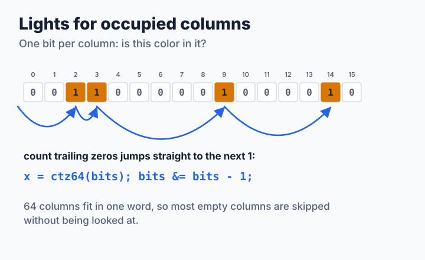

# Remember Where Each Color Is

Cutting nodes has been the most expensive part of encoding a photograph since the [nodes](nodes.md) chapter: for every color present in a band, it scans every slot of that color's drawer, and most slots are empty. The [first-colors](first-colors.md) encoder visits each (color, column) pair exactly once. This chapter notes each visit in a row of bits, so that cutting nodes walks only the occupied columns. The decoder is the [masks](masks.md) chapter's, and the stream is still the [packing](packing.md) chapter's. The source is [`code/occupancy.c`](code/occupancy.c).

**You will learn:**

- how a row of bits per color records where the color appears,
- how cutting nodes walks those bits instead of the slots,
- why this pays only once each pair is visited once.

## Lights for occupied columns

For every color, keep a row of lights: one bit per column, on when the color appears there. Sixty-four lights fit in one 64-bit word. To find the next occupied column, the code does not look at the empty ones at all; `ctz64()` jumps straight to the next light that is on:



Classifying sets the light at the moment it fills the slot, which costs one more OR per (color, column) pair:

```c
e->map[(size_t)c * e->width + x] =
    (unsigned char)(equal_bytes(word, c) & ((1u << rows) - 1));
e->occupancy[c * e->words + (size_t)x / 64] |= UINT64_C(1) << (x % 64);
e->used[c] = 1;
```

Cutting nodes then walks the lights. A light within `NODE_GAP` columns of the current node extends it; any other light starts a new node. Walking a word also clears it, ready for the next band:

```c
for (size_t i = 0; i < e->words; i++) {
    for (uint64_t bits = occ[i]; bits != 0; bits &= bits - 1) {
        int x = (int)(i * 64) + ctz64(bits);
        if (sx >= 0 && x - mx <= NODE_GAP) {
            mx = x + 1;                 /* extend the current node */
            continue;
        }
        if (sx >= 0) add_node(e, c, sx, mx);
        sx = x;                         /* start a new one */
        mx = x + 1;
    }
    occ[i] = 0;
}
add_node(e, c, sx, mx);
```

The nodes are the same as before, so the stream does not change. [Next node](next-node.md) used the same kind of row for the start columns of nodes; here a row per color serves cutting.

## Where this idea came from

chafa's SIXEL encoder kept a bitmap per color from its first version in 2019, which lets a pass skip a group of columns in which that color does not appear. The [implementation history](../../sixel-format/implementation-history.md#chafa-column-words-and-parallel-batches) describes it.

> **Try it.** Set the lights in the [column-words](column-words.md) encoder instead, once for every pixel, and measure. Is it the lights that make this chapter fast, or the fact that each pair is visited once?

## How fast is it?

<!-- measurements:begin:occupancy -->
| Input | Encode | Speed-up | Decode | Speed-up | Stream |
| --- | --- | --- | --- | --- | --- |
| Photograph, 600×450 | 2.31 ms | 1.8× | 0.74 ms | 1.0× | 328,750 bytes |
| Photograph, 1920×1080 | 11.7 ms | 2.0× | 4.12 ms | 1.0× | 1,663,155 bytes |
| Two colors, 1920×1080 | 3.90 ms | 0.9× | 1.47 ms | 1.0× | 692,322 bytes |
| Random noise, 1920×1080 | 68.4 ms | 1.5× | 18.5 ms | 1.0× | 9,316,560 bytes |
<!-- measurements:end -->

Cutting nodes takes 2.2 ms instead of 14.4 ms on the photograph, so the whole encoder is twice as fast, and random noise is 1.5 times faster. On the two-color pattern, where cutting nodes was already cheap, the encoder is a little slower: the shifted comparisons of the previous chapters cost more there than the lights save. The four chapters together made the photograph's encoder 1.8 times faster than [next node](next-node.md), and made the two-color pattern 1.8 times slower. libsixel faces the same trade-off and decides differently: its [`sixel_band_classify()`](../../../src/encoder-core-encode.c) uses column words only for palettes of one or two colors, and plain per-pixel stores plus occupancy bits otherwise. Which choice wins depends on the pictures, which is why every idea in this tutorial is measured instead of assumed to help.

Previous: [Visit each color of a column once](first-colors.md) · Next: [Decode into column words](word-decoder.md)
