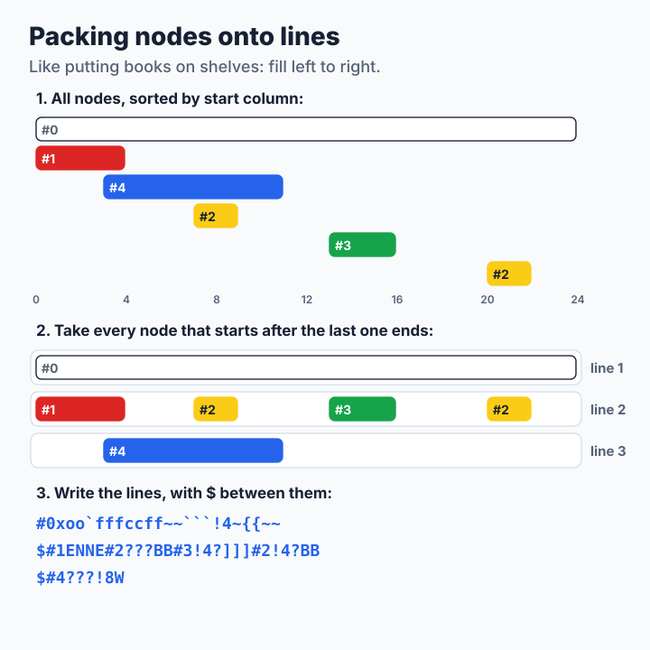

# Pack Nodes onto Shared Lines

The [nodes](nodes.md) encoder gives every color in a band a graphics line of its own, even a color with a single node at the right edge. Each of those lines starts at the left edge and skips the blank columns before its first node. This chapter lets nodes of different colors share a line, the way kmiya's encoder does. The decoder is still the first codec's. The source is [`code/packing.c`](code/packing.c), and from here on every encoder of the tutorial writes exactly its bytes.

**You will learn:**

- how to pack nodes onto shared lines, like books on shelves,
- why the order of the nodes matters,
- what packing saves and what it costs, measured rather than assumed.

## Packing nodes onto lines

Two nodes that do not overlap can share a line: paint the first one, skip ahead, paint the second. Packing them is like putting books on shelves. Sort the books by where they start. Then fill the first shelf from left to right, taking every book that starts after the previous one ends. Books that do not fit wait for the next shelf:



The white background covers the whole band and fills line 1 alone. The red node and the blue node both use column 3, so blue has to wait for line 3. Yellow, green and the second yellow fit on line 2 after red. Three lines instead of five.

The code keeps the sorted nodes in a linked list. Each pass over the list writes one line and removes the nodes it used:

```c
while (list != NULL) {
    if (color >= 0) buf_putc(out, '$');     /* back to column 0 */
    int x = 0;
    for (node_t **link = &list, *np; (np = *link) != NULL;) {
        if (np->sx < x) {
            link = &np->next;               /* overlaps; next line */
            continue;
        }
        if (np->color != color) {
            buf_putc(out, '#');
            buf_putnum(out, color = np->color);
        }
        buf_putrun(out, '?', np->sx - x);   /* blank columns */
        put_span(out, np->map, np->sx, np->mx);
        memset(np->map + np->sx, 0, (size_t)(np->mx - np->sx));
        x = np->mx;
        *link = np->next;                   /* unlink */
    }
}
```

Three details make it work well:

- **The order.** Nodes are sorted by start column, and among nodes with the same start the longest comes first. Equal nodes keep color order. The code builds this order with one bucket per start column and then joins the buckets from left to right.
- **The `#`.** A color is selected only when it differs from the previous node's. Two nodes of the same color next to each other on a line share one `#`.
- **A fresh start in every band.** `color` starts at `-1` in every band, so every band selects its first color explicitly, even if the previous band ended with the same one. That costs a few bytes, but it makes every band readable on its own, which [parallel bands](parallel-bands.md) need.

## Lines, not bytes

Packing changes the shape of the stream more than its size. On the Full HD photograph, the nodes stream has 22,431 graphics lines and crosses 28.8 million blank columns; the packed stream has 1,874 lines and crosses 2.5 million. But each color switch inside a line costs a `#n`, so the packed stream selects colors almost four times as often. The two effects nearly cancel: the packed stream is 0.8% smaller for the photograph and 6% smaller for random noise, and for some pictures it is a little larger.

> **Try it.** Compare the stream sizes of the nodes and packing encoders on the sample photograph and on a picture with scattered colors:
>
> ```sh
> ./first-codec synth sparse 1000 31 > sparse.ppm
> for p in nodes packing; do ./$p encode sparse.ppm | wc -c; done
> for p in nodes packing; do ./$p encode ../../../../images/snake.ppm | wc -c; done
> ```
>
> Packing loses on both. Look at the first band of both streams with `cat -v` and find out why. (Hint: count the `#` characters.)

## Where this idea came from

Packing nodes greedily onto shared lines is, like the nodes themselves, the design of kmiya's `sixel` encoder, preserved from 2014-03-02 and carried on by libsixel, which describes the method in the [SIXEL format overview](../../sixel-format/README.md#nodes-and-greedy-non-overlapping-sweeps). The [implementation history](../../sixel-format/implementation-history.md#kmiyas-sixel-and-the-node-method) gives the sources.

## How fast is it?

<!-- measurements:begin:packing -->
| Input | Encode | Speed-up | Decode | Speed-up | Stream |
| --- | --- | --- | --- | --- | --- |
| Photograph, 600×450 | 3.77 ms | 0.8× | 2.31 ms | 2.9× | 328,750 bytes |
| Photograph, 1920×1080 | 21.3 ms | 0.9× | 14.3 ms | 3.7× | 1,663,155 bytes |
| Two colors, 1920×1080 | 2.34 ms | 0.9× | 2.32 ms | 1.0× | 692,322 bytes |
| Random noise, 1920×1080 | 148.1 ms | 0.4× | 38.9 ms | 4.0× | 9,316,560 bytes |
<!-- measurements:end -->

The encoder got *slower*, a little on the photograph and more than twice on random noise. The list walk visits every remaining node once per line, and a band of noise has thousands of nodes and many lines. [Next node](next-node.md) removes that walk.

The decoder got 3.7 times faster on the photograph without a single changed line, because the first decoder steps through every blank column one at a time and the packed stream has 11 times fewer of them. A decoder that skips a run of blank columns in one step gains nothing: the [full decoder](full-decoder.md) of the next chapter decodes both streams in the same time. A speed-up can belong to the pair of programs rather than to either one, which is a reason to measure both halves together.

Previous: [Read each pixel once](nodes.md) · Next: [A decoder for every stream](full-decoder.md)
