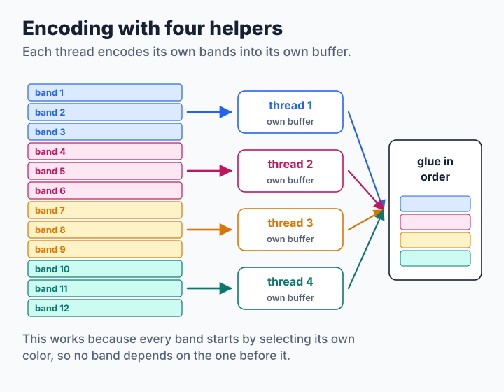
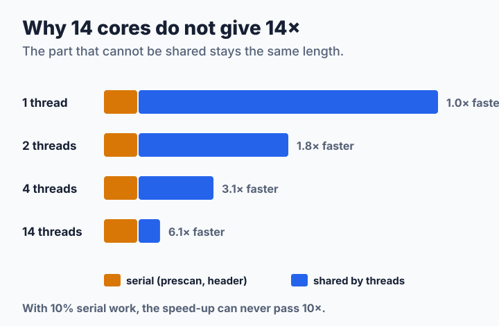

# Encode Bands in Parallel

After the [transpose](transpose.md) chapter, most of the encoder's time goes into work that is done one byte after another: classifying, cutting nodes and writing the stream. A modern computer has many cores, so let several of them work at the same time, each on its own part of the picture. Each part is a **thread**. For the encoder, SIXEL's bands are the natural parts. The decoder is the transpose chapter's serial one. The source is [`code/parallel-bands.c`](code/parallel-bands.c). It includes `transpose.c` and reuses its band encoder; its output is byte for byte the packing chapter's for any number of threads.

**You will learn:**

- how to split the encoder's work so that the result does not change,
- what a thread costs to start,
- why 14 cores do not make a program 14 times faster.

Set `TUTORIAL_THREADS` to choose the number of threads. By default each program uses up to one per CPU, but no more than the picture needs, because starting a thread costs more than encoding a small band.

## Bands are already independent

The bytes of a band depend only on its own pixels and the palette. Since the [packing](packing.md) chapter, every band also begins by selecting its own first color, so nothing carries over from the band before. That means the bands can be shared out like homework: each thread gets a range of bands, its own work area and its own output buffer, and at the end the buffers are glued together in order.



```c
static void *encode_worker(void *arg)
{
    encode_job_t *job = arg;
    encoder_t e;

    job->status = encoder_init(&e, job->img);
    if (job->status != 0) return NULL;
    for (int b = job->first_band; b < job->end_band; b++)
        encode_band(&e, job->img, b * 6, &job->out);
    encoder_free(&e);
    return NULL;
}
```

The calling thread takes the first range itself, so `n` ranges need only `n - 1` new threads. If a thread cannot be started, its range runs on the calling thread instead. The header, the palette and the gluing stay on one thread, but they are small.

Giving each thread one big range keeps the bookkeeping simple, but everyone has to wait for the slowest thread, and a range of busy bands can take much longer than a range of empty ones. libsixel's encoder instead hands out [one job per band](../../threading/encoder.md#six-row-jobs-and-ordered-output) to a pool of threads and writes finished bands while later ones are still being encoded, so output can start before the whole picture is done.

## Why 14 cores do not give 14×

Some work cannot be shared: the header, the gluing, starting the threads. However many threads share the rest, that part stays as long as it was:



If one tenth of the work cannot be shared, the program can never become more than 10 times faster, no matter how many cores it gets. This rule is called **Amdahl's law**, and it is the first thing to check when a program stops scaling.

## Where this idea came from

chafa's SIXEL encoder divided the image into batches of rows, built them in a thread pool and appended their output in order from its first version in 2019. notcurses made bands the work unit of a small pool of resident worker threads in 2022, and a-sixel encodes bands in parallel with Rust's rayon library. The [implementation history](../../sixel-format/implementation-history.md#chafa-column-words-and-parallel-batches) lists them.

> **Try it.** Measure the speed with 1, 2, 4, 8 and all threads, and draw a graph of the speed-up:
>
> ```sh
> for t in 1 2 4 8 14; do
>     TUTORIAL_THREADS=$t ./parallel-bands bench photo.ppm 1 10
> done
> ```
>
> Where does the curve flatten?

> **Challenge.** Replace the fixed ranges with a shared counter: each thread takes the next band when it is ready, so a fast core simply does more. Keep one buffer per band so that the output stays in order, and keep `make check` passing.

## How fast is it?

<!-- measurements:begin:parallel-bands -->
| Input | Encode | Speed-up | Decode | Speed-up | Stream |
| --- | --- | --- | --- | --- | --- |
| Photograph, 600×450 | 2.28 ms | 1.1× | 0.58 ms | 1.0× | 328,750 bytes |
| Photograph, 1920×1080 | 2.45 ms | 4.4× | 2.70 ms | 1.0× | 1,663,155 bytes |
| Two colors, 1920×1080 | 0.50 ms | 5.5× | 0.72 ms | 1.0× | 692,322 bytes |
| Random noise, 1920×1080 | 12.9 ms | 5.7× | 15.3 ms | 1.0× | 9,316,560 bytes |
<!-- measurements:end -->

The speed-up in the table compares with the transpose chapter. The Full HD photograph encodes 4.4 times faster with the default number of threads, and the [thread sweep](measurements.md#thread-scaling) shows the curve: it keeps gaining up to 14 threads and reaches about 7 times. Random noise scales a little better. The small photograph encodes on one thread, because it is too small to be worth splitting. The machine has 10 performance cores and 4 slower efficiency cores, and each thread gets a fixed range of bands, so the slowest range decides the finish.

Previous: [Turn columns back into rows](transpose.md) · Next: [Decode bands in parallel](parallel-decoder.md)
