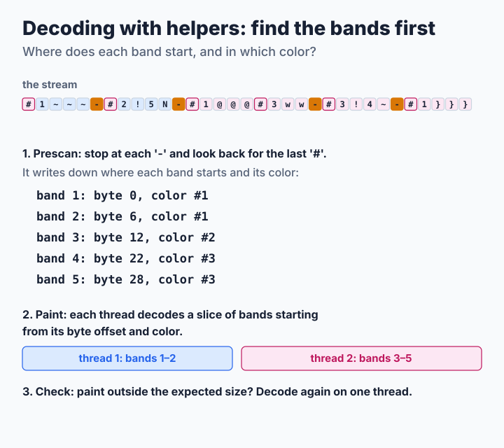

# Decode Bands in Parallel

A stream is harder to share out than a picture. Where band 3 starts is only known after finding the `-` that ends band 2. The first pixels of a band are painted with the color selected somewhere before it. And the picture's size is only certain at the end. This chapter finds the bands first and then decodes them in parallel, falling back to one thread when the plan does not fit the stream. The encoder is the [parallel-bands](parallel-bands.md) chapter's. The source is [`code/parallel-decoder.c`](code/parallel-decoder.c); it includes `transpose.c` and reuses its decoder, its vector operations and its transpose.

**You will learn:**

- why the decoder first has to find where the bands start,
- how to find each band's starting color without reading every `#`,
- what to do when the parallel plan does not fit the stream.

The decoder works in three phases:



## 1. Prescan

One quick pass, on a single thread, looks only at the two kinds of byte that it cannot leave for later: `-` (a new band starts after it) and `"` (the size). Everything else is skipped sixteen bytes at a time with the vector compares of the [vector-lanes](vector-lanes.md) chapter:

```c
while (end - p >= 16) {
    v128 v = v_load(p);
    unsigned int hits = v_movemask(v_or(v_eq(v, v_set1('-')),
                                        v_eq(v, v_set1('"'))));
    if (hits != 0) {
        p += ctz64(hits);               /* jump to the first hit */
        break;
    }
    p += 16;
}
```

A band needs one more fact: which color is selected when it starts. A photograph selects a color every few bytes, so stopping at every `#` would make this pass nearly as slow as a full decode. It does not have to. The color at the start of a band is simply the last `#` before the `-`, so the prescan searches backwards from each `-` and usually finds it within a few bytes:

```c
for (unsigned char const *q = p; q > band;) {
    if (*--q == '#') {
        q++;
        parse_params(&q, end, a, 1);
        color = a[0] > 255 ? 255 : a[0];
        break;
    }
}
```

A band with no `#` at all keeps the color it inherited. The prescan writes down each band's byte offset and color, and nothing else.

## 2. Paint in parallel

The decoder takes the size from the raster attributes, makes room for the column words of every band, and cuts the stream into pieces of similar length, each starting at a recorded band start. Each thread runs the transpose chapter's loop over its piece, starting with the recorded color, and then turns its own bands into rows. Different threads always work on different bands, so they never write to the same picture memory and do not need to wait for each other.

The palette needs care. A color can be defined anywhere in a stream, and two threads must not write the same register. So each thread only collects the definitions it passes, and when all threads have finished the program applies them in stream order. The last definition wins, as it does when decoding on one thread.

## 3. Check, or decode on one thread

The size in the raster attributes is a promise, not a guarantee: it can be missing, and a stream can paint outside it. libsixel's [decoding pipeline](../../decoder/pipeline/README.md#raster-declaration-versus-observed-paint) defines the picture as covering both. A thread that finds paint outside the room it was given stops and reports it, and a stream without a size never starts the parallel phase. In both cases the serial decoder simply decodes the whole stream again on one thread, so the result never depends on which path was taken. The test script includes such streams.

libsixel's parallel decoder splits by [byte ranges](../../threading/decoder.md#why-decoding-is-split-by-bytes) rather than by a list of band starts, but it draws the same kind of line: syntax that needs the parser's global state, such as redefining a color or resetting the size, can [send a stream back to one thread](../../threading/decoder.md#fallback-and-correctness).

## Where this idea came from

The earliest parallel SIXEL decoder found is libsixel's, from 2025-11. Whether an earlier decoder split a stream between threads is not known. The [implementation history](../../sixel-format/implementation-history.md#libsixel-parallel-bands-delta-frames-and-gpus) lists it.

> **Try it.** Measure the decoder with 1, 2, 4, 8 and all threads, and compare the curve with the encoder's from the previous chapter:
>
> ```sh
> for t in 1 2 4 8 14; do
>     TUTORIAL_THREADS=$t ./parallel-decoder bench photo.ppm 1 10
> done
> ```
>
> Does encoding or decoding flatten first?

## How fast is it?

<!-- measurements:begin:parallel-decoder -->
| Input | Encode | Speed-up | Decode | Speed-up | Stream |
| --- | --- | --- | --- | --- | --- |
| Photograph, 600×450 | 1.90 ms | 1.0× | 0.14 ms | 4.1× | 328,750 bytes |
| Photograph, 1920×1080 | 1.88 ms | 1.0× | 0.53 ms | 5.1× | 1,663,155 bytes |
| Two colors, 1920×1080 | 0.34 ms | 1.0× | 0.27 ms | 3.0× | 692,322 bytes |
| Random noise, 1920×1080 | 10.8 ms | 1.0× | 2.32 ms | 6.6× | 9,316,560 bytes |
<!-- measurements:end -->

The Full HD photograph decodes 5.1 times faster than with one thread, and random noise 6.6 times. The prescan is not what limits this: it takes about 0.06 ms on the Full HD photograph, against about 0.5 ms for the whole decode, because it stops only at band ends. In the [thread sweep](measurements.md#thread-scaling), the decoder reaches about 5 times at 8 to 10 threads and then gets slightly slower, which the fixed ranges and the 4 slower efficiency cores of the machine probably explain, although this was not measured separately. The two-color pattern scales less well, less than 3 times; its total time is so short that the cost of starting threads and of materializing starts to matter.

Previous: [Encode bands in parallel](parallel-bands.md) · Next: [Smaller streams by overpainting](overpaint.md)
