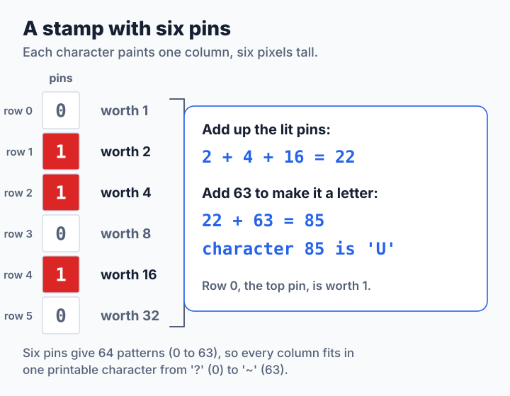
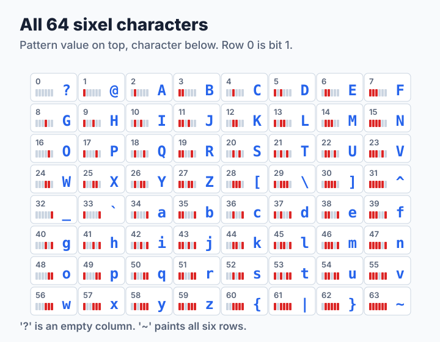
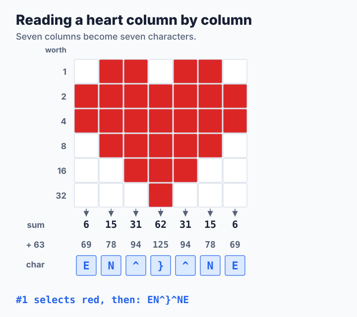
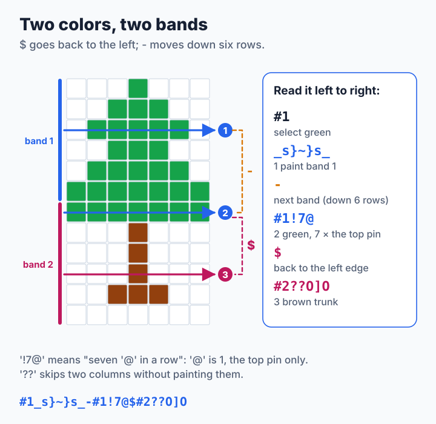
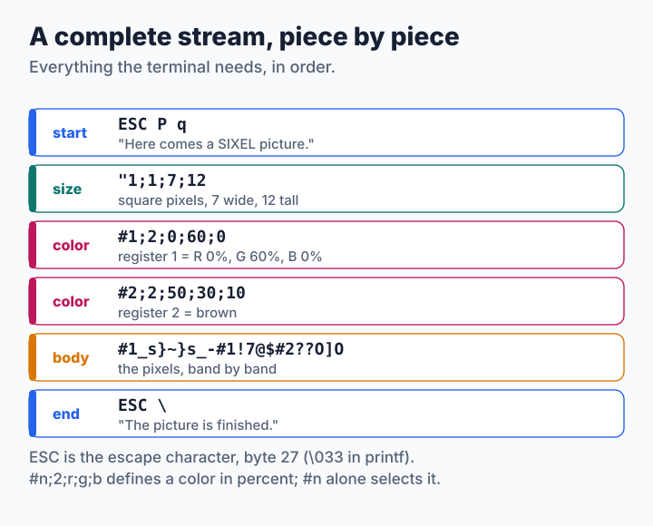

# Lesson 0: Drawing SIXEL by Hand

Before writing any code, let us draw a picture in SIXEL with nothing but a pencil and the `printf` command. By the end of this lesson you will be able to read every byte of a SIXEL stream, and you will know exactly what the encoder of [step 1](step1-run-length.md) has to produce.

**You will learn:**

- how one character paints a column of six pixels,
- how to pick colors and move the cursor,
- what a complete SIXEL stream looks like from start to end.

## A stamp with six pins

SIXEL comes from the printers and terminals that Digital Equipment Corporation (DEC) built in the 1980s, and its name means "six pixels". A good way to picture it is a stamp with six pins stacked on top of each other. The stamp moves from left to right across the paper. At each column it can push any of its six pins, and each pushed pin paints one pixel in the current color.



Which pins to push is written as one character. Give the pins the values 1, 2, 4, 8, 16 and 32 from top to bottom, add up the values of the pins you want, and add 63. The result is the character's code. In the picture, pins 1, 2 and 4 are pushed: 2 + 4 + 16 = 22, and 22 + 63 = 85, which is the letter `U`.

Why add 63? Six pins give 64 possible patterns, the numbers 0 to 63. Adding 63 turns them into the printable characters from `?` (63) to `~` (126), so a SIXEL picture is plain text that any program can store and send. Every pattern has its own character:



Computer people call the pin values *bits*: pin *r* is bit *r* of the number, and the value of bit *r* is `1 << r`. You will meet that notation in the code.

## Your first picture: a heart

Here is a heart, seven pixels wide and six tall: exactly one row of stamps. Go through it column by column, add up the values of the red pixels, and add 63:



The seven characters `EN^}^NE` are the whole heart. To show it, wrap it in the few bytes a terminal needs:

```sh
printf '\033Pq#1;2;90;10;20#1EN^}^NE\033\\'
```

| Bytes | Meaning |
| --- | --- |
| `\033Pq` | Escape, `P`, `q`: "here comes a SIXEL picture" |
| `#1;2;90;10;20` | Make color register 1 red: 90% red, 10% green, 20% blue |
| `#1` | Paint with register 1 from now on |
| `EN^}^NE` | Seven columns of the heart |
| `\033\\` | Escape, backslash: "the picture is finished" |

`\033` is how `printf` writes the escape character (byte 27), and `\\` is one backslash. The heart is tiny, only seven pixels wide, so look closely at the start of the line.

> **Try it.** Make the heart four times as wide. A `!` followed by a number repeats the next character that many times, so `!4E` means `EEEE`:
>
> ```sh
> printf '\033Pq#1;2;90;10;20#1!4E!4N!4^!4}!4^!4N!4E\033\\'
> ```
>
> Then draw a diagonal line from the top left to the bottom right, one pixel per column. Which six characters do you need? (The answer is at the end of this page.)

## More colors and more rows

Real pictures have more than one color and more than six rows. Two more characters move the stamp:

- `$` (*carriage return*) moves it back to the left edge of the same six rows, so you can paint over them again in another color.
- `-` (*next line*) moves it to the left edge of the next six rows.

The six rows that the stamp covers are called a **band**. Here is a tree twelve pixels tall, so it has two bands. Band 1 is all green. Band 2 has a green top row and a brown trunk, so it needs two trips of the stamp, one per color, separated by `$`:



Pixels you never paint are left alone and show the background. That is why the trunk trip starts with `??`: two empty columns that move the stamp to column 2 without painting.

## A complete stream

A full SIXEL picture always has the same pieces in the same order:



- `"1;1;7;12` gives the size: square pixels (`1;1`), 7 pixels wide, 12 tall. It is optional, but it lets the terminal prepare the right amount of space.
- `#n;2;r;g;b` defines register *n* in red, green and blue percent (0 to 100). `#n` alone selects register *n* for painting. Defining every color first and selecting it later keeps the body short.
- The body paints band after band.

Put together, the tree is one line:

```sh
printf '\033Pq"1;1;7;12#1;2;0;60;0#2;2;50;30;10#1_s}~}s_-#1!7@$#2??O]O\033\\'
```

> **Try it.** Change the green to another color by changing `#1;2;0;60;0`. Then make the trunk taller: the trunk characters `O]O` paint rows 4 and 1 to 4 of band 2. Which characters would paint rows 1 to 5?

## Let the program draw it

Doing this by hand is fine for a heart, but a photograph has millions of pixels. That is the encoder's job. To see the encoder do what you just did, draw the heart as a picture file. Save this text as `heart.pgm` in the `code` directory:

```text
P2
7 6
1
0 1 1 0 1 1 0
1 1 1 1 1 1 1
1 1 1 1 1 1 1
0 1 1 1 1 1 0
0 0 1 1 1 0 0
0 0 0 1 0 0 0
```

`P2` says "a gray picture written as text", `7 6` is the size, and `1` is the largest value. Every following number is one pixel, and it is also the pixel's color register: 0 is black and 1 is white. Now let the step 1 encoder turn it into SIXEL, and look at the text it writes with `cat -v`, which shows the escape character as `^[`:

```sh
make
./step1 encode heart.pgm            # draws the heart, white on black
./step1 encode heart.pgm | cat -v
```

```text
^[Pq"1;1;7;6#0;2;0;0;0#1;2;100;100;100#0xo_@_ox$#1EN^}^NE^[\
```

There is your heart, `#1EN^}^NE`, at the end. Before it, the encoder also paints the black background with register 0 (`#0xo_@_ox`), because in a picture file every pixel has a color, even a black one.

> **Try it.** Draw your initials in a `P2` file, perhaps 12 pixels tall so that you get two bands, and work out the SIXEL by hand before you run `./step1 encode`. Did you get the same characters?

## What you learned

- One sixel character paints one column of six pixels: add the values 1, 2, 4, 8, 16, 32 of the painted rows, then add 63.
- `#n;2;r;g;b` defines a color, `#n` selects it, `!n` repeats the next character, `$` goes back to the left edge, and `-` moves down six rows.
- A stream is `ESC P q`, an optional size, the color definitions, the body and `ESC \`.

That is the whole format the tutorial needs. The [SIXEL format overview](../../sixel-format/README.md) describes the rest, such as HLS colors and the parameters after `ESC P`. In [step 1](step1-run-length.md) you teach a program to do what you just did by hand, and to read it back.

**Answers.** The diagonal line is `@ACGO_`: the values 1, 2, 4, 8, 16 and 32, one row lower in each column. A trunk in rows 1 to 5 needs 2 + 4 + 8 + 16 + 32 = 62, the character `}`, in the middle column.
