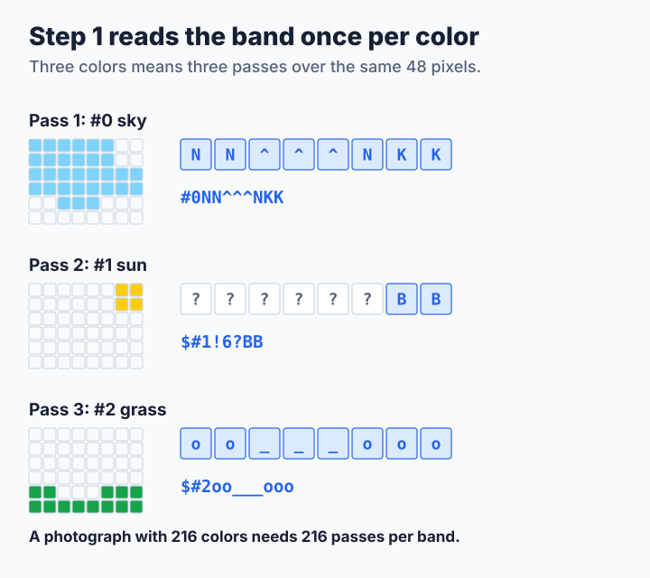
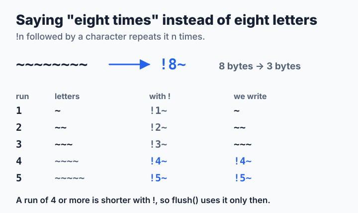
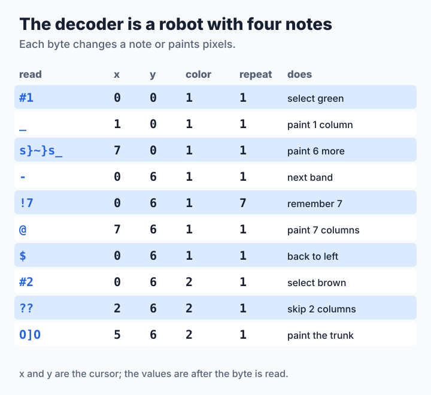

# Step 1: A First Encoder and Decoder

In [Lesson 0](step0-by-hand.md) you drew a heart by adding up pin values with a pencil. Now you teach a program to do the same for any picture, and to read SIXEL back into pixels. Both directions fit in about thirty lines of C. They are not fast yet, but they are complete, and every later step only makes them faster. The full source is [`code/step1.c`](code/step1.c).

**You will learn:**

- how to turn "for every band, for every color, for every column" into loops,
- how the repeat character `!` makes streams shorter,
- how a decoder keeps track of where it is,
- why this first plan gets slow with many colors.

## The encoder's plan

Do exactly what you did by hand. Take the first band (six rows). Take the first color. Walk across the band and, for every column, add up the values of the rows that have this color. Write one character per column. Then go back with `$`, take the next color and walk again. When all colors are done, write `-` and continue with the next band.



In the picture above, the band has three colors, so the encoder walks over the same 48 pixels three times. The sun only fills two columns on the right, so its line is six empty columns followed by `BB`.

## Saying "eight times" in three bytes

Pictures often have long runs of the same character, such as a sky that is blue for a hundred columns. SIXEL lets you write `!` followed by a count instead:



`!8~` is three bytes instead of eight. For a run of three the repeat form is no shorter, so the encoder uses it only for runs of four or more. The encoder collects a run until the character changes and then writes it out with `flush()`.

## Encoder

```c
static void flush(buffer_t *out, int ch, int count)
{
    if (count > 3) buf_printf(out, "!%d%c", count, ch);  /* DECGRI repeat */
    else while (count-- > 0) buf_putc(out, ch);
}

int encode_sixel(image_t const *img, buffer_t *out)
{
    int w = img->width, h = img->height;

    buf_printf(out, "\033Pq\"1;1;%d;%d", w, h);          /* DCS and raster */
    for (int c = 0; c < img->ncolors; c++)               /* palette in % */
        buf_printf(out, "#%d;2;%d;%d;%d", c, PCT(img->palette[c * 3]),
                   PCT(img->palette[c * 3 + 1]), PCT(img->palette[c * 3 + 2]));
    for (int y = 0; y < h; y += 6) {                     /* one band */
        if (y > 0) buf_putc(out, '-');                   /* next band */
        for (int c = 0; c < img->ncolors; c++) {         /* one color */
            int last = -1, run = 0;
            buf_printf(out, c > 0 ? "$#%d" : "#%d", c);  /* CR, select */
            for (int x = 0; x < w; x++) {
                int bits = 0;
                for (int r = 0; r < 6 && y + r < h; r++)
                    if (img->pixels[(y + r) * w + x] == c) bits |= 1 << r;
                if (bits != last) flush(out, last + '?', run), run = 0;
                last = bits, run++;
            }
            if (last != 0) flush(out, last + '?', run);  /* drop blank tail */
        }
    }
    buf_printf(out, "\033\\");                           /* ST */
    return 0;
}
```

Read it from the outside in:

| Code | What it does | In Lesson 0 |
| --- | --- | --- |
| `"\033Pq\"1;1;%d;%d"` | Start the picture and give its size | `ESC P q "1;1;7;12` |
| first `for (c ...)` | Define every register; `PCT()` turns 0–255 into 0–100 | `#1;2;90;10;20` |
| `for (y ...; y += 6)` | One band at a time, `-` between bands | moving down a band |
| `for (c ...)` | One color at a time, `$` before all but the first | one trip of the stamp |
| `for (x ...)` | One column at a time | one character |
| `for (r ...)` | Add `1 << r` for every row `r` that has color `c` | adding up the pin values |
| `bits != last` | The character changed, so write out the previous run | `!4E` |

Two details are worth a closer look. `y + r < h` stops at the bottom of the picture, whose last band may have fewer than six rows. And a run of empty columns (`?`) at the end of a line is not written at all, because the following `$` goes back to the left edge anyway.

> **Try it.** Encode the heart from Lesson 0 and compare the output with what you worked out by hand:
>
> ```sh
> ./step1 encode heart.pgm | cat -v
> ```

## The decoder: a robot with four notes

The decoder reads the stream one byte at a time. Think of it as a robot that carries four notes: the column `x` where the stamp stands, the top row `y` of the current band, the selected `color`, and a `repeat` count. Most bytes only change a note. Only the sixel characters `?` to `~` paint.



## Decoder

```c
int decode_sixel(unsigned char const *p, size_t size, image_t *img)
{
    unsigned char const *end = p + size;
    int a[5], x = 0, y = 0, color = 0, repeat = 1;

    while (p < end && *p++ != 'q') {}                    /* skip ESC P ... q */
    while (p < end && *p != 0x1b) {                      /* until ESC \ */
        int ch = *p++;
        if (ch == '"') {                                 /* raster attributes */
            parse_params(&p, end, a, 4);
            if (image_alloc(img, a[2], a[3]) != 0) return -1;
        } else if (ch == '#') {                          /* color register */
            int n = parse_params(&p, end, a, 5);
            color = a[0] > 255 ? 255 : a[0];
            if (color >= img->ncolors) img->ncolors = color + 1;
            if (n == 5 && a[1] == 2) set_rgb_pct(img, color, a[2], a[3], a[4]);
        } else if (ch == '!') {                          /* repeat count */
            parse_params(&p, end, &repeat, 1);
        } else if (ch == '$') {                          /* carriage return */
            x = 0;
        } else if (ch == '-') {                          /* next band */
            x = 0, y += 6;
        } else if (ch >= '?' && ch <= '~') {             /* six pixels */
            for (int i = 0; i < (repeat > 0 ? repeat : 1); i++, x++)
                for (int r = 0; r < 6; r++)
                    if ((ch - '?') >> r & 1 && x < img->width && y + r < img->height)
                        img->pixels[(y + r) * img->width + x] = (unsigned char)color;
            repeat = 1;
        }
    }
    return img->pixels != NULL ? 0 : -1;
}
```

There is one branch per kind of byte. `parse_params()`, from [`common.c`](code/common.c), reads numbers separated by `;`, such as the `1;2;90;10;20` after `#`. The painting branch undoes the encoder's sum: `(ch - '?') >> r & 1` is 1 when pin `r` is pushed. The test `x < img->width && y + r < img->height` keeps a stream that paints outside the picture from writing outside the array.

> **Try it.** Decode the tree from Lesson 0 and open `tree.ppm` in an image viewer:
>
> ```sh
> printf '\033Pq"1;1;7;12#1;2;0;60;0#2;2;50;30;10#1_s}~}s_-#1!7@$#2??O]O\033\\' |
>     ./step1 decode > tree.ppm
> ```

This decoder takes shortcuts. It needs the size (`"`) before any painting, ignores colors given in HLS (`#n;1;h;l;s`), and paints at most one pixel per step. Streams from other programs may need all three; step 2 fixes them.

## Your turn

Now write your own. Open [`code/mysixel.c`](code/mysixel.c), which has both functions empty and the steps written as comments, and build it with `make mysixel`.

1. **Encoder first.** Fill in the palette and the band loop. You can check the encoder alone, because any finished decoder can read its output:

    ```sh
    ./mysixel encode heart.pgm | cat -v                     # compare with Lesson 0
    ./mysixel encode heart.pgm | ./step2 decode > heart.ppm  # does it look right?
    ```

2. **Then the decoder.** Start with `#`, the sixel characters, `$` and `-`, then add `"` and `!`. Test it with streams you wrote by hand in Lesson 0, then with `./step2 encode heart.pgm | ./mysixel decode > heart.ppm`.

3. **Then the self test.** `./mysixel selftest` encodes and decodes 50 test pictures of awkward sizes, such as 1×7 and 65×13, and tells you the first pixel that came back wrong. When it prints `50 of 50 round trips passed`, you have written a complete SIXEL codec.

If you get stuck, these are the usual mistakes: forgetting that the last band can be shorter than six rows, writing `$` before the first color of a band, or forgetting to reset `repeat` to 1 after painting.

## What it costs

<!-- measurements:begin -->
| Input | Encode | Decode | Stream |
| --- | --- | --- | --- |
| Photograph, 600×450 | 21.0 ms | 2.42 ms | 275,844 bytes |
| Photograph, 2400×1800 | 319.8 ms | 33.0 ms | 3,019,374 bytes |
| Two colors, 2400×1800 | 3.52 ms | 4.61 ms | 1,441,842 bytes |
| Random noise, 2400×1800 | 592.9 ms | 373.7 ms | 20,629,898 bytes |
<!-- measurements:end -->

Look at the two 2400×1800 pictures with the same number of pixels. The two-color pattern takes 3.5 ms to encode, the 216-color photograph 320 ms, about 90 times as long. That is the plan's weak point: the encoder walks over every band once **per color**, so its work grows with colors × pixels. The stream suffers too: every band contains a `$` and a `#n` for every color, even colors that do not appear in that band, and empty runs for colors that appear only on the right.

[Step 2](step2-nodes.md) reads every pixel only once, whatever the number of colors.
