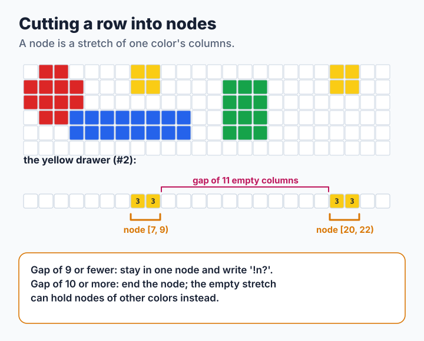
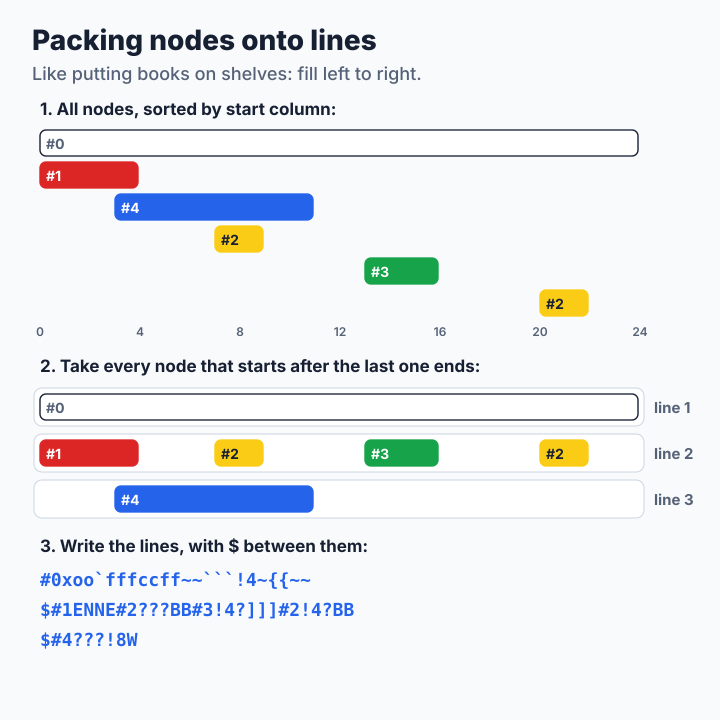
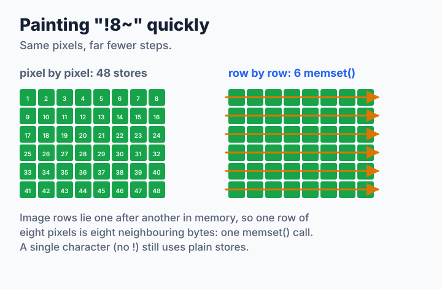

# Step 2: Read Each Pixel Once

The step 1 encoder walks over each band once per color. With 216 colors, it reads every pixel 216 times, and 215 of those visits find nothing. This step fixes that with the design of kmiya's `sixel` encoder, the [origin of libsixel](../../project-history.md#kmiyas-sixel): read the band once, sort the pixels by color, and then pack the colors cleverly onto as few graphics lines as possible. It also completes the decoder. The source is [`code/step2.c`](code/step2.c).

**You will learn:**

- how to sort pixels into one row per color in a single pass,
- what a *node* is and why long gaps split it,
- how to pack nodes onto shared lines, like books on shelves,
- how the decoder handles HLS colors, missing sizes and long repeats.

## Sorting pixels into drawers

Picture a chest of drawers with one drawer per color. Each drawer has one slot per column. Walk over the six rows of the band once. For every pixel, open the drawer of its color and add the pixel's row value to the slot of its column:

![An eight by six band is read once. Each pixel ORs its row weight into map[color][x], giving one row of column values per color](figures/step2-classify.svg)

When the band is done, every slot holds exactly the number you computed by hand in Lesson 0: the sum of the row values of that color in that column. Add 63 and it is the sixel character. Each pixel was looked at once, no matter how many colors there are. In C the chest is one array `map` with `w` bytes per color, and "add the row value" is `|=`:

```c
for (r = 0; r < 6 && y + r < h; r++) {
    unsigned char const *row = img->pixels + (size_t)(y + r) * w;
    for (x = 0; x < w; x++) {
        map[row[x] * w + x] |= (unsigned char)(1 << r);
        used[row[x]] = 1;
    }
}
```

`used[c]` remembers which colors appeared in this band, so the next phases can skip the empty drawers.

## Cutting a drawer into nodes

Most colors of a photograph appear in a few places of a band, not everywhere. A **node** is one stretch of one color: it starts at a column where the color appears and ends after the last one. Short gaps stay inside the node and cost a few `?` characters. A long gap ends the node, because the empty columns can be used by other colors instead:



The rule is: a gap of up to nine empty columns stays inside the node. A node is written as two numbers, its first column `sx` and the column `mx` just after its end, so the node `[7, 9)` covers columns 7 and 8.

```c
for (sx = 0; sx < w; sx = mx) {
    for (; sx < w && row[sx] == 0; sx++) {      /* skip empty columns */
    }
    if (sx == w) {
        break;
    }
    mx = sx + 1;
    for (x = mx; x < w && x - mx <= NODE_GAP; x++) {
        if (row[x] != 0) {
            mx = x + 1;                         /* the node grows */
        }
    }
    /* ... record node (c, sx, mx) ... */
}
```

## Packing nodes onto lines

Step 1 gave every color its own graphics line. But two nodes that do not overlap can share a line: paint the first one, skip ahead, paint the second. Packing them is like putting books on shelves. Sort the books by where they start. Then fill the first shelf from left to right, taking every book that starts after the previous one ends. Books that do not fit wait for the next shelf:



The white background covers the whole band and fills line 1 alone. The red node and the blue node both use column 3, so blue has to wait for line 3. Yellow, green and the second yellow fit on line 2 after red. Three lines instead of five.

The code keeps the sorted nodes in a linked list. Each pass over the list writes one line and removes the nodes it used:

```c
while (list != NULL) {
    if (color >= 0) {
        buf_putc(out, '$');             /* back to column 0 */
    }
    x = 0;
    for (link = &list; (np = *link) != NULL;) {
        if (np->sx < x) {
            link = &np->next;           /* overlaps; next line */
            continue;
        }
        if (np->color != color) {
            buf_putc(out, '#');
            buf_putnum(out, np->color);
            color = np->color;
        }
        buf_putrun(out, '?', np->sx - x);   /* blank columns */
        put_span(out, np->map, np->sx, np->mx);
        memset(np->map + np->sx, 0, (size_t)(np->mx - np->sx));
        x = np->mx;
        *link = np->next;               /* unlink */
    }
}
```

Three details make it work well:

- **The order.** Nodes are sorted by start column, and among nodes with the same start the longest comes first. Equal nodes keep color order. The code builds this order with one bucket per start column.
- **The `#`.** A color is selected only when it differs from the previous node's. Two nodes of the same color next to each other on a line share one `#`.
- **Cleaning up.** Writing a node also clears its slots in `map`, so the chest is empty again when the band is done, without a separate clearing pass.

`color` starts at `-1` in every band, so every band selects its first color explicitly, even if the previous band ended with the same one. That costs a few bytes, but it makes every band readable on its own, which [step 5](step5-threads.md) needs to encode bands in parallel.

> **Try it.** Compare the stream sizes of step 1 and step 2 on a photograph and on a picture with scattered colors:
>
> ```sh
> ./step1 synth sparse 1000 31 > sparse.ppm
> for s in 1 2; do ./step$s encode sparse.ppm | wc -c; done
> for s in 1 2; do ./step$s encode ../../../../images/snake.ppm | wc -c; done
> ```
>
> Step 2 wins clearly on the photograph, but on `sparse.ppm` its stream is *larger*. Look at the first band of both streams with `cat -v` and find out why. (Hint: count the `#` and `?` characters.)
>
> Then change `NODE_GAP` in `step2.c` to 0 and to 50, rebuild, and measure again. Which value gives the smallest stream? `make check` now reports that step 3 differs from step 2. Why? (Put the value back afterwards.)

## A decoder for every stream

The step 1 decoder needs help from the stream. The step 2 decoder does not:

- **HLS colors.** `#n;1;h;l;s` defines a color by hue (an angle, 0 to 360), lightness and saturation. SIXEL puts blue at 0°, red at 120° and green at 240°, so `set_hls()` in [`code/common.c`](code/common.c) turns the hue before using the usual formula.
- **No size, or paint beyond it.** The canvas grows when a stream paints outside it. It at least doubles each time, so that growing stays cheap even for a stream with no size at all. The final picture covers both the declared size and every painted pixel, the same rule libsixel uses for [raster declarations versus observed paint](../../decoder/pipeline/README.md#raster-declaration-versus-observed-paint).
- **Fast repeats.** In memory, a row of the picture is a run of neighboring bytes. So `!8~`, which fills eight columns of six rows, is six runs of eight bytes, and each run takes one `memset()` call instead of eight separate stores:



```c
if (ch >= '?' && ch <= '~') {
    bits = ch - '?';
    if (bits != 0) {
        /* ... grow the canvas to (x + repeat) x (y + 6) if needed ... */
        for (r = 0; r < 6; r++) {
            if ((bits >> r & 1) == 0) {
                continue;
            }
            dst = cv.pixels + (size_t)(y + r) * cv.width + x;
            if (repeat == 1) {
                *dst = (unsigned char)color;    /* the common case */
            } else {
                memset(dst, color, (size_t)repeat);
            }
        }
        band_rows |= bits;
    }
    x += repeat;                /* the source also clamps x to the size limit */
}
```

A single character, the common case in photographs, still uses a plain store, because calling `memset()` for one byte costs more than it saves. `band_rows` collects the rows painted in the band, so the decoder knows the picture's height without checking every character.

> **Try it.** Decode a stream that has no size and paints beyond its own edge. The step 1 decoder fails; step 2 grows the canvas:
>
> ```sh
> printf '\033Pq#1;2;100;0;0#1~~~$#2;2;0;100;0!5N-#1!3@\033\\' > noraster.six
> ./step1 decode noraster.six > a.ppm; echo $?
> ./step2 decode noraster.six > b.ppm; echo $?
> ```

## How fast is it?

<!-- measurements:begin -->
| Input | Encode | Speed-up | Decode | Speed-up | Stream |
| --- | --- | --- | --- | --- | --- |
| Photograph, 600×450 | 1.21 ms | 17× | 1.12 ms | 2.2× | 213,711 bytes |
| Photograph, 2400×1800 | 15.6 ms | 20× | 12.4 ms | 2.7× | 2,787,156 bytes |
| Two colors, 2400×1800 | 4.84 ms | 0.7× | 3.77 ms | 1.2× | 1,441,842 bytes |
| Random noise, 2400×1800 | 339.1 ms | 1.7× | 71.3 ms | 5.2× | 19,399,499 bytes |
<!-- measurements:end -->

The speed-up compares each step with the step before it. The photograph now encodes 20 times faster, and its stream is 8% smaller, because colors share lines. The two-color pattern does not benefit: step 1 already made only two passes there, and the extra bookkeeping costs a little. The decoder is faster on every input.

Two costs remain, and both depend on something other than the number of pixels:

- **Cutting nodes** scans every slot of every drawer that was used in the band, so it costs width × colors present. In a dithered photograph most of those slots are empty.
- **Decoding** writes up to six rows of the picture for every character. Those rows are a whole picture width apart in memory, so the computer has to jump around in memory for every column.

[Step 3](step3-column-words.md) attacks both by changing how the data is laid out in memory. The [SIXEL format overview](../../sixel-format/README.md#nodes-and-greedy-non-overlapping-sweeps) shows the same node packing as libsixel performs it.
