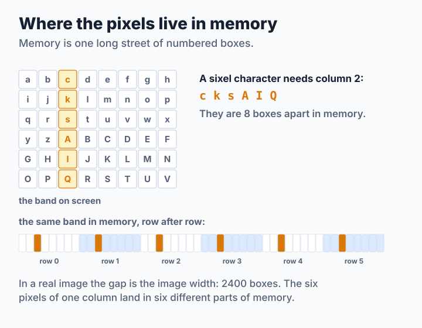
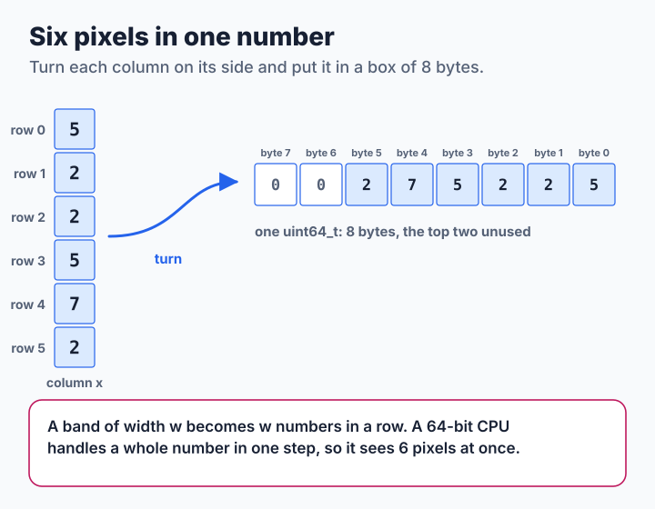
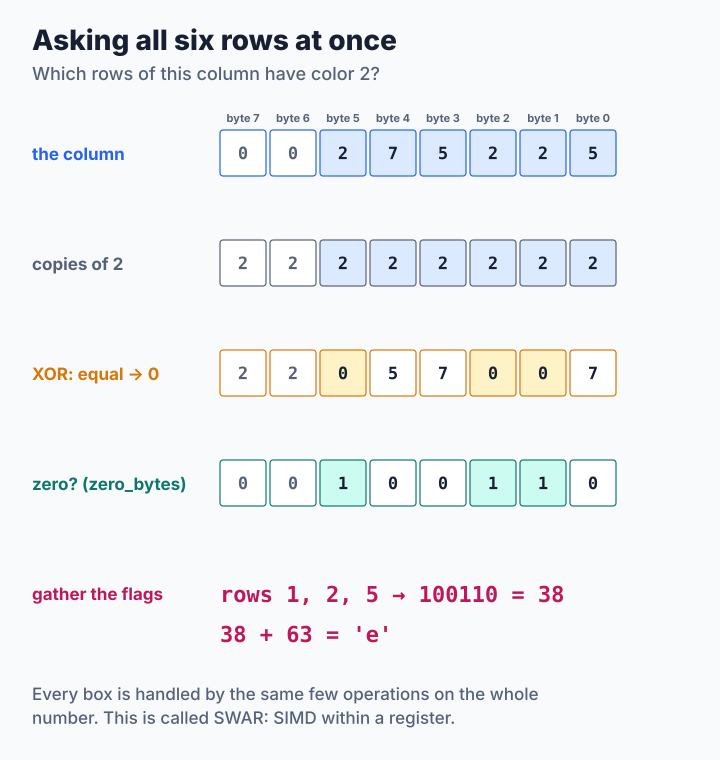
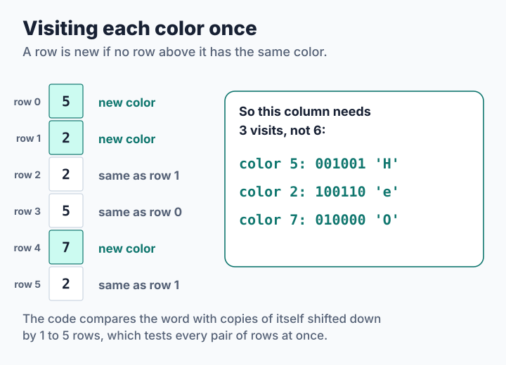
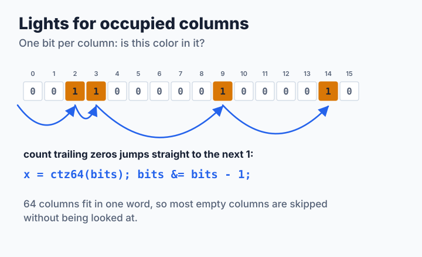
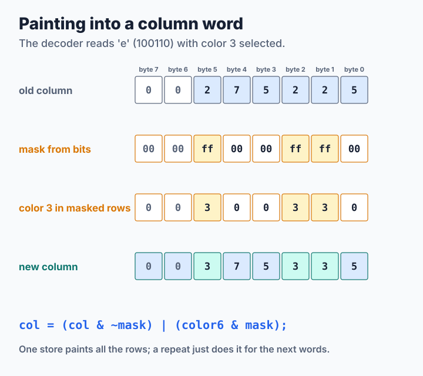

# Step 3: Six Pixels in One Number

Steps 1 and 2 changed *what* the program does. This step changes *where the data sits in memory*, and that alone makes the decoder 1.6 times faster. The idea: a sixel character is about one column of six pixels, so keep those six pixels together. The source is [`code/step3.c`](code/step3.c); its output is byte for byte the same as step 2's.

**You will learn:**

- why the six pixels of a column are far apart in memory,
- how to pack them into one 64-bit number, a *column word*,
- how to answer "which rows have color *c*?" for all six rows at once,
- how a row of bits lets the program skip empty columns,
- why a trick that speeds up one picture can slow down another.

## Where the pixels live in memory

Memory is one long street of numbered boxes, one byte each. A picture is stored row after row: first all of row 0, then all of row 1, and so on. The pixel at column `x` of row `y` lives in box `y * width + x`.



A sixel character needs the six pixels of one column, but those pixels are a whole row apart. In a picture 2400 pixels wide, they are 2400 boxes apart. The processor reads memory in small blocks of 64 bytes (called *cache lines*), so to get one column it has to fetch six different blocks, and it uses only one byte of each.

## Six pixels in one number

The fix is to turn each column on its side. A 64-bit integer (`uint64_t`) is eight bytes long. Put the register number of row 0 in byte 0, row 1 in byte 1, and so on up to row 5. Bytes 6 and 7 stay zero. This number is a **column word**:



The figure draws byte 0 on the right, the way we write the ones digit of a number on the right. A band of width `w` becomes an array of `w` column words, one after another in memory, so walking across the band walks along the street. The encoder builds them one row at a time, which keeps the loops simple enough that the compiler can speed them up on its own:

```c
for (r = 0; r < rows; r++) {
    row = img->pixels + (size_t)(y + r) * e->width;
    for (x = 0; x < e->width; x++) {
        e->columns[x] |= (uint64_t)row[x] << (8 * r);   /* row r, byte r */
    }
}
```

This is the same layout libsixel's decoder uses, described under [ordinary-mode band columns](../../decoder/pipeline/README.md#ordinary-mode-band-columns).

## Asking all six rows at once

The encoder's question for each column is: "which rows have color *c*?" The answer is the sixel character. With six separate bytes that takes six comparisons. With the column in one number, a few operations on the whole number answer it for all rows at once. This is called **SWAR**, "SIMD within a register". Follow it with the column 5, 2, 2, 5, 7, 2 and color 2:



1. **Copies of the color.** `c * 0x0101010101010101` puts `c` into every byte: multiplying by `0x01` in every byte position is the same as adding eight shifted copies of `c`.
2. **XOR.** The exclusive or `^` of two equal numbers is 0, and of two different numbers is not 0. So after `word ^ copies`, the rows that have color 2 have become zero bytes.
3. **Find the zero bytes.** `zero_bytes()` sets the top bit of every byte that is zero, and clears it everywhere else (see the box below).
4. **Gather.** One multiplication moves the eight top bits next to each other into a single byte. Rows 1, 2 and 5 give `100110` in binary, which is 38, and 38 + 63 is the character `e`.

```c
/* Bit 7 of each byte of the result is set when that byte of v is zero. */
static inline uint64_t
zero_bytes(uint64_t v)
{
    return ~(((v & BYTES_7F) + BYTES_7F) | v | BYTES_7F);
}

/* Bit i of the result is set when byte i of word equals c. */
static inline unsigned int
equal_bytes(uint64_t word, unsigned int c)
{
    uint64_t zero = zero_bytes(word ^ (c * BYTES_01));

    return (unsigned int)((((zero >> 7) & BYTES_01) *
                           UINT64_C(0x0102040810204080)) >> 56);
}
```

> **For the curious: how `zero_bytes()` works.** Look at one byte `v` at a time. Adding `0x7f` to the low seven bits of `v` overflows into the top bit unless those seven bits are all zero. ORing with `v` itself also sets the top bit if `v`'s own top bit was set. ORing with `0x7f` fills in the low seven bits. So the result is `0xff` for every nonzero byte and `0x7f` for a zero byte, and `~` flips that to `0x00` and `0x80`:
>
> | `v` | `(v & 0x7f) + 0x7f` | `\| v \| 0x7f` | `~` | zero? |
> | --- | --- | --- | --- | --- |
> | `0x00` | `0x7f` | `0x7f` | `0x80` | yes |
> | `0x05` | `0x84` | `0xff` | `0x00` | no |
> | `0x80` | `0x7f` | `0xff` | `0x00` | no |
>
> The sum is at most `0x7f + 0x7f = 0xfe`, so it never carries into the next byte, and all eight bytes are handled independently. The gathering multiplication works in a similar way: it adds eight shifted copies of the flags, arranged so that flag *i* lands on bit 56 + *i* and no two copies collide.

## Visiting each color once

A column can hold up to six different colors, but often holds fewer. The column above holds only three: 5, 2 and 7. So the encoder visits each column once per color *in it*, not once per row. A row starts a new color if no row above it has the same color:



The code finds all those rows at once, with the same zero-byte trick: it compares the word with copies of itself shifted down by one to five rows, which compares every row with every row above it.

```c
for (x = 0; x < e->width; x++) {
    word = e->columns[x];
    repeat = 0;
    for (k = 1; k < rows; k++) {                    /* same as k rows up? */
        repeat |= zero_bytes(word ^ (word << (8 * k))) &
            (~UINT64_C(0) << (8 * k));
    }
    for (firsts = lanes & ~repeat; firsts != 0; firsts &= firsts - 1) {
        c = (unsigned int)(word >> (ctz64(firsts) & ~7)) & 0xff;
        bits = equal_bytes(word, c) & ((1u << rows) - 1);
        e->map[(size_t)c * e->width + x] = (unsigned char)bits;
        e->occupancy[c * e->words + (size_t)x / 64] |=
            UINT64_C(1) << (x % 64);
        e->used[c] = 1;
    }
}
```

`firsts` has one bit set for every row that starts a new color. `firsts &= firsts - 1` clears the lowest set bit, a common trick for visiting the set bits of a number one by one. `ctz64()` ("count trailing zeros") tells where the lowest set bit is. Each (color, column) pair then costs one store into the drawer.

## Lights for occupied columns

Step 2 cut nodes by scanning every slot of every used drawer, most of them empty. Step 3 also keeps, for every color, a row of lights: one bit per column, on when the color appears there. Sixty-four lights fit in one 64-bit word. To find the next occupied column, the code does not look at the empty ones at all; `ctz64()` jumps straight to the next light that is on:



```c
for (i = 0; i < e->words; i++) {
    for (bits = occ[i]; bits != 0; bits &= bits - 1) {
        x = (int)(i * 64) + ctz64(bits);
        /* extend the current node or start a new one, as in step 2 */
    }
    occ[i] = 0;
}
```

The same idea speeds up packing. Step 2 walked the whole list of nodes for every line and skipped the ones that did not fit. Step 3 keeps a row of lights for the columns where at least one node starts. The next node for a line is the longest node at the first light at or after the cursor, which one jump finds:

```c
static int
next_start(encoder_t const *e, int x)
{
    size_t i = (size_t)x / 64;
    uint64_t bits;

    if (x >= e->width) {
        return -1;
    }
    bits = e->starts[i] & (~UINT64_C(0) << (x % 64));  /* lights at >= x */
    while (bits == 0) {
        if (++i == e->words) {
            return -1;
        }
        bits = e->starts[i];
    }
    return (int)(i * 64) + ctz64(bits);
}
```

It picks exactly the nodes that step 2's walk would pick, in the same order, so the stream does not change by a single byte.

## The decoder paints column words

The decoder also keeps each band as an array of column words. A sixel character with color *c* must replace the bytes of the rows it paints and keep the others. With a **mask**, a number that is `0xff` in the bytes to replace and `0x00` elsewhere, that is a single operation:



```c
mask = row_mask((unsigned int)bits);    /* 0xff in every painted row */
paint = color6 & mask;                  /* color6 = c in all six bytes */
col = d.columns + (size_t)band * d.width + x;
for (i = 0; i < repeat; i++) {
    col[i] = (col[i] & ~mask) | paint;
}
```

`col & ~mask` clears the painted rows, and `| paint` fills them with the color. A repeat simply does the same for the next words, which lie side by side in memory. `row_mask()` is the gathering trick in reverse: it spreads six bits out to six bytes.

```c
static inline uint64_t
row_mask(unsigned int bits)
{
    return ((bits * UINT64_C(0x0002040810204081)) & BYTES_01) * 0xff;
}
```

When the stream ends, `materialize()` turns the column words back into rows of the picture, once per pixel. [Step 4](step4-simd.md) shows how to do that quickly.

Unpainted bytes stay zero, which is also register 0, so the tutorial needs no record of which pixels were painted. libsixel's decoder keeps such a record in byte 6 of the word, because its callers can ask which pixels were painted and because a pixel painted with register 0 must look different from an untouched one.

> **Try it.** Write `zero_bytes()`, `equal_bytes()` and `row_mask()` in a small test program and check them on the examples in the figures: `equal_bytes()` of the column 5, 2, 2, 5, 7, 2 with color 2 must be 38, and `row_mask(38)` must be `0x0000ff0000ffff00`. Then try every color from 0 to 255 against a few random columns and compare with a plain loop over the six bytes.

## How fast is it?

<!-- measurements:begin -->
| Input | Encode | Speed-up | Decode | Speed-up | Stream |
| --- | --- | --- | --- | --- | --- |
| Photograph, 600×450 | 1.20 ms | 1.0× | 0.71 ms | 1.6× | 213,711 bytes |
| Photograph, 2400×1800 | 15.3 ms | 1.0× | 7.95 ms | 1.6× | 2,787,156 bytes |
| Two colors, 2400×1800 | 8.27 ms | 0.6× | 4.24 ms | 0.9× | 1,441,842 bytes |
| Random noise, 2400×1800 | 150.7 ms | 2.2× | 56.2 ms | 1.3× | 19,399,499 bytes |
<!-- measurements:end -->

The decoder is about 1.6 times faster on the photographs and 1.3 times on noise. On the two-color pattern it is slightly slower: step 2 paints only two lines per band there, and the extra pass that turns column words back into rows, about 1.3 ms for 2400×1800 pixels, costs more than the jumping around in memory saved.

The encoder's result depends on the picture, and that is the main lesson of this step. Cutting nodes became more than twice as fast, and on random noise, where every band uses all 256 colors in scattered columns, the whole encoder is more than twice as fast. But finding the colors of a column now takes a few dozen operations for each color in it, while step 2 needed only six simple stores per column. On the two-color pattern, where step 2's node cutting was already cheap, step 3 is slower overall.

libsixel faces the same trade-off and decides differently: its [`sixel_band_classify()`](../../../src/encoder-core-encode.c) uses column words only for palettes of one or two colors, and step 2's plain stores, plus the lights, otherwise. Which one wins depends on the rest of the program, which is why every idea in this tutorial is measured instead of assumed to help.
