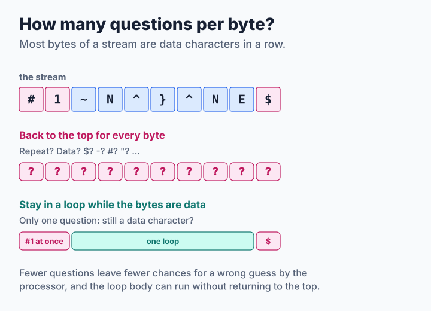
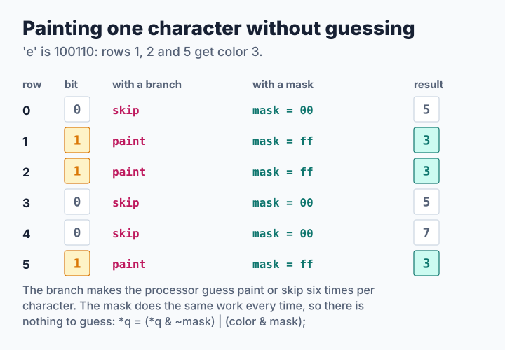

# Step 3: Fewer Decisions per Byte

[Step 2](step2-nodes.md) gave the codec a good plan, but its decoder still asks the same questions again and again: what is this byte, is this pin pushed, did the picture get taller? This lesson removes questions that have an obvious answer. The memory layout stays the same and no special instructions are needed, yet decoding a dithered photograph becomes almost three times faster. The source is [`code/step3.c`](code/step3.c); its stream is byte for byte the same as step 2's.

**You will learn:**

- why a question can cost more than the work it decides,
- how to stay in an inner loop while the bytes are data characters,
- how a mask replaces an `if`, and when that does not help,
- how a row of bits finds the next node for a graphics line without walking past the others.

## Asking about every byte

The step 2 decoder returns to the top of its big loop for every byte, and every time it works through the same list: is it `!`, is it a sixel character, is it `$`, `-`, `#`, or `"`? But most bytes of a stream are data characters that follow one another, so most of those answers are already known:



The fix is an inner loop that stays put while the bytes are data characters. It asks only whether the next byte is still one, and whether the column is still on the canvas:

```c
if (y + 6 <= cv.height) {
    row = cv.pixels + (size_t)y * cv.width;
    last = -1;
    while (p < end && *p >= '?' && *p <= '~' && x < cv.width) {
        bits = *p++ - '?';
        dst = row + x;
        for (r = 0; r < 6; r++) {
            mask = 0u - ((unsigned int)bits >> r & 1u);
            *dst = (unsigned char)((*dst & ~mask) |
                                   ((unsigned int)color & mask));
            dst += cv.width;
        }
        band_rows |= bits;
        if (bits != 0) {
            last = x;
        }
        x++;
    }
    /* ... */
}
```

The loop also moves bookkeeping out of the way. It checks the canvas once before it starts instead of once per character, and it records the last painted column once when it ends.

The same thinking applies to numbers. Nearly every `#` in a stream is a plain selection such as `#42`, with no `;` after it. Reading that on the spot with `parse_plain_number()` is much cheaper than a general parser that has to allow five parameters. Anything less plain falls back to `parse_params()`:

```c
ch = *p++;
if (ch == '#' && parse_plain_number(&p, end, &n)) {
    color = n > 255 ? 255 : n;
    if (color >= img->ncolors) {
        img->ncolors = color + 1;
    }
    continue;
}
```

## Painting without guessing

A processor works on many instructions at once, so at an `if` it cannot wait for the answer. It guesses which way the program will go and carries on. A right guess costs almost nothing. A wrong guess throws away the work done since the guess.

Step 2 asks `if ((bits >> r & 1) == 0)` six times per character. In a dithered photograph those bits look random, so the processor cannot guess them well. A **mask** does the same job without asking. `0u - bit` is `0` when the bit is 0 and all ones when it is 1, and `(old & ~mask) | (color & mask)` then keeps the old value or takes the color:



The mask version always reads and writes all six rows, so it does more memory work than the `if` for a character with few pins pushed. Whether that trade pays depends on the picture, as the numbers below show. A repeated character still uses `memset()` for each row, because a long run is where that call earns its cost.

## Finding the next node

The encoder has a list that it keeps walking. For each graphics line, step 2 goes through all remaining nodes and skips the ones that overlap the cursor. A band with thousands of nodes and many lines repeats that walk many times.

Step 3 leaves the nodes in their start-column buckets and keeps one more thing: a row of bits, one per column, set when that column's bucket is not empty. Sixty-four of those bits fit in one `uint64_t`, and `ctz64()` ("count trailing zeros") jumps straight to the lowest set bit. So the next node on a line is the longest one in the first non-empty bucket at or after the cursor:

```c
static int
next_start(uint64_t const *starts, size_t words, int width, int x)
{
    size_t i = (size_t)x / 64;
    uint64_t bits;

    if (x >= width) {
        return -1;
    }
    bits = starts[i] & (~UINT64_C(0) << (x % 64));  /* columns >= x */
    while (bits == 0) {
        if (++i == words) {
            return -1;
        }
        bits = starts[i];
    }
    return (int)(i * 64) + ctz64(bits);
}
```

This picks exactly the nodes that step 2's walk would pick, in the same order, so the stream does not change by a single byte. libsixel keeps [start-column buckets and a bitset](../../encoder/output/encode-policy/README.md) in the same way.

> **Try it: write the inner loop yourself.** Copy `step2.c` to `mine.c` and add an inner loop for data characters to its decoder, without looking at `step3.c`. Keep the `if` on each bit at first, then measure, then change it to a mask and measure again:
>
> ```sh
> cp step2.c mine.c
> cc -O2 -o mine common.c mine.c -lpthread
> ./step2 decode ../../../encoder/output/high-color/study/snake-256-fs.six > photo.ppm
> ./mine selftest
> ./mine bench photo.ppm 1 10
> ```
>
> Then compare `./mine decode noraster.six` with `./step2 decode noraster.six`, using the stream from the previous lesson. The two must agree.

## How fast is it?

<!-- measurements:begin:step3 -->
| Input | Encode | Speed-up | Decode | Speed-up | Stream |
| --- | --- | --- | --- | --- | --- |
| Photograph, 600×450 | 3.65 ms | 1.1× | 0.76 ms | 2.6× | 328,750 bytes |
| Photograph, 1920×1080 | 21.4 ms | 1.0× | 4.17 ms | 2.7× | 1,663,155 bytes |
| Two colors, 1920×1080 | 2.17 ms | 1.1× | 1.47 ms | 1.2× | 692,322 bytes |
| Random noise, 1920×1080 | 103.2 ms | 1.5× | 18.6 ms | 1.8× | 9,316,560 bytes |
<!-- measurements:end -->

The decoder is about 2.7 times faster on the Full HD photograph. Splitting the two ideas shows how they work together. The table gives decode times in milliseconds:

<!-- measurements:begin:attribution -->
| Decoder | Photograph, 1920×1080 | Two colors, 1920×1080 | Random noise, 1920×1080 |
| --- | --- | --- | --- |
| Step 2 | 11.5 | 1.83 | 32.8 |
| Step 2 with masks for single characters | 6.22 | 2.00 | 26.4 |
| Step 3 without the masks | 10.4 | 1.11 | 25.2 |
| Step 3 | 4.17 | 1.47 | 18.6 |
<!-- measurements:end -->

On the photograph, masks alone nearly halve the time, and the inner loop adds the rest. On the two-color pattern, masks make the decoder *slower*: its bits follow a regular pattern that the processor can guess, so the extra memory work buys nothing. That fits the explanation above, although this tutorial did not count wrong guesses directly. The [measurement record](measurements.md) has the current numbers and the method.

The encoder barely changes on the photograph. Emitting takes 6.2 ms instead of 7.0 ms, because a photograph's bands have few enough lines that the walk was not expensive. On random noise, with its many lines per band, emitting takes 42 ms instead of 91 ms. A larger cost is now in plain view: cutting nodes takes 14.4 ms of the photograph's 21.4 ms, because the encoder scans every slot of every used color. [Step 4](step4-column-words.md) removes that scan.

libsixel's decoder takes the same approach to parsing, and the [decoding pipeline](../../decoder/pipeline/README.md) describes which tokens its fast lane consumes.
