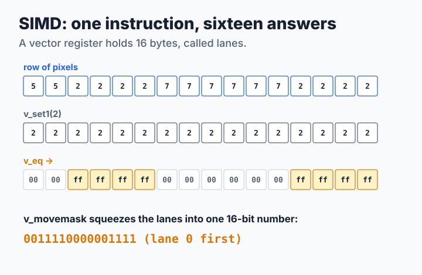
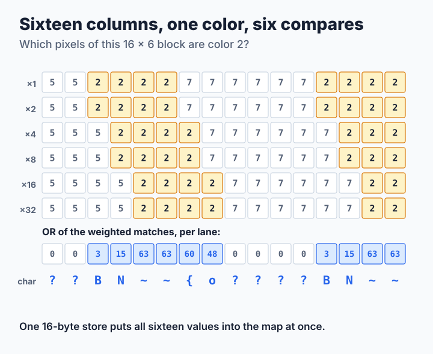
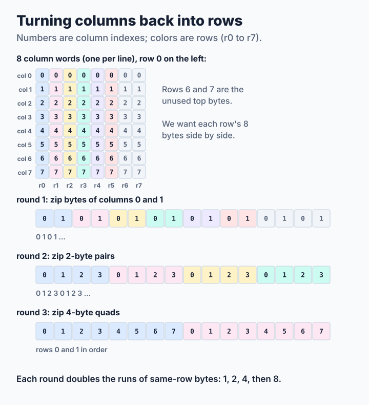

# Step 4: Sixteen at Once with SIMD

[Step 3](step3-column-words.md) packed eight bytes into one 64-bit number and handled them together with clever arithmetic. Modern processors have a more direct tool: **vector registers** that hold sixteen bytes and instructions that compare, combine or shuffle all sixteen in one go. This is called **SIMD**, *single instruction, multiple data*. This step uses it in the two places where SIXEL's layout is most regular. The source is [`code/step4.c`](code/step4.c); its output is byte for byte the same as steps 2 and 3.

**You will learn:**

- what lanes and vector compares are,
- how six compares give one color's characters for sixteen columns,
- how to turn columns back into rows with a few shuffles,
- why SIMD helps some pictures and not others.

The code uses only the vector instructions that every 64-bit PC and every 64-bit ARM processor has: SSE2 on x86-64 and Advanced SIMD (NEON) on AArch64. Elsewhere, or when built with `-DTUTORIAL_NO_SIMD`, the step 3 code runs unchanged. The step 3 code also handles the few columns left over at the right edge of each band.

## One instruction, sixteen answers

Each of the sixteen bytes of a vector register is called a **lane**. A vector compare looks at all sixteen pairs of lanes at once and writes `0xff` in the lanes that are equal and `0x00` in the others:



The encoder needs only a few such operations. To keep the algorithm readable on both kinds of processor, the code gives them short names:

| Operation | SSE2 | NEON | Meaning |
| --- | --- | --- | --- |
| `v_load`, `v_store` | `_mm_loadu_si128`, `_mm_storeu_si128` | `vld1q_u8`, `vst1q_u8` | Move 16 bytes |
| `v_set1(c)` | `_mm_set1_epi8` | `vdupq_n_u8` | Copy one byte into all 16 lanes |
| `v_eq(a, b)` | `_mm_cmpeq_epi8` | `vceqq_u8` | `0xff` where lanes are equal, else `0x00` |
| `v_and`, `v_or`, `v_zero` | `_mm_and_si128`, `_mm_or_si128`, `_mm_setzero_si128` | `vandq_u8`, `vorrq_u8`, `vdupq_n_u8(0)` | Bitwise logic |
| `v_movemask(v)` | `_mm_movemask_epi8` | (see below) | One bit per lane, as a 16-bit number |

NEON has no movemask instruction. For compare results, whose lanes are either `0x00` or `0xff`, the tutorial keeps one bit of a different value in each lane and adds up each half:

```c
static inline unsigned int
v_movemask(uint8x16_t v)
{
    static uint8_t const weights[16] = {
        1, 2, 4, 8, 16, 32, 64, 128, 1, 2, 4, 8, 16, 32, 64, 128
    };
    uint8x16_t m = vandq_u8(v, vld1q_u8(weights));

    return (unsigned int)vaddv_u8(vget_low_u8(m)) |
           (unsigned int)vaddv_u8(vget_high_u8(m)) << 8;
}
```

## Encoder: sixteen columns, one color

Load the six rows of a block of sixteen columns into six vectors. Compare each row with color *c*, keep the row's value (1, 2, 4, …, 32) in the matching lanes, and OR the six results together. Every lane now holds the sixel value of color *c* in its column, exactly what you added up by hand in Lesson 0, for sixteen columns at once:



```c
for (x = 0; x < end; x += 16) {
    e->stamp++;
    for (r = 0; r < rows; r++) {
        row[r] = v_load(src[r] + x);
    }
    for (r = 0; r < rows; r++) {
        for (lane = 0; lane < 16; lane++) {
            c = src[r][x + lane];
            if (e->seen[c] == e->stamp) {
                continue;               /* this color is done already */
            }
            e->seen[c] = e->stamp;
            color = v_set1(c);
            bits = v_zero();
            for (k = r; k < rows; k++) {    /* rows above r lack c */
                bits = v_or(bits, v_and(v_eq(row[k], color), weight[k]));
            }
            v_store(e->map + (size_t)c * e->width + x, bits);
            occupied = ~v_movemask(v_eq(bits, v_zero())) & 0xffff;
            e->occupancy[(size_t)c * e->words + (size_t)x / 64] |=
                (uint64_t)occupied << (x % 64);
            e->used[c] = 1;
        }
    }
}
```

The loop over the block's 96 pixels only looks for colors it has not handled yet. `seen[c] == stamp` marks colors already done in this block, and increasing `stamp` for the next block forgets them all without clearing anything. Every new color then costs up to six compares, one 16-byte store into the drawer of step 2, and one movemask for the lights of step 3. Lanes without the color store zero, which the drawer already holds there, so the store needs no mask.

The work now grows with the number of different colors in a 16×6 block, not in a column. That number is small when neighboring pixels share colors, as in the enlarged photograph and the two-color pattern, and large in random noise, where one block can hold almost 96 colors.

## Decoder: turning columns back into rows

Step 3's decoder ends by copying byte *r* of every column word into row *r* of the picture, one byte at a time. Look at eight column words as a square of 8×8 bytes: the copy turns its columns into rows. This is called a **transpose**. SIMD does it with three rounds of *zipping*, taking pieces from two vectors in turn like the teeth of a zipper:



Round 1 zips single bytes of two columns, so the bytes of each row come in pairs. Round 2 zips those pairs, giving groups of four. Round 3 zips the groups, and now each row's eight bytes sit side by side, ready to be stored with one instruction:

```c
__m128i a0 = _mm_unpacklo_epi8(_mm_loadl_epi64((void const *)&col[0]),
                               _mm_loadl_epi64((void const *)&col[1]));
/* ... a1, a2, a3 from columns 2-3, 4-5 and 6-7 ... */
__m128i b0 = _mm_unpacklo_epi16(a0, a1);
__m128i b1 = _mm_unpackhi_epi16(a0, a1);
/* ... b2, b3 from a2 and a3 ... */
out[0] = _mm_unpacklo_epi32(b0, b2);    /* rows 0 and 1 */
out[1] = _mm_unpackhi_epi32(b0, b2);    /* rows 2 and 3 */
out[2] = _mm_unpacklo_epi32(b1, b3);    /* rows 4 and 5 */
```

The NEON version is the same zipper with `vzip1q` and `vzip2q`. Each column word is read once instead of once per row, and each row receives one 8-byte store instead of eight single-byte stores.

> **Try it.** Build step 4 without SIMD and compare the speed on the photograph and on noise:
>
> ```sh
> cc -O2 -DTUTORIAL_NO_SIMD -o step4-scalar common.c step4.c -lpthread
> ./step4 bench ../../../../images/snake.ppm 4 10
> ./step4-scalar bench ../../../../images/snake.ppm 4 10
> ./step1 synth noise 2400 1800 > noise.ppm
> ./step4 bench noise.ppm 1 10
> ./step4-scalar bench noise.ppm 1 10
> ```
>
> Which picture gains, and which one loses? Can you explain why from the number of colors per block?

## How fast is it?

<!-- measurements:begin -->
| Input | Encode | Speed-up | Decode | Speed-up | Stream |
| --- | --- | --- | --- | --- | --- |
| Photograph, 600×450 | 1.04 ms | 1.2× | 0.60 ms | 1.2× | 213,711 bytes |
| Photograph, 2400×1800 | 12.7 ms | 1.2× | 7.04 ms | 1.1× | 2,787,156 bytes |
| Two colors, 2400×1800 | 5.76 ms | 1.4× | 3.44 ms | 1.2× | 1,441,842 bytes |
| Random noise, 2400×1800 | 161.8 ms | 0.9× | 55.2 ms | 1.0× | 19,399,499 bytes |
<!-- measurements:end -->

The encoder gains on both photographs and most on the two-color pattern, where each block holds only two colors. On noise it loses a little, because the number of colors per block approaches the number of pixels. The transpose makes turning columns into rows about 3.4 times faster, 0.38 ms instead of 1.3 ms for 2400×1800 pixels, but that was only a sixth of step 3's decoding time, so the decoder as a whole gains 10–20%.

These loops are no longer what limits the speed. For the enlarged photograph, turning columns into rows now takes less than 0.4 ms of the 7 ms decode, and writing out the stream takes about 60% of the encode. Writing and reading the stream, one byte at a time with a decision per byte, is essentially the same work in steps 2 to 4. The way to go faster now is to use several processor cores at once: [step 5](step5-threads.md).

libsixel uses SIMD in [color-space conversion](../../encoder/colorspace-handling/README.md) and [resampling](../../encoder/preprocessing/resampling/README.md); its SIXEL band encoder and decoder use the 64-bit word techniques of step 3.
