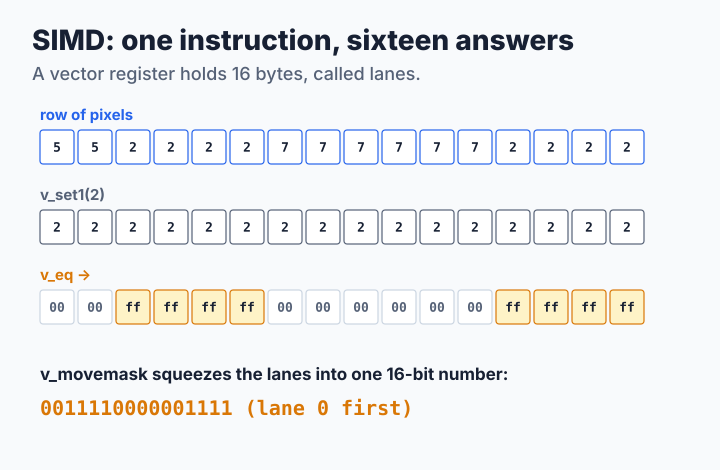
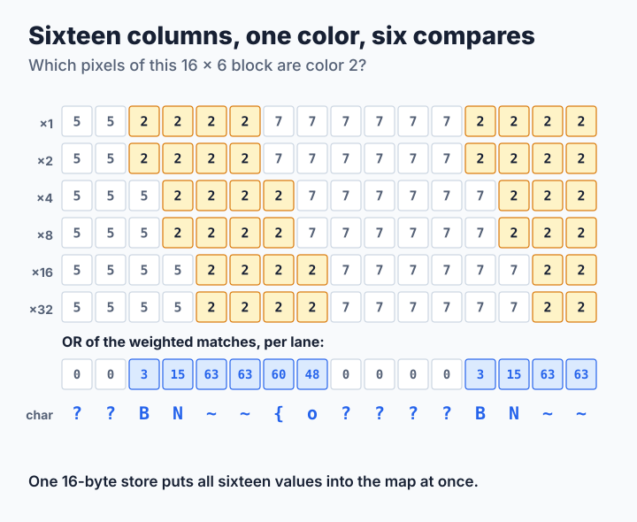
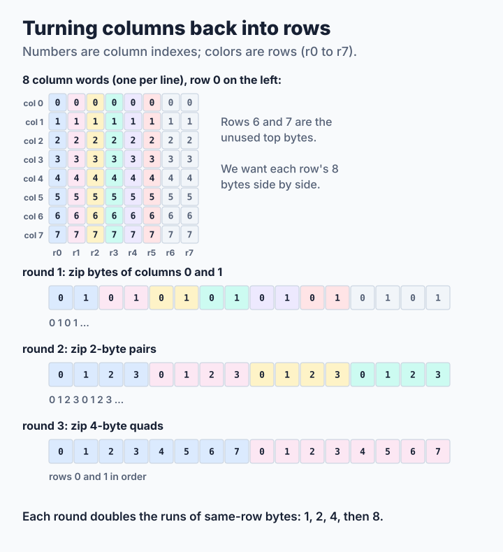

# Step 5: Sixteen at Once with SIMD

[Step 4](step4-column-words.md) packed eight bytes into one 64-bit number and handled them together with clever arithmetic. Modern processors have a more direct tool: **vector registers** that hold sixteen bytes and instructions that compare, combine or shuffle all sixteen in one go. This is called **SIMD**, *single instruction, multiple data*. This step uses it in the two places where SIXEL's layout is most regular. The source is [`code/step5.c`](code/step5.c); its output is byte for byte the same as steps 2 to 4.

**You will learn:**

- what lanes and vector compares are,
- how six compares give one color's characters for sixteen columns,
- how to turn columns back into rows with a few shuffles,
- why SIMD helps some pictures and not others.

The code uses only the vector instructions that every 64-bit PC and every 64-bit ARM processor has: SSE2 on x86-64 and Advanced SIMD (NEON) on AArch64. Elsewhere, or when built with `-DTUTORIAL_NO_SIMD`, the step 4 code runs unchanged.

## One instruction, sixteen answers

Each of the sixteen bytes of a vector register is called a **lane**. A vector compare looks at all sixteen pairs of lanes at once and writes `0xff` in the lanes that are equal and `0x00` in the others:



The encoder needs only a few such operations. To keep the algorithm readable on both kinds of processor, the code gives them short names:

| Operation | SSE2 | NEON | Meaning |
| --- | --- | --- | --- |
| `v_load`, `v_store` | `_mm_loadu_si128`, `_mm_storeu_si128` | `vld1q_u8`, `vst1q_u8` | Move 16 bytes |
| `v_set1(c)` | `_mm_set1_epi8` | `vdupq_n_u8` | Copy one byte into all 16 lanes |
| `v_eq(a, b)` | `_mm_cmpeq_epi8` | `vceqq_u8` | `0xff` where lanes are equal, else `0x00` |
| `v_and`, `v_or`, `v_zero` | `_mm_and_si128`, `_mm_or_si128`, `_mm_setzero_si128` | `vandq_u8`, `vorrq_u8`, `vdupq_n_u8(0)` | Bitwise logic |
| `v_movemask(v)` | `_mm_movemask_epi8` | (see below) | One bit per lane, as a 16-bit number |

NEON has no movemask instruction. For compare results, whose lanes are either `0x00` or `0xff`, the tutorial keeps one bit of a different value in each lane and adds up each half:

```c
static inline unsigned int
v_movemask(uint8x16_t v)
{
    static uint8_t const weights[16] = {
        1, 2, 4, 8, 16, 32, 64, 128, 1, 2, 4, 8, 16, 32, 64, 128
    };
    uint8x16_t m = vandq_u8(v, vld1q_u8(weights));

    return (unsigned int)vaddv_u8(vget_low_u8(m)) |
           (unsigned int)vaddv_u8(vget_high_u8(m)) << 8;
}
```

## Encoder: sixteen columns, one color

Load the six rows of a block of sixteen columns into six vectors. Compare each row with color *c*, keep the row's value (1, 2, 4, …, 32) in the matching lanes, and OR the six results together. Every lane now holds the sixel value of color *c* in its column, exactly what you added up by hand in Lesson 0, for sixteen columns at once:



```c
for (x = 0; x < end; x += 16) {
    e->stamp++;
    for (r = 0; r < rows; r++) {
        row[r] = v_load(src[r] + x);
    }
    for (r = 0; r < rows; r++) {
        for (lane = 0; lane < 16; lane++) {
            c = src[r][x + lane];
            if (e->seen[c] == e->stamp) {
                continue;               /* this color is done already */
            }
            e->seen[c] = e->stamp;
            color = v_set1(c);
            bits = v_zero();
            for (k = r; k < rows; k++) {    /* rows above r lack c */
                bits = v_or(bits, v_and(v_eq(row[k], color), weight[k]));
            }
            v_store(e->map + (size_t)c * e->width + x, bits);
            occupied = ~v_movemask(v_eq(bits, v_zero())) & 0xffff;
            e->occupancy[(size_t)c * e->words + (size_t)x / 64] |=
                (uint64_t)occupied << (x % 64);
            e->used[c] = 1;
        }
    }
}
```

This loop replaces step 4's column words in the encoder. With SIMD, they run only for the at most fifteen columns left over at the right edge of each band. The occupancy bits stay, because cutting nodes still needs them.

The loop over the block's 96 pixels only looks for colors it has not handled yet. `seen[c] == stamp` marks colors already done in this block, and increasing `stamp` for the next block forgets them all without clearing anything. Every new color then costs up to six compares, one 16-byte store into the drawer of step 2, and one movemask for the lights of step 4. Lanes without the color store zero, which the drawer already holds there, so the store needs no mask.

The work now grows with the number of different colors in a 16×6 block, not in a column. That number is small when neighboring pixels share colors, as in the enlarged photograph and the two-color pattern, and large in random noise, where one block can hold almost 96 colors.

## Decoder: turning columns back into rows

Step 4's decoder ends by copying byte *r* of every column word into row *r* of the picture, one byte at a time. Look at eight column words as a square of 8×8 bytes: the copy turns its columns into rows. This is called a **transpose**. SIMD does it with three rounds of *zipping*, taking pieces from two vectors in turn like the teeth of a zipper:



Round 1 zips single bytes of two columns, so the bytes of each row come in pairs. Round 2 zips those pairs, giving groups of four. Round 3 zips the groups, and now each row's eight bytes sit side by side, ready to be stored with one instruction:

```c
__m128i a0 = _mm_unpacklo_epi8(_mm_loadl_epi64((void const *)&col[0]),
                               _mm_loadl_epi64((void const *)&col[1]));
/* ... a1, a2, a3 from columns 2-3, 4-5 and 6-7 ... */
__m128i b0 = _mm_unpacklo_epi16(a0, a1);
__m128i b1 = _mm_unpackhi_epi16(a0, a1);
/* ... b2, b3 from a2 and a3 ... */
out[0] = _mm_unpacklo_epi32(b0, b2);    /* rows 0 and 1 */
out[1] = _mm_unpackhi_epi32(b0, b2);    /* rows 2 and 3 */
out[2] = _mm_unpacklo_epi32(b1, b3);    /* rows 4 and 5 */
```

The NEON version is the same zipper with `vzip1q` and `vzip2q`. Each column word is read once instead of once per row, and each row receives one 8-byte store instead of eight single-byte stores.

> **Try it.** Build step 5 without SIMD and compare the speed on the photograph and on noise:
>
> ```sh
> cc -O2 -DTUTORIAL_NO_SIMD -o step5-scalar common.c step5.c -lpthread
> ./step5 bench photo.ppm 1 10
> ./step5-scalar bench photo.ppm 1 10
> ./step1 synth noise 1920 1080 > noise.ppm
> ./step5 bench noise.ppm 1 10
> ./step5-scalar bench noise.ppm 1 10
> ```
>
> `photo.ppm` is the picture you decoded in [step 3](step3-fewer-decisions.md). Which picture gains, and which one loses? Can you explain why from the number of colors per block?
>
> Then write one yourself. `put_span()` looks for the end of a run one byte at a time. Rewrite it to compare sixteen bytes at once with `v_eq()` and `v_movemask()`, and find the first difference with `ctz64()`. `make check` must still pass. Measure it: photographs have short runs, so the result may surprise you.

## How fast is it?

<!-- measurements:begin:step5 -->
| Input | Encode | Speed-up | Decode | Speed-up | Stream |
| --- | --- | --- | --- | --- | --- |
| Photograph, 600×450 | 2.31 ms | 1.0× | 0.51 ms | 1.2× | 328,750 bytes |
| Photograph, 1920×1080 | 10.7 ms | 1.1× | 2.67 ms | 1.1× | 1,663,155 bytes |
| Two colors, 1920×1080 | 2.70 ms | 1.4× | 0.70 ms | 1.6× | 692,322 bytes |
| Random noise, 1920×1080 | 72.9 ms | 0.9× | 15.2 ms | 1.0× | 9,316,560 bytes |
<!-- measurements:end -->

SIMD is the smallest step of the tutorial on the photograph, about 1.1 times in both directions. Classifying takes 2.2 ms instead of 3.4 ms, but classifying is not where most of the time goes. The two-color pattern gains most, because each block holds only two colors. Random noise loses a little, because the number of colors per block approaches the number of pixels.

The transpose makes turning columns into rows about 3.4 times faster, 0.17 ms instead of 0.57 ms for a Full HD picture. But that pass was less than a fifth of decoding, and the parsing around it is unchanged. In the encoder, writing out the stream takes about 60% of the time, and no vector compare helps with that. SIMD pays only where the data is regular and the time is actually spent, which is why this lesson comes after the cheaper ideas of steps 3 and 4.

libsixel's own vector paths make similar choices. Its [vector band-word paths](../../decoder/pipeline/README.md#vector-band-word-paths) materialize sixteen column words at a time with table lookups and keep ordinary literal runs scalar, because those runs are short and the scalar store is already cheap. Its [encoder](../../encoder/output/encode-policy/README.md) uses NEON to classify sparse mask bytes. It also uses SIMD in [color-space conversion](../../encoder/colorspace-handling/README.md) and [resampling](../../encoder/preprocessing/resampling/README.md).

What remains is work done one byte after another on one core. [Step 6](step6-threads.md) brings in the others.
