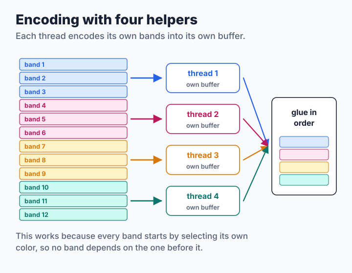
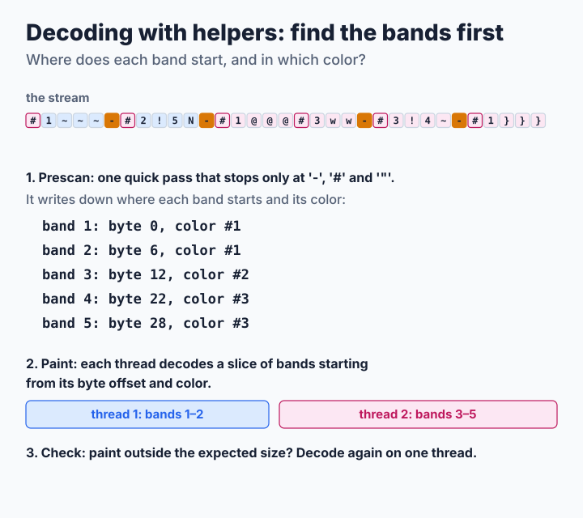
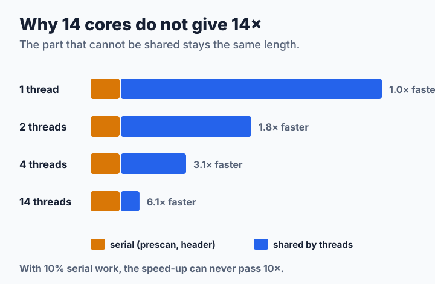

# Step 5: Many Cores at Once

After [step 4](step4-simd.md), most of the time goes into work that is done one byte after another: writing the stream and reading it. A single core cannot do that much faster. But a modern computer has many cores, so let several of them work at the same time, each on its own part of the picture. Each part is a **thread**. SIXEL's bands are the natural parts, but the encoder and the decoder split them in very different ways. The source is [`code/step5.c`](code/step5.c). It includes `step4.c` and reuses its band encoder, its decoder loop and its SIMD helpers; its output is byte for byte the same as steps 2 to 4 for any number of threads.

**You will learn:**

- how to split the encoder's work so that the result does not change,
- why the decoder first has to find where the bands start,
- what to do when the parallel plan does not fit the stream,
- why 14 cores do not make a program 14 times faster.

Set `TUTORIAL_THREADS` to choose the number of threads. By default each program uses up to one per CPU, but no more than the picture needs, because starting a thread costs more than encoding a small band.

## Encoder: bands are already independent

The bytes of a band depend only on its own pixels and the palette. Since [step 2](step2-nodes.md#packing-nodes-onto-lines), every band also begins by selecting its own first color, so nothing carries over from the band before. That means the bands can be shared out like homework: each thread gets a range of bands, its own work area and its own output buffer, and at the end the buffers are glued together in order.



```c
static void *
encode_worker(void *arg)
{
    encode_job_t *job = arg;
    encoder_t e;
    int b;

    job->status = encoder_init(&e, job->img);
    if (job->status != 0) {
        return NULL;
    }
    for (b = job->first_band; b < job->end_band; b++) {
        encode_band(&e, job->img, b * 6, &job->out);
    }
    encoder_free(&e);
    return NULL;
}
```

The calling thread takes the first range itself, so `n` ranges need only `n - 1` new threads. If a thread cannot be started, its range runs on the calling thread instead. The header, the palette and the gluing stay on one thread, but they are small.

Giving each thread one big range keeps the bookkeeping simple, but everyone has to wait for the slowest thread, and a range of busy bands can take much longer than a range of empty ones. libsixel's encoder instead hands out [one job per band](../../threading/encoder.md#six-row-jobs-and-ordered-output) to a pool of threads and writes finished bands while later ones are still being encoded, so output can start before the whole picture is done.

## Decoder: find the bands first

A stream is harder to share out. Where band 3 starts is only known after finding the `-` that ends band 2. The first pixels of a band are painted with the color selected somewhere before it. And the picture's size is only certain at the end. So the decoder works in three phases:



### 1. Prescan

One quick pass, on a single thread, looks only at the bytes that matter to later bands: `-` (a new band starts after it), `#` (colors) and `"` (the size). Everything else, the sixel characters, repeats and `$`, is skipped sixteen bytes at a time with the vector compares of step 4:

```c
while (end - p >= 16) {
    v128 v = v_load(p);
    unsigned int hits = v_movemask(v_or(v_or(v_eq(v, v_set1('-')),
                                             v_eq(v, v_set1('#'))),
                                        v_eq(v, v_set1('"'))));
    if (hits != 0) {
        p += ctz64(hits);               /* jump to the first hit */
        break;
    }
    p += 16;
}
```

For each band, the prescan writes down where it starts in the stream and which color is selected there. It also applies every color definition in stream order, so the palette is complete before any thread starts painting.

### 2. Paint in parallel

The decoder takes the size from the raster attributes, makes room for the column words of every band, and cuts the stream into pieces of similar length, each starting at a recorded band start. Each thread runs the step 4 loop over its piece, starting with the recorded color, and then turns its own bands into rows. Different threads always work on different bands, so they never write to the same memory and do not need to wait for each other.

### 3. Check, or decode on one thread

The size in the raster attributes is a promise, not a guarantee: it can be missing, and a stream can paint outside it. libsixel's [decoding pipeline](../../decoder/pipeline/README.md#raster-declaration-versus-observed-paint) defines the picture as covering both. A thread that finds paint outside the room it was given stops and reports it, and a stream without a size never starts the parallel phase. In both cases the step 4 decoder simply decodes the whole stream again on one thread, so the result never depends on which path was taken. The test script includes such streams.

libsixel's parallel decoder splits by [byte ranges](../../threading/decoder.md#why-decoding-is-split-by-bytes) rather than by a list of band starts, but it draws the same kind of line: syntax that needs the parser's global state, such as redefining a color or resetting the size, can [send a stream back to one thread](../../threading/decoder.md#fallback-and-correctness).

> **Try it.** Measure the speed with 1, 2, 4, 8 and all threads, and draw a graph of the speed-up:
>
> ```sh
> for t in 1 2 4 8 16; do
>     TUTORIAL_THREADS=$t ./step5 bench ../../../../images/snake.ppm 4 10
> done
> ```
>
> Where does the curve flatten? Does encoding or decoding flatten first?

## Why 14 cores do not give 14×

Some work cannot be shared: the prescan, the header, the gluing. However many threads share the rest, that part stays as long as it was:



If one tenth of the work cannot be shared, the program can never become more than 10 times faster, no matter how many cores it gets. This rule is called **Amdahl's law**, and it explains most of the numbers below.

## How fast is it?

<!-- measurements:begin -->
| Input | Encode | Speed-up | Decode | Speed-up | Stream |
| --- | --- | --- | --- | --- | --- |
| Photograph, 600×450 | 1.05 ms | 1.0× | 0.32 ms | 1.9× | 213,711 bytes |
| Photograph, 2400×1800 | 2.18 ms | 5.8× | 1.98 ms | 3.6× | 2,787,156 bytes |
| Two colors, 2400×1800 | 1.04 ms | 5.5× | 0.63 ms | 5.5× | 1,441,842 bytes |
| Random noise, 2400×1800 | 25.0 ms | 6.5× | 49.8 ms | 1.1× | 19,399,499 bytes |
<!-- measurements:end -->

On the large pictures the encoder runs 5.5 to 6.5 times faster with 14 threads. Several things keep it below 14: 4 of the machine's 14 cores are slower efficiency cores, the encoder waits for the slowest of its ranges, and the header and gluing stay on one thread. The small photograph is too small to be worth splitting and encodes on one thread.

The decoder runs 3.6 and 5.5 times faster on the large photograph and the two-color pattern, where the prescan skips most bytes sixteen at a time, and twice as fast on the small photograph with three threads. Random noise is different: it selects a new color every few bytes, so the prescan stops almost as often as a full decode would. The serial prescan then takes most of the time, and by Amdahl's law the speed-up stays close to 1.

> **Challenge.** Make the noise decoder faster. A prescan that only looks for `-`, and finds each band's starting color by searching backwards from it, would skip much more. The threads must then apply the color definitions in stream order. Keep `make check` passing.

## Where to go from here

You now have a complete SIXEL codec and know the ideas behind a fast one: a better plan (step 2), a better memory layout (step 3), wider instructions (step 4) and more cores (step 5). libsixel adds what a production codec needs around them: transparency and key colors, [OR mode](../../encoder/output/or-mode/README.md), [high-color output](../../encoder/output/high-color/README.md), the size-oriented [encoding policy](../../encoder/output/encode-policy/README.md), palette history and [dequantization](../../decoder/dequantization/README.md) in the decoder, and the [threading model](../../threading/README.md) that schedules palette application, encoding and output together.
