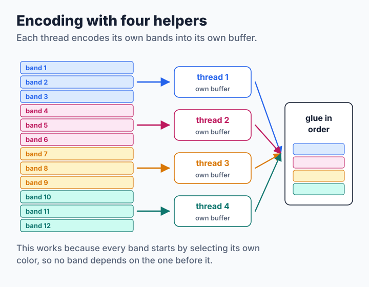
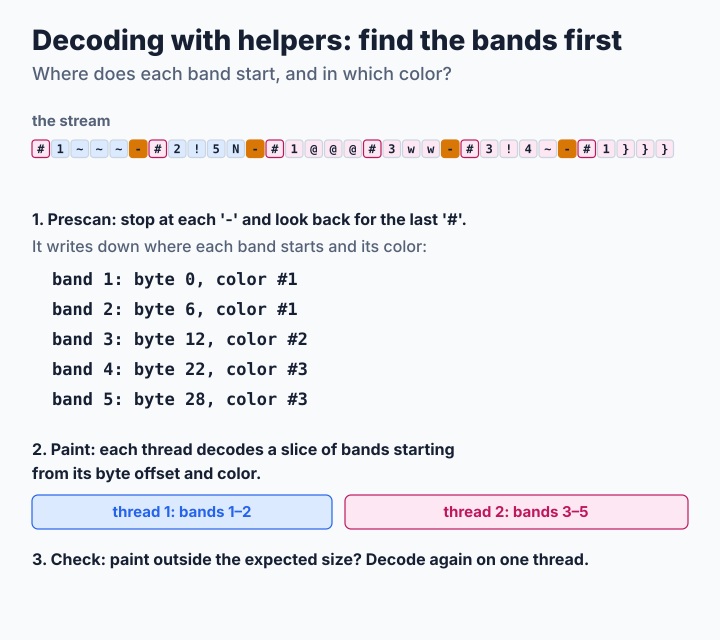
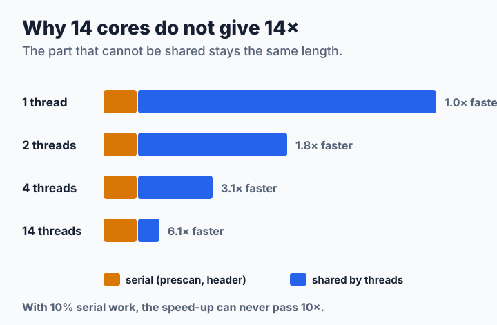

# Step 6: Many Cores at Once

After [step 5](step5-simd.md), most of the time goes into work that is done one byte after another: writing the stream and reading it. A modern computer has many cores, so let several of them work at the same time, each on its own part of the picture. Each part is a **thread**. SIXEL's bands are the natural parts, but the encoder and the decoder split them in very different ways. The source is [`code/step6.c`](code/step6.c). It includes `step5.c` and reuses its band encoder, its decoder helpers and its SIMD operations; its output is byte for byte the same as steps 2 to 5 for any number of threads.

**You will learn:**

- how to split the encoder's work so that the result does not change,
- why the decoder first has to find where the bands start,
- what to do when the parallel plan does not fit the stream,
- why 14 cores do not make a program 14 times faster.

Set `TUTORIAL_THREADS` to choose the number of threads. By default each program uses up to one per CPU, but no more than the picture needs, because starting a thread costs more than encoding a small band.

## Encoder: bands are already independent

The bytes of a band depend only on its own pixels and the palette. Since [step 2](step2-nodes.md#packing-nodes-onto-lines), every band also begins by selecting its own first color, so nothing carries over from the band before. That means the bands can be shared out like homework: each thread gets a range of bands, its own work area and its own output buffer, and at the end the buffers are glued together in order.



```c
static void *
encode_worker(void *arg)
{
    encode_job_t *job = arg;
    encoder_t e;
    int b;

    job->status = encoder_init(&e, job->img);
    if (job->status != 0) {
        return NULL;
    }
    for (b = job->first_band; b < job->end_band; b++) {
        encode_band(&e, job->img, b * 6, &job->out);
    }
    encoder_free(&e);
    return NULL;
}
```

The calling thread takes the first range itself, so `n` ranges need only `n - 1` new threads. If a thread cannot be started, its range runs on the calling thread instead. The header, the palette and the gluing stay on one thread, but they are small.

Giving each thread one big range keeps the bookkeeping simple, but everyone has to wait for the slowest thread, and a range of busy bands can take much longer than a range of empty ones. libsixel's encoder instead hands out [one job per band](../../threading/encoder.md#six-row-jobs-and-ordered-output) to a pool of threads and writes finished bands while later ones are still being encoded, so output can start before the whole picture is done.

## Decoder: find the bands first

A stream is harder to share out. Where band 3 starts is only known after finding the `-` that ends band 2. The first pixels of a band are painted with the color selected somewhere before it. And the picture's size is only certain at the end. So the decoder works in three phases:



### 1. Prescan

One quick pass, on a single thread, looks only at the two kinds of byte that it cannot leave for later: `-` (a new band starts after it) and `"` (the size). Everything else is skipped sixteen bytes at a time with the vector compares of step 5:

```c
while (end - p >= 16) {
    v128 v = v_load(p);
    unsigned int hits = v_movemask(v_or(v_eq(v, v_set1('-')),
                                        v_eq(v, v_set1('"'))));
    if (hits != 0) {
        p += ctz64(hits);               /* jump to the first hit */
        break;
    }
    p += 16;
}
```

A band needs one more fact: which color is selected when it starts. A photograph selects a color every few bytes, so stopping at every `#` would make this pass nearly as slow as a full decode. It does not have to. The color at the start of a band is simply the last `#` before the `-`, so the prescan searches backwards from each `-` and usually finds it within a few bytes:

```c
for (q = p; q > band;) {
    if (*--q == '#') {
        q++;
        parse_params(&q, end, a, 1);
        color = a[0] > 255 ? 255 : a[0];
        break;
    }
}
```

A band with no `#` at all keeps the color it inherited. The prescan writes down each band's byte offset and color, and nothing else.

### 2. Paint in parallel

The decoder takes the size from the raster attributes, makes room for the column words of every band, and cuts the stream into pieces of similar length, each starting at a recorded band start. Each thread runs the step 4 loop over its piece, starting with the recorded color, and then turns its own bands into rows. Different threads always work on different bands, so they never write to the same picture memory and do not need to wait for each other.

The palette needs care. A color can be defined anywhere in a stream, and two threads must not write the same register. So each thread only collects the definitions it passes, and when all threads have finished the program applies them in stream order. The last definition wins, as it does when decoding on one thread.

### 3. Check, or decode on one thread

The size in the raster attributes is a promise, not a guarantee: it can be missing, and a stream can paint outside it. libsixel's [decoding pipeline](../../decoder/pipeline/README.md#raster-declaration-versus-observed-paint) defines the picture as covering both. A thread that finds paint outside the room it was given stops and reports it, and a stream without a size never starts the parallel phase. In both cases the step 4 decoder simply decodes the whole stream again on one thread, so the result never depends on which path was taken. The test script includes such streams.

libsixel's parallel decoder splits by [byte ranges](../../threading/decoder.md#why-decoding-is-split-by-bytes) rather than by a list of band starts, but it draws the same kind of line: syntax that needs the parser's global state, such as redefining a color or resetting the size, can [send a stream back to one thread](../../threading/decoder.md#fallback-and-correctness).

> **Try it.** Measure the speed with 1, 2, 4, 8 and all threads, and draw a graph of the speed-up:
>
> ```sh
> for t in 1 2 4 8 16; do
>     TUTORIAL_THREADS=$t ./step6 bench photo.ppm 1 10
> done
> ```
>
> Where does the curve flatten? Does encoding or decoding flatten first?

## Why 14 cores do not give 14×

Some work cannot be shared: the prescan, the header, the gluing, starting the threads. However many threads share the rest, that part stays as long as it was:



If one tenth of the work cannot be shared, the program can never become more than 10 times faster, no matter how many cores it gets. This rule is called **Amdahl's law**, and it is the first thing to check when a program stops scaling.

## How fast is it?

<!-- measurements:begin:step6 -->
| Input | Encode | Speed-up | Decode | Speed-up | Stream |
| --- | --- | --- | --- | --- | --- |
| Photograph, 600×450 | 2.36 ms | 1.0× | 0.13 ms | 3.9× | 328,750 bytes |
| Photograph, 1920×1080 | 2.39 ms | 4.5× | 0.53 ms | 5.0× | 1,663,155 bytes |
| Two colors, 1920×1080 | 0.57 ms | 4.7× | 0.33 ms | 2.1× | 692,322 bytes |
| Random noise, 1920×1080 | 14.6 ms | 5.0× | 2.30 ms | 6.6× | 9,316,560 bytes |
<!-- measurements:end -->

The speed-up in the table compares with step 5. The [thread sweep](measurements.md#thread-scaling-of-step-6) shows the curve: on the Full HD photograph the encoder keeps gaining up to 14 threads and reaches almost 7 times, and the decoder reaches about 6 times at 10 threads and then gets slightly slower. Random noise scales about as well. The small photograph encodes on one thread, because it is too small to be worth splitting.

The prescan is not what limits this. It takes about 0.07 ms on the Full HD photograph, against about 0.5 ms for the whole decode, because it now stops only at band ends. The two-color pattern scales less well, about 2.5 times in decoding; its total time is so short that the cost of starting threads and of materializing starts to matter, although this tutorial did not separate those causes. The machine has 10 performance cores and 4 slower efficiency cores, and each thread gets a fixed range of bands, so the slowest range decides the finish. That probably explains the decoder's bend at 10 threads, but this too was not measured separately.

> **Challenge.** Replace the fixed ranges with a shared counter: each thread takes the next few bands when it is ready, so a fast core simply does more. An atomic counter from `<stdatomic.h>` is enough for the decoder's byte ranges, and the encoder can do the same if it keeps one buffer per band. Keep `make check` passing, and see whether the bend at 10 threads goes away.

## Where to go from here

You now have a complete SIXEL codec and know the ideas behind a fast one: a better plan (step 2), fewer decisions (step 3), a better memory layout (step 4), wider instructions (step 5) and more cores (step 6). libsixel adds what a production codec needs around them: transparency and key colors, [OR mode](../../encoder/output/or-mode/README.md), [high-color output](../../encoder/output/high-color/README.md), the size-oriented [encoding policy](../../encoder/output/encode-policy/README.md), whose idea you can try in [step 7](step7-overpaint.md), palette history and [dequantization](../../decoder/dequantization/README.md) in the decoder, and the [threading model](../../threading/README.md) that schedules palette application, encoding and output together.
