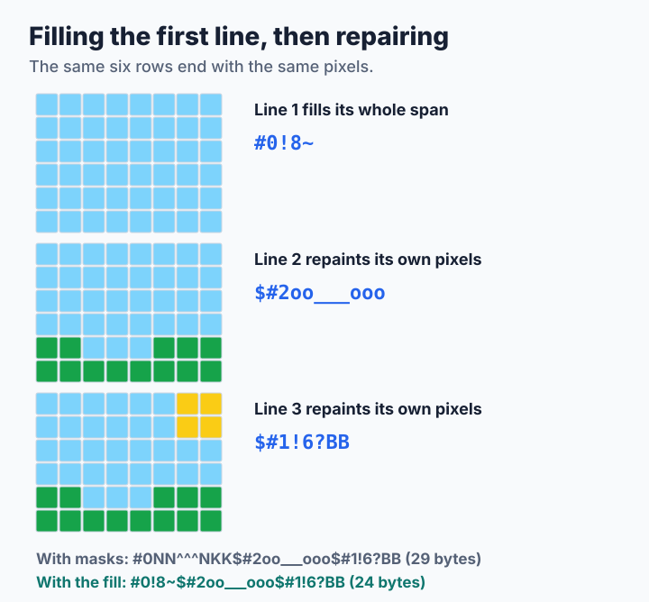

# Step 7: Smaller Streams by Overpainting

So far the stream has stayed the same while the program got faster. This applied lesson changes the bytes instead. A picture can reach the same pixels with a shorter stream if it paints some pixels twice. A terminal or a slow connection then has less to carry, and all it takes is a few lines in the encoder's emit loop. The source is [`code/step7.c`](code/step7.c), which is step 3 with that one change.

The idea is the one behind `img2sixel -E size`, introduced to libsixel by Araki Ken. The [encoding policy](../../encoder/output/encode-policy/README.md) reference describes the real option and credits the original article.

**You will learn:**

- why a mask with holes costs more bytes than a solid span,
- when painting a pixel with a wrong color is safe,
- why the same trick saves half of one stream and almost nothing of another,
- how to test an optimization that changes the bytes but must not change the pixels.

## Holes cost bytes

Look again at the small scene from step 1. Its sky has holes where the sun and the ground are, so its mask is full of different characters:

```text
#0NN^^^NKK$#2oo___ooo$#1!6?BB
```

Now think about how a terminal draws. A later color simply replaces an earlier one. So the sky does not need holes at all, if something later will paint those pixels anyway:



The picture ends the same, and the mask `NN^^^NKK` has become the much shorter `!8~`. The character `~` sets all six bits, so `!8~` paints every row of eight columns.

## When it is safe

A filled span overwrites every pixel in it, so each of those pixels must be painted again later with its real color. Three facts make that true:

1. The nodes of one graphics line never overlap. A span filled on the band's first line therefore overwrites nothing that was painted before it.
2. Every other pixel in that span belongs to some other node, and all of those nodes come later.
3. In this tutorial every pixel of a picture has a color, so no pixel is meant to stay unpainted.

The second graphics line does not have fact 1 on its side: it could overwrite pixels of the first line that nothing would repair. So only the first line fills.

Fact 3 is the one that a real encoder cannot take for granted. With transparent pixels, an unpainted cell means "keep what is on the screen", and filling it would destroy that. libsixel has to check for such cases, and the reference lists [where fill and repaint cannot combine](../../encoder/output/encode-policy/README.md#where-fill-and-repaint-cannot-combine).

## The code

Here is the whole change to step 3's `put_band()`. It only remembers whether the cursor has returned to the left edge yet:

```c
int fill = 1;           /* still on the band's first graphics line */
int full = '?' + (1 << rows) - 1;

/* ... */
if (sx < 0) {
    buf_putc(out, '$');             /* back to column 0 */
    fill = 0;
    x = 0;
    continue;
}
/* ... */
if (fill) {
    buf_putrun(out, full, np->mx - np->sx);
} else {
    put_span(out, np->map, np->sx, np->mx);
}
```

`rows` is the height of the band, which is less than six at the bottom of a picture whose height is not a multiple of six. There `full` sets only the rows that exist, because a sixel character can reach below the picture and make it taller.

See for yourself that nothing else changed:

```sh
diff step3.c step7.c
```

## Testing a change of bytes

Steps 2 to 6 can be compared byte by byte, but step 7's stream is supposed to differ. So [`code/check.sh`](code/check.sh) checks what must still hold: every decoder turns step 7's stream into the same pixels as step 2's, and the stream is never longer. Comparing the pixels is what catches a wrong fill, and comparing the length is what catches a fill that stopped saving anything.

> **Try it: break it on purpose.** Remove the `fill = 0;` line, so that every graphics line fills. Run `./step7 selftest` and see how quickly the round trips fail. Then explain why the first failing picture fails.

> **Try it: look at the stream.** Encode the same picture with both programs and compare a piece of each stream:
>
> ```sh
> ./step3 encode ../../../../images/snake.ppm | head -c 600 | tail -c 200
> ./step7 encode ../../../../images/snake.ppm | head -c 600 | tail -c 200
> ```

## How much does it save?

<!-- measurements:begin:overpaint -->
| Input | Step 3 bytes | Step 7 bytes | Saved | Encode, ms | Decode, ms | Saved by libsixel `size` |
| --- | --- | --- | --- | --- | --- | --- |
| Photograph, 600×450 | 328,750 | 302,133 | 8.1% | 3.71 → 3.62 | 0.75 → 0.71 | 8.1% |
| Photograph, 1920×1080 | 1,663,155 | 1,443,766 | 13.2% | 22.0 → 21.2 | 4.22 → 3.98 | 13.0% |
| Two colors, 1920×1080 | 692,322 | 347,802 | 49.8% | 2.22 → 1.58 | 1.48 → 0.80 | 48.9% |
| Random noise, 1920×1080 | 9,316,560 | 9,228,951 | 0.9% | 107.9 → 107.8 | 18.8 → 19.7 | 0.9% |
<!-- measurements:end -->

The saving follows the picture's structure. Every band of the two-color pattern has one color that fills the whole width, and its long mask collapses into a single run, so half the stream disappears. A dithered photograph gains less, because only one node per stretch of columns gets to fill. Random noise gains almost nothing: each color has so few pixels in a band that its nodes are short, and the first line holds only a small part of them.

Time barely matters here. Writing and reading a shorter stream can take less time, as the two-color pattern shows, but the decoder also paints more pixels. On random noise the decoder gets no faster, so read this lesson as a way to spend fewer bytes and not as a speed-up.

The last column shows libsixel's `size` policy on the same pictures, and it behaves the same way. Its [measured comparison](../../encoder/output/encode-policy/README.md#measured-quality-speed-and-size) confirms that decoded pixels stay identical.

> **Challenge.** Add the fill to step 6 instead of step 3, in `put_band()` of [`code/step5.c`](code/step5.c), so that you get the small stream at full speed. Each thread emits its own bands, so the fill needs no coordination. `make check` compares your pixels, if you add your program to it.

> **Challenge.** The longest node at the left edge fills first, whatever its color. Would it save more to start with the color that has the most holes in that span, and how would you find it without giving back the time saved in step 2?

## Where to go from here

libsixel applies this idea inside its [encoding policy](../../encoder/output/encode-policy/README.md), together with the checks a production encoder needs for transparency, OR mode, high-color output and 6delta. A stream gets much bigger or smaller with the patterns in the picture, and the largest source of those patterns is dithering. The next chapter of this tutorial, [Dithering, step by step](../dithering/README.md), starts there.
