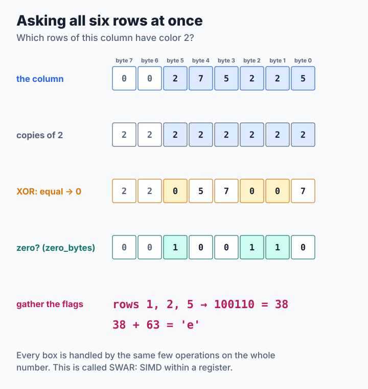

# Compare Eight Bytes at Once

With a column in one word, a few operations on the whole word can ask a question of all six rows at the same time. This is called **SWAR**, "SIMD within a register". This chapter uses it to find all the rows of one color in a column in one step. It is the tool the next chapters rely on; on its own, as the numbers show, it costs more than it saves. The decoder is the [masks](masks.md) chapter's, and the stream is still the [packing](packing.md) chapter's. The source is [`code/swar.c`](code/swar.c).

**You will learn:**

- how XOR and an addition find the zero bytes of a word,
- how one multiplication gathers eight flags into one byte,
- why a clever operation can still lose to a plain loop.

## Asking all six rows at once

The encoder's question for each column is: "which rows have color *c*?" The answer is the sixel character. With six separate bytes that takes six comparisons. With the column in one number, a few operations on the whole number answer it for all rows at once. Follow it with the column 5, 2, 2, 5, 7, 2 and color 2:



1. **Copies of the color.** `c * 0x0101010101010101` puts `c` into every byte: multiplying by `0x01` in every byte position is the same as adding eight shifted copies of `c`.
2. **XOR.** The exclusive or `^` of two equal numbers is 0, and of two different numbers is not 0. So after `word ^ copies`, the rows that have color 2 have become zero bytes.
3. **Find the zero bytes.** `zero_bytes()` sets the top bit of every byte that is zero, and clears it everywhere else (see the box below).
4. **Gather.** One multiplication moves the eight top bits next to each other into a single byte. Rows 1, 2 and 5 give `100110` in binary, which is 38, and 38 + 63 is the character `e`.

```c
/* Bit 7 of each byte of the result is set when that byte of v is zero. */
static inline uint64_t zero_bytes(uint64_t v)
{
    return ~(((v & BYTES_7F) + BYTES_7F) | v | BYTES_7F);
}

/* Bit i of the result is set when byte i of word equals c. */
static inline unsigned int equal_bytes(uint64_t word, unsigned int c)
{
    uint64_t zero = zero_bytes(word ^ (c * BYTES_01));
    return (unsigned int)((((zero >> 7) & BYTES_01) *
                           UINT64_C(0x0102040810204080)) >> 56);
}
```

> **For the curious: how `zero_bytes()` works.** Look at one byte `v` at a time. Adding `0x7f` to the low seven bits of `v` overflows into the top bit unless those seven bits are all zero. ORing with `v` itself also sets the top bit if `v`'s own top bit was set. ORing with `0x7f` fills in the low seven bits. So the result is `0xff` for every nonzero byte and `0x7f` for a zero byte, and `~` flips that to `0x00` and `0x80`:
>
> | `v` | `(v & 0x7f) + 0x7f` | `\| v \| 0x7f` | `~` | zero? |
> | --- | --- | --- | --- | --- |
> | `0x00` | `0x7f` | `0x7f` | `0x80` | yes |
> | `0x05` | `0x84` | `0xff` | `0x00` | no |
> | `0x80` | `0x7f` | `0xff` | `0x00` | no |
>
> The sum is at most `0x7f + 0x7f = 0xfe`, so it never carries into the next byte, and all eight bytes are handled independently. The gathering multiplication works in a similar way: it adds eight shifted copies of the flags, arranged so that flag *i* lands on bit 56 + *i* and no two copies collide.

## Filling a slot in one step

The encoder now fills a drawer slot in one step when it meets a color for the first time in a column. A later pixel of the same color finds the slot already filled and moves on:

```c
for (int r = 0; r < rows; r++) {
    unsigned int c = (unsigned int)(word >> (8 * r)) & 0xff;
    unsigned char *slot = e->map + (size_t)c * e->width + x;
    if (*slot == 0) {
        *slot = (unsigned char)(equal_bytes(word, c) & all);
        e->used[c] = 1;
    }
}
```

The slot is the same as before, so cutting nodes and the stream do not change.

## Where this idea came from

Finding zero bytes with an addition is a well-known trick of string functions in C libraries. In a SIXEL encoder, the earliest use found is jjrv's `sixel.ts` of 2025, written in TypeScript, which finds pending colors in a short lookahead over column words with zero-byte tests. The [implementation history](../../sixel-format/implementation-history.md#column-oriented-encoders-notcurses-and-jjrvs-gist) gives the source.

> **Try it: write the bit tricks yourself.** Write `zero_bytes()` and `equal_bytes()` in a small test program and check them on the example in the figure: `equal_bytes()` of the column 5, 2, 2, 5, 7, 2 with color 2 must be 38. Then try every color from 0 to 255 against a few random columns and compare with a plain loop over the six bytes.

## How fast is it?

<!-- measurements:begin:swar -->
| Input | Encode | Speed-up | Decode | Speed-up | Stream |
| --- | --- | --- | --- | --- | --- |
| Photograph, 600×450 | 4.37 ms | 0.8× | 0.78 ms | 1.0× | 328,750 bytes |
| Photograph, 1920×1080 | 26.5 ms | 0.8× | 4.16 ms | 1.0× | 1,663,155 bytes |
| Two colors, 1920×1080 | 3.22 ms | 0.9× | 1.48 ms | 1.0× | 692,322 bytes |
| Random noise, 1920×1080 | 104.7 ms | 1.0× | 18.9 ms | 1.0× | 9,316,560 bytes |
<!-- measurements:end -->

The encoder got slower on every picture, and sorting the photograph into drawers takes 5.6 ms instead of 1.3 ms. Each pixel still costs a load of its slot, which lands somewhere in a large array, and each new color in a column adds the dozen operations of `equal_bytes()` on top. Removing six stores per column did not pay for that. What would pay is not to look at the repeated pixels at all, which is the [next chapter](first-colors.md).

Previous: [Keep a column in one word](column-words.md) · Next: [Visit each color of a column once](first-colors.md)
