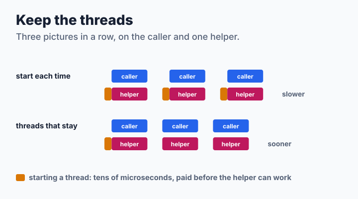

# Keep the Threads

The two parallel chapters start their threads for every picture and wait for them to end. Starting a thread asks the operating system for a stack and a place in its scheduler, which takes tens of microseconds, and the [parallel-decoder](parallel-decoder.md) chapter found that the shortest pictures scale least well. This chapter starts the threads once and keeps them waiting for the next picture, for both halves. The source is [`code/thread-pool.c`](code/thread-pool.c), a copy of `parallel-decoder.c` with a pool in place of `pthread_create()` and `pthread_join()`.

**You will learn:**

- how a few threads can wait for work without using the processor,
- how a round number tells a waiting thread that new work has arrived,
- why the calling thread should do a share of the work itself.

## Threads that wait

A pool is a handful of threads, a lock, and two condition variables: one on which the threads wait for work, and one on which the caller waits for them to finish. A thread waiting on a condition variable sleeps in the operating system and costs nothing until it is woken:



The caller describes the work as an array of jobs and one function, the same `encode_worker()` and `decode_worker()` the earlier chapters handed to `pthread_create()`:

```c
run_jobs(encode_worker, jobs, sizeof(jobs[0]), n);
```

`run_jobs()` starts threads only while the pool has fewer than it needs, then publishes the jobs, wakes everyone and does job 0 on its own thread:

```c
pool.fn = fn;
pool.jobs = jobs;
pool.count = helpers + 1;
pool.pending = helpers;
pool.generation++;                      /* a new round */
pthread_cond_broadcast(&pool.start);
pthread_mutex_unlock(&pool.lock);
fn(jobs);                               /* the caller's share */
```

Thread `i` takes job `i`. Then the caller waits until `pending` has dropped to zero.

## Which round is this?

A condition variable can wake a thread without a reason, and a thread can be busy when the broadcast arrives, so a thread cannot count wake-ups. Instead it remembers the round number it last worked on and waits until the number changes:

```c
while (pool.generation == seen)
    pthread_cond_wait(&pool.start, &pool.lock);
seen = pool.generation;
```

A thread that is started in the middle of a round has to know which round was the one before, or it would wait for the round that is already waiting for it. `run_jobs()` therefore notes the old number in `pool.born` before it starts any thread, and each new thread begins with `seen = pool.born`.

## Where this idea came from

Thread pools are as old as threads; chafa built its SIXEL batches in a pool from its first version in 2019, as the [implementation history](../../sixel-format/implementation-history.md#chafa-column-words-and-parallel-batches) describes. libsixel keeps resident decoder workers for repeated frames since 2026, in [`decoder-parallel.c`](../../../src/decoder-parallel.c).

> **Try it.** Measure the two-color pattern with the [parallel-decoder](parallel-decoder.md) program and with this one, at 2, 4 and 14 threads. Does the pool save more when there are more threads to start?

## How fast is it?

<!-- measurements:begin:thread-pool -->
| Input | Encode | Speed-up | Decode | Speed-up | Stream |
| --- | --- | --- | --- | --- | --- |
| Photograph, 600×450 | 1.63 ms | 1.0× | 0.13 ms | 1.2× | 328,750 bytes |
| Photograph, 1920×1080 | 1.45 ms | 1.1× | 0.45 ms | 1.1× | 1,663,155 bytes |
| Two colors, 1920×1080 | 0.27 ms | 1.1× | 0.22 ms | 1.3× | 692,322 bytes |
| Random noise, 1920×1080 | 10.5 ms | 1.0× | 2.14 ms | 1.0× | 9,316,560 bytes |
<!-- measurements:end -->

The speed-up compares with the [parallel-decoder](parallel-decoder.md) chapter. The pictures that take the least time gain most: the two-color pattern decodes 1.3 times faster and the small photograph 1.2 times, because starting threads was a large part of their time. Random noise takes long enough that the start of a thread does not matter. A program that encodes or decodes many pictures in a row, such as a video player, saves this on every picture. The [thread sweep](measurements.md#thread-scaling) is measured with this program.

Previous: [Decode bands in parallel](parallel-decoder.md) · Next: [Smaller streams by overpainting](overpaint.md)
