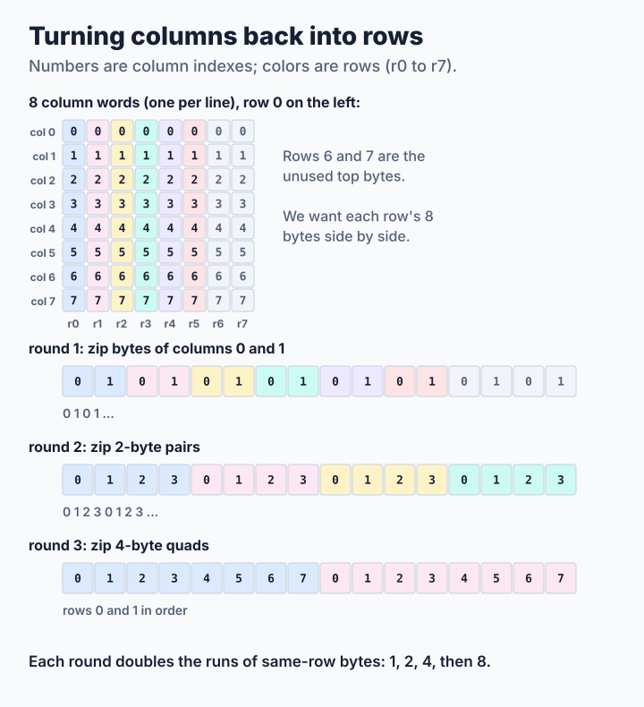

# Turn Columns Back into Rows

The [word decoder](word-decoder.md) ends by copying byte *r* of every column word into row *r* of the picture, one byte at a time. Look at eight column words as a square of 8×8 bytes: the copy turns its columns into rows. This is called a **transpose**, and the vector registers of the [previous chapter](vector-lanes.md) do it with a few shuffles. The encoder is the [vector-lanes](vector-lanes.md) chapter's. The source is [`code/transpose.c`](code/transpose.c).

**You will learn:**

- how interleaving two vectors works, like the teeth of a zipper,
- how three rounds of interleaving transpose an 8×8 block of bytes,
- why a large speed-up of one pass can be a small speed-up of the whole program,
- when the best transpose is none at all.

## A zipper in three rounds

SIMD transposes with three rounds of *zipping*, taking pieces from two vectors in turn like the teeth of a zipper:



Round 1 zips single bytes of two columns, so the bytes of each row come in pairs. Round 2 zips those pairs, giving groups of four. Round 3 zips the groups, and now each row's eight bytes sit side by side, ready to be stored with one instruction:

```c
__m128i a0 = _mm_unpacklo_epi8(LOAD8(0), LOAD8(1));    /* columns 0 and 1 */
/* ... a1, a2, a3 from columns 2-3, 4-5 and 6-7 ... */
__m128i b0 = _mm_unpacklo_epi16(a0, a1), b1 = _mm_unpackhi_epi16(a0, a1);
/* ... b2, b3 from a2 and a3 ... */
__m128i out[3] = {
    _mm_unpacklo_epi32(b0, b2),     /* rows 0 and 1 */
    _mm_unpackhi_epi32(b0, b2),     /* rows 2 and 3 */
    _mm_unpacklo_epi32(b1, b3),     /* rows 4 and 5 */
};
```

The NEON version is the same zipper with `vzip1q` and `vzip2q`. Each column word is read once instead of once per row, and each row receives one 8-byte store instead of eight single-byte stores. The columns left over at the right edge, fewer than eight, still take the scalar path.

## Or do not transpose at all

The fastest pass back to rows is the one that never runs. A program that draws the picture on a GPU, or lays it over another picture, can take the column words as they are and let the shader pick byte *r* of word *x* for row *r*, which is a cheap lookup on a GPU. Then the decoder ends at the column words, and the transpose moves to where the pixels are used anyway. libsixel offers this as its [band-column output](../../decoder/pipeline/README.md#band-column-output): the words of every band, with a bit for each painted pixel, and a CPU function that expands them only for callers that need rows.

## Where this idea came from

Transposing 8×8 blocks of bytes with interleaving instructions is a standard SIMD technique, used for example in image and video codecs. Which SIXEL decoder first used it is not known; the earliest SIMD code found in a SIXEL decoder is icy_sixel's SSE2 span filling of 2024, listed in the [implementation history](../../sixel-format/implementation-history.md#encoders-in-other-languages).

> **Try it.** Build this chapter with `-DTUTORIAL_NO_SIMD` and time only the pass back to rows, for example by printing the time around `materialize()`. How close is the speed-up of that pass to eight, the number of bytes in a row of the block?

## How fast is it?

<!-- measurements:begin:transpose -->
| Input | Encode | Speed-up | Decode | Speed-up | Stream |
| --- | --- | --- | --- | --- | --- |
| Photograph, 600×450 | 1.93 ms | 1.0× | 0.53 ms | 1.1× | 328,750 bytes |
| Photograph, 1920×1080 | 8.67 ms | 1.0× | 2.68 ms | 1.2× | 1,663,155 bytes |
| Two colors, 1920×1080 | 1.79 ms | 1.0× | 0.82 ms | 1.5× | 692,322 bytes |
| Random noise, 1920×1080 | 66.4 ms | 1.0× | 15.2 ms | 1.0× | 9,316,560 bytes |
<!-- measurements:end -->

The transpose makes the pass back to rows about 3.4 times faster, 0.17 ms instead of 0.58 ms for a Full HD picture. But that pass was less than a fifth of decoding the photograph, and the parsing around it is unchanged, so the whole decoder gains only about 1.2 times there. The two-color pattern, whose parsing is cheap, gains 1.5 times.

libsixel's own [vector band-word paths](../../decoder/pipeline/README.md#vector-band-word-paths) materialize sixteen column words at a time with table lookups and keep ordinary literal runs scalar, because those runs are short and the scalar store is already cheap.

The parsing around the transpose has not changed since the [masks](masks.md) chapter. The next two chapters make it shorter on one core, before threads bring in the others.

Previous: [Sixteen columns in one instruction](vector-lanes.md) · Next: [Read a number in one load](number-load.md)
