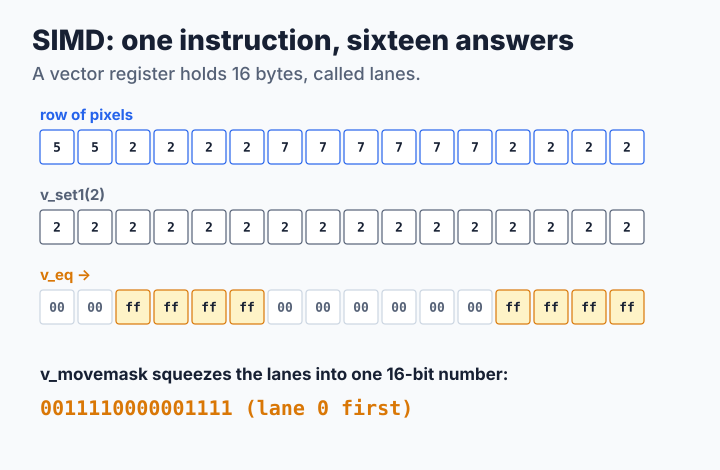
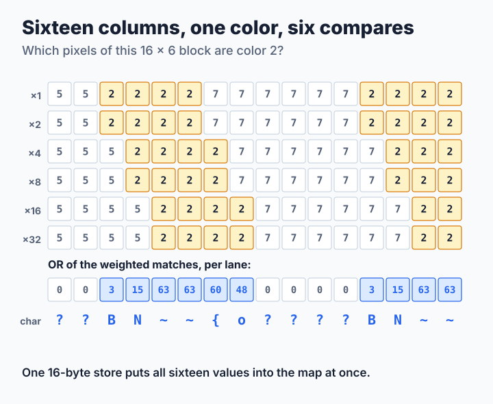

# Sixteen Columns in One Instruction

The [word decoder](word-decoder.md) handled the six bytes of a column word together with ordinary 64-bit arithmetic. Modern processors have a wider tool: **vector registers** that hold sixteen bytes and instructions that compare, combine or shuffle all sixteen in one go. This is called **SIMD**, *single instruction, multiple data*. This chapter uses it to sort sixteen columns into drawers at once. The decoder is the [word-decoder](word-decoder.md) chapter's, and the stream is still the [packing](packing.md) chapter's. The source is [`code/vector-lanes.c`](code/vector-lanes.c).

**You will learn:**

- what lanes and vector compares are,
- how six compares give one color's characters for sixteen columns,
- why SIMD helps some pictures and not others.

The code uses only the vector instructions that every 64-bit PC and every 64-bit ARM processor has: SSE2 on x86-64 and Advanced SIMD (NEON) on AArch64. Elsewhere, or when built with `-DTUTORIAL_NO_SIMD`, the [direct-writes](direct-writes.md) encoder runs unchanged.

## One instruction, sixteen answers

Each of the sixteen bytes of a vector register is called a **lane**. A vector compare looks at all sixteen pairs of lanes at once and writes `0xff` in the lanes that are equal and `0x00` in the others:



The encoder needs only a few such operations. To keep the algorithm readable on both kinds of processor, the code gives them short names:

| Operation | SSE2 | NEON | Meaning |
| --- | --- | --- | --- |
| `v_load`, `v_store` | `_mm_loadu_si128`, `_mm_storeu_si128` | `vld1q_u8`, `vst1q_u8` | Move 16 bytes |
| `v_set1(c)` | `_mm_set1_epi8` | `vdupq_n_u8` | Copy one byte into all 16 lanes |
| `v_eq(a, b)` | `_mm_cmpeq_epi8` | `vceqq_u8` | `0xff` where lanes are equal, else `0x00` |
| `v_and`, `v_or`, `v_zero` | `_mm_and_si128`, `_mm_or_si128`, `_mm_setzero_si128` | `vandq_u8`, `vorrq_u8`, `vdupq_n_u8(0)` | Bitwise logic |
| `v_movemask(v)` | `_mm_movemask_epi8` | (see below) | One bit per lane, as a 16-bit number |

NEON has no movemask instruction. For compare results, whose lanes are either `0x00` or `0xff`, the tutorial keeps one bit of a different value in each lane and adds up each half:

```c
static inline unsigned int v_movemask(uint8x16_t v)
{
    static uint8_t const weights[16] = {
        1, 2, 4, 8, 16, 32, 64, 128, 1, 2, 4, 8, 16, 32, 64, 128
    };
    uint8x16_t m = vandq_u8(v, vld1q_u8(weights));
    return (unsigned int)vaddv_u8(vget_low_u8(m)) |
           (unsigned int)vaddv_u8(vget_high_u8(m)) << 8;
}
```

## Sixteen columns, one color

Load the six rows of a block of sixteen columns into six vectors. Compare each row with color *c*, keep the row's value (1, 2, 4, …, 32) in the matching lanes, and OR the six results together. Every lane now holds the sixel value of color *c* in its column, exactly what you added up by hand in the first chapter, for sixteen columns at once:



```c
for (int x = 0; x < end; x += 16) {
    e->stamp++;
    for (int r = 0; r < rows; r++)
        row[r] = v_load(src[r] + x);
    for (int r = 0; r < rows; r++) {
        for (int lane = 0; lane < 16; lane++) {
            int c = src[r][x + lane];
            if (e->seen[c] == e->stamp) continue;   /* this color is done already */
            e->seen[c] = e->stamp;
            v128 color = v_set1(c), bits = v_zero();
            for (int k = r; k < rows; k++)          /* rows above r lack c */
                bits = v_or(bits, v_and(v_eq(row[k], color), weight[k]));
            v_store(e->map + (size_t)c * e->width + x, bits);
            unsigned int occupied = ~v_movemask(v_eq(bits, v_zero())) & 0xffff;
            e->occupancy[(size_t)c * e->words + (size_t)x / 64] |=
                (uint64_t)occupied << (x % 64);
            e->used[c] = 1;
        }
    }
}
```

This loop takes the place of the [occupancy](occupancy.md) chapter's loop over pixels, which now runs only for the at most fifteen columns left over at the right edge of each band. The occupancy bits stay, because cutting nodes still needs them.

The loop over the block's 96 pixels only looks for colors it has not handled yet. `seen[c] == stamp` marks colors already done in this block, and increasing `stamp` for the next block forgets them all without clearing anything. Every new color then costs up to six compares, one 16-byte store into its drawer, and one movemask for its lights. Lanes without the color store zero, which the drawer already holds there, so the store needs no mask.

The work now grows with the number of different colors in a 16×6 block, not in a column. That number is small when neighboring pixels share colors, as in the enlarged photograph and the two-color pattern, and large in random noise, where one block can hold almost 96 colors.

## Where this idea came from

Which SIXEL encoder first classified columns with vector compares is not known. The earliest SIMD code found in a SIXEL codec is in a decoder: icy_sixel 0.4.0 of 2024 fills spans with SSE2. The [implementation history](../../sixel-format/implementation-history.md#encoders-in-other-languages) lists it.

> **Try it.** Build this chapter without SIMD and compare the speed on the photograph and on noise:
>
> ```sh
> cc -O2 -DTUTORIAL_NO_SIMD -o vector-lanes-scalar common.c vector-lanes.c -lpthread
> ./vector-lanes bench photo.ppm 1 10
> ./vector-lanes-scalar bench photo.ppm 1 10
> ./first-codec synth noise 1920 1080 > noise.ppm
> ./vector-lanes bench noise.ppm 1 10
> ./vector-lanes-scalar bench noise.ppm 1 10
> ```
>
> `photo.ppm` is the picture you decoded in the [fewer questions](fewer-questions.md) chapter. Which picture gains, and which one loses? Can you explain why from the number of colors per block?
>
> Then write one yourself. `put_band()` looks for the end of a run one byte at a time. Rewrite it to compare sixteen bytes at once with `v_eq()` and `v_movemask()`, and find the first difference with `ctz64()`. `make check` must still pass. Measure it: photographs have short runs, so the result may surprise you.

## How fast is it?

<!-- measurements:begin:vector-lanes -->
| Input | Encode | Speed-up | Decode | Speed-up | Stream |
| --- | --- | --- | --- | --- | --- |
| Photograph, 600×450 | 1.90 ms | 0.9× | 0.61 ms | 1.0× | 328,750 bytes |
| Photograph, 1920×1080 | 8.60 ms | 1.0× | 3.09 ms | 1.0× | 1,663,155 bytes |
| Two colors, 1920×1080 | 1.73 ms | 2.4× | 1.21 ms | 1.0× | 692,322 bytes |
| Random noise, 1920×1080 | 65.7 ms | 0.9× | 15.7 ms | 1.0× | 9,316,560 bytes |
<!-- measurements:end -->

On the photograph SIMD gains almost nothing: classifying takes 2.2 ms instead of 2.4 ms, and classifying is not where most of the time goes. Writing out the stream takes about half of the time, and no vector compare helps with that. The two-color pattern gains 2.4 times, because each block holds only two colors: classifying takes 0.9 ms instead of 3.3 ms, which wins back what the [occupancy](occupancy.md) chapter lost there. Random noise loses a little, because the number of colors per block approaches the number of pixels. SIMD pays only where the data is regular and the time is actually spent, which is why this chapter comes after the cheaper ideas.

libsixel's [encoder](../../encoder/output/encode-policy/README.md) uses NEON to classify sparse mask bytes, and SIMD in [color-space conversion](../../encoder/colorspace-handling/README.md) and [resampling](../../encoder/preprocessing/resampling/README.md).

Previous: [Decode into column words](word-decoder.md) · Next: [Turn columns back into rows](transpose.md)
