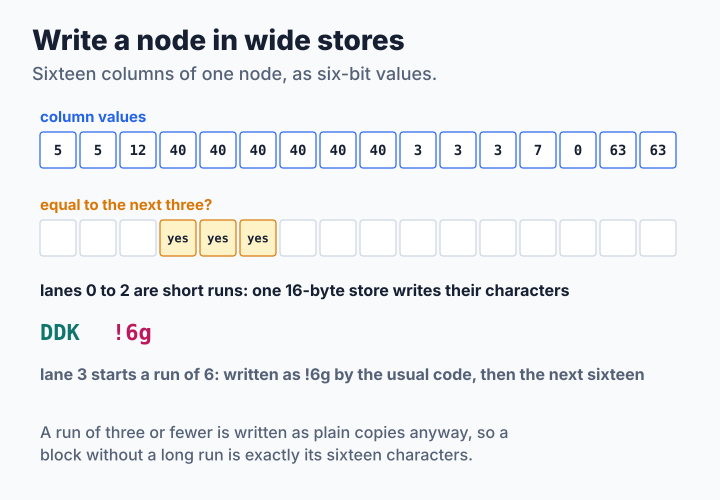

# Write a Node in Wide Stores

Since the [direct writes](direct-writes.md) chapter, the encoder writes a node one run at a time: it looks at the next column, counts how many columns repeat it, and then writes either plain copies or `!` and a count. Most runs in a photograph are one to three columns long, so the count is asked and answered for nearly every column. This chapter looks at sixteen columns at once and copies all the short runs among them with one store. It also writes every number below 1000 with one copy from a table. The decoder is the [literal-lanes](literal-lanes.md) chapter's, and the stream is still the [packing](packing.md) chapter's. The source is [`code/wide-stores.c`](code/wide-stores.c).

**You will learn:**

- how to find the start of a long run among sixteen columns with three compares,
- why short runs can be copied without being counted,
- how a table of digits replaces division by ten.

## Which runs need a count?

A run of four or more equal characters is written as `!`, a count and the character. A shorter run is written as plain copies, and plain copies of a run are simply the characters themselves. So the only columns that need attention are those where a long run starts, and a long run starts at a column that equals the next three:



Loading the map at `x`, `x + 1`, `x + 2` and `x + 3` and comparing gives that answer for sixteen columns at once:

```c
v128 c = v_load(m);
v128 four = v_and(v_and(v_eq(c, v_load(m + 1)), v_eq(c, v_load(m + 2))),
                  v_eq(c, v_load(m + 3)));
unsigned int starts = v_movemask(four) & lanes_inside_the_node;
v_store(q, v_add(c, v_set1('?')));      /* sixteen characters */
i = starts != 0 ? ctz32(starts) : 16;
q += i;                                 /* keep the short runs */
```

All sixteen columns are stored, turned into characters by adding `'?'`, but the pointer moves only past the columns before the first long run. The bytes after that are written over by the long run, which the scalar code of the earlier chapters writes with `!`. The first column that equals the next three is always where a run begins, because the column before it would otherwise have matched first. The reservation of the [direct writes](direct-writes.md) chapter already leaves enough room behind a node for a store of sixteen bytes. The map is allocated sixteen bytes longer, so that the loads past the end of its last row stay inside it.

## Numbers from a table

A number is written by dividing by ten for each digit and then reversing the digits. For the numbers below 1000, which are nearly all color numbers and counts, a table of 1000 entries holds the digits ready, left-aligned in four bytes, with the number of digits in the last byte:

```c
static unsigned char const digit_table[1000][4] = { /* "0", "1", ... "999" */ };

memcpy(q, digit_table[n], 4);           /* one four-byte copy */
q += digit_table[n][3];                 /* one to three digits */
```

Like the short runs, the copy writes a few bytes too many, and what comes next writes over them. The table is filled by the compiler with a macro, so it is constant and safe to read from any number of threads.

## Where this idea came from

libsixel's encoder copies node cells sixteen at a time and finds long runs with the same vector compares since 2026, in [`sixel_put_node()`](../../../src/encoder-core-encode.c), and spells its counts and color numbers from a constant table in [`encoder-count.h`](../../../src/encoder-count.h). Digit tables are a long-standing trick of fast integer formatting. Whether an earlier SIXEL encoder did either is not known.

> **Try it.** Keep the vector stores and go back to `put_num()` with divisions, then the other way round. Which half of this chapter helps the photograph, and which helps random noise?

## How fast is it?

<!-- measurements:begin:wide-stores -->
| Input | Encode | Speed-up | Decode | Speed-up | Stream |
| --- | --- | --- | --- | --- | --- |
| Photograph, 600×450 | 1.65 ms | 1.2× | 0.48 ms | 1.2× | 328,750 bytes |
| Photograph, 1920×1080 | 7.25 ms | 1.2× | 2.84 ms | 1.0× | 1,663,155 bytes |
| Two colors, 1920×1080 | 1.43 ms | 1.3× | 0.55 ms | 1.0× | 692,322 bytes |
| Random noise, 1920×1080 | 63.3 ms | 1.0× | 13.5 ms | 1.0× | 9,316,560 bytes |
<!-- measurements:end -->

The Full HD photograph encodes 1.2 times faster and the two-color pattern 1.3 times. In the [encoder phases](measurements.md#encoder-phases), writing the photograph's stream takes 2.9 ms instead of 4.3 ms, and the two-color pattern's almost nothing. Random noise gains least: its nodes are only a few columns long, so one store covers little of the work, and cutting the nodes takes a third of its time. The decoder has not changed; its row only shows how much one measurement differs from the next.

Previous: [Paint sixteen characters at once](literal-lanes.md) · Next: [Encode bands in parallel](parallel-bands.md)
