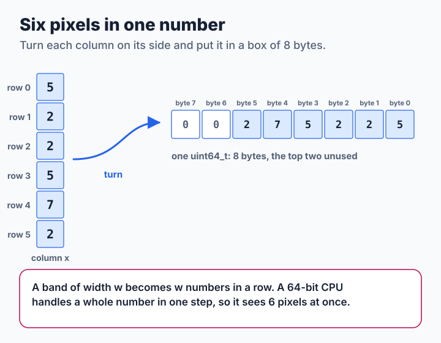
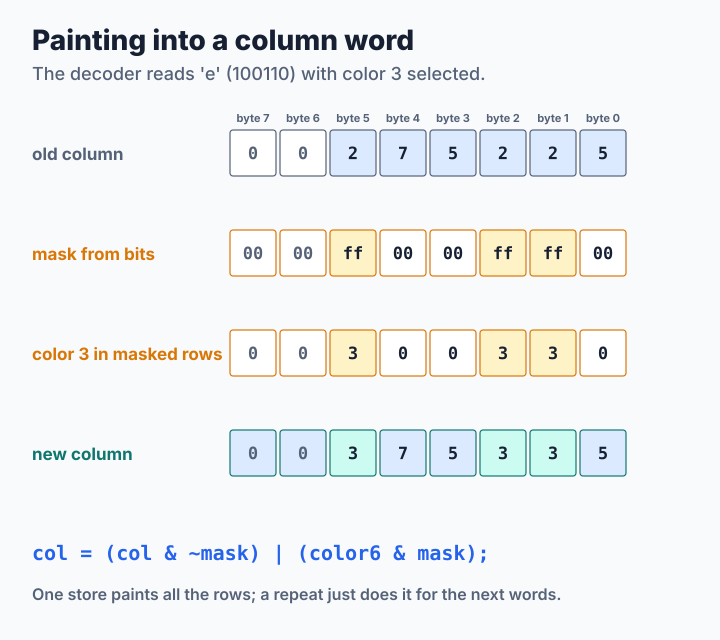

# Decode into Column Words

The [masks](masks.md) decoder paints a character with six stores, one per row, each a whole row of the picture away from the last. This chapter changes *where the decoder keeps a band in memory*: the six pixels of a column go into one 64-bit number, so a character is painted with one masked store, and columns turn back into rows once at the end. The encoder is the [direct-writes](direct-writes.md) chapter's. The source is [`code/word-decoder.c`](code/word-decoder.c).

**You will learn:**

- how to keep the six pixels of a column in one 64-bit number, a *column word*,
- how a mask of whole bytes replaces six byte stores,
- how six bits spread out into six bytes with one multiplication,
- what the extra pass at the end costs.

## Six pixels in one number

Memory is one long street of numbered boxes, one byte each. A picture is stored row after row, so the pixel at column `x` of row `y` lives in box `y * width + x`, and the six pixels of a sixel character are a whole row apart: 1920 boxes in a Full HD picture.

Turn each column on its side instead. A 64-bit integer (`uint64_t`) is eight bytes long. Put the register number of row 0 in byte 0, row 1 in byte 1, and so on up to row 5. Bytes 6 and 7 stay zero. This number is a **column word**:



The figure draws byte 0 on the right, the way we write the ones digit of a number on the right. A band of width `w` becomes an array of `w` column words, one after another in memory, so a repeat walks along the street.

## One store per character

The decoder keeps each band as an array of column words. A sixel character with color *c* must replace the bytes of the rows it paints and keep the others. With a **mask**, a number that is `0xff` in the bytes to replace and `0x00` elsewhere, that is a single operation:



```c
mask = row_mask((unsigned int)bits);    /* 0xff in every painted row */
paint = color6 & mask;                  /* color6 = c in all six bytes */
col = d.columns + (size_t)band * d.width + x;
for (int i = 0; i < repeat; i++)
    col[i] = (col[i] & ~mask) | paint;
```

`col & ~mask` clears the painted rows, and `| paint` fills them with the color. A repeat simply does the same for the next words, which lie side by side in memory. `row_mask()` spreads the six bits of the character out to six bytes with one multiplication:

```c
static inline uint64_t row_mask(unsigned int bits)
{
    return ((bits * UINT64_C(0x0002040810204081)) & BYTES_01) * 0xff;
}
```

Multiplying by `0x0002040810204081` adds up shifted copies of `bits`: one shifted by 0 bits, one by 7, one by 14, and so on, seven bits apart. Bit *i* of the copy shifted by 7*i* lands on bit 8*i*, the lowest bit of byte *i*. `& BYTES_01` keeps only those lowest bits, so byte *i* is now 1 when row *i* is painted and 0 otherwise, and multiplying by `0xff` turns each 1 into `0xff`. The other bits of the copies land elsewhere and are thrown away by the AND.

The inner loop of the [fewer questions](fewer-questions.md) chapter stays, with this one store in place of six.

## Back to rows at the end

When the stream ends, `materialize()` copies byte *r* of every column word into row *r* of the picture, once per pixel. The [transpose](transpose.md) chapter shows how to do that quickly.

Unpainted bytes stay zero, which is also register 0, so the tutorial needs no record of which pixels were painted. libsixel's decoder keeps such a record in byte 6 of the word, as described under [ordinary-mode band columns](../../decoder/pipeline/README.md#ordinary-mode-band-columns), because its callers can ask which pixels were painted and because a pixel painted with register 0 must look different from an untouched one.

## Where this idea came from

Packing the six pixels of a column into one value is old. Ghostscript's LN03 printer driver of 1991 transposed six-by-eight blocks of a monochrome bitmap into column bytes, and chafa's SIXEL encoder of 2019 kept the six pixels of a color column in the low six bytes of one 64-bit word. On the decoding side, Tetsuya Isaki's SIXEL support for the NetBSD/x68k `ite` console replaced six row arrays with one 32-bit word per column in 2016, updated with one table lookup, one multiplication and one OR. That is the earliest decoder found that paints into column words. The [implementation history](../../sixel-format/implementation-history.md#decoder-side-transposition-in-ite), its [chafa entry](../../sixel-format/implementation-history.md#chafa-column-words-and-parallel-batches) and the [OR-mode history](../../encoder/output/or-mode/x68k.md#history) give the details.

> **Try it.** Write `row_mask()` yourself and check it on the figure: `row_mask(38)` must be `0x0000ff0000ffff00`. Then try all 64 values against a plain loop over the six bits.

## How fast is it?

<!-- measurements:begin:word-decoder -->
| Input | Encode | Speed-up | Decode | Speed-up | Stream |
| --- | --- | --- | --- | --- | --- |
| Photograph, 600×450 | 1.71 ms | 1.0× | 0.60 ms | 1.4× | 328,750 bytes |
| Photograph, 1920×1080 | 8.80 ms | 1.0× | 3.12 ms | 1.4× | 1,663,155 bytes |
| Two colors, 1920×1080 | 4.22 ms | 1.0× | 1.21 ms | 1.3× | 692,322 bytes |
| Random noise, 1920×1080 | 61.3 ms | 1.0× | 15.7 ms | 1.2× | 9,316,560 bytes |
<!-- measurements:end -->

One store instead of six makes decoding 1.2 to 1.4 times faster on every input, including the pass back to rows, which takes about 0.6 ms for a Full HD picture. The encoder has not changed.

Previous: [Write without checking every byte](direct-writes.md) · Next: [Sixteen columns in one instruction](vector-lanes.md)
