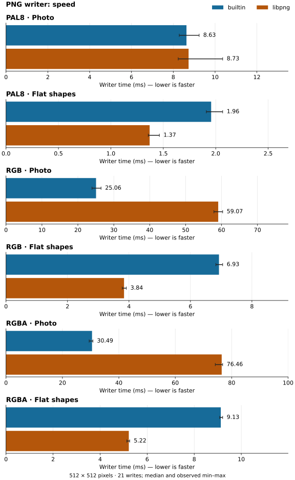
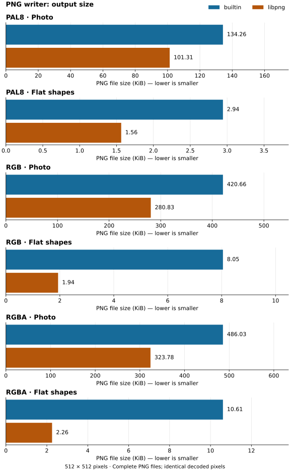

# PNG Writer

This document defines how libsixel turns decoded or caller-supplied pixels into PNG data. It covers the compile-time libpng and builtin backends, the indexed and direct 8-bit output contracts, and the special `img2sixel` path that generates SIXEL before recreating a PNG for quality inspection.

The owning implementation is [`src/writer.c`](../../src/writer.c). [`src/decoder.c`](../../src/decoder.c) selects the pixel representation passed to the writer, while [`src/encoder.c`](../../src/encoder.c) owns the post-SIXEL snapshot path.

## Entry points and data flow

The public entry point is `sixel_helper_write_image_file()`. `SIXEL_FORMAT_PNG` is the only implemented output format accepted by this helper; the other enumerated formats return `SIXEL_NOT_IMPLEMENTED`. A null allocator selects a temporary default allocator. The filename `-` selects standard output, which is placed in binary mode where the platform requires it; any other filename is opened in binary write mode. The writer explicitly flushes the stream and closes only files that it opened.

There are two command paths into the writer:

```text
sixel2png
  -> parse and render SIXEL
  -> choose PAL8, RGB888, or RGBA8888 output
  -> shared color-aware PNG writer (sRGB or explicit interpretation)
  -> selected PNG backend

img2sixel with -o output.png, -o png:<path>, or -o png:-
  -> load source image
  -> resize, quantize, apply the selected palette, and dither
  -> generate the normal SIXEL byte stream into a temporary file
  -> decode that generated SIXEL with the standard decoder defaults
  -> shared color-aware PNG writer (sRGB or explicit interpretation)
  -> selected PNG backend
```

The second path is intentionally a post-SIXEL snapshot, not serialization of the input image or a pre-SIXEL encoder buffer. For an ordinary stable-palette SIXEL stream, the decoder returns the painted palette indices and palette, so the PNG exposes the quantized and dithered result that the generated SIXEL represents. This is the path intended for encoder quality inspection. The same command options must therefore affect both normal SIXEL output and PNG snapshot output before the paths diverge at the final destination.

The decoder selects the writer representation as follows:

| Decoder path | Writer input | PNG class |
| --- | --- | --- |
| Default stable-palette decode, with no dequantizer and no resizing promotion | `PAL8` plus palette | Indexed 8-bit |
| Palette decode followed by `k_undither`, `selective_blur`, or another RGB-producing reconstruction | `RGB888` | Direct RGB8 |
| `sixel2png -D`, including direct output after dequantization | `RGBA8888` | Direct RGBA8 |
| Resize or another frame operation that promotes the decoded representation | Promoted frame format, normally `RGB888` or `RGBA8888` | Matching direct 8-bit class |

High-color SIXEL is a boundary of the indexed snapshot contract. High-color output can redefine a color register after earlier pixels have used it, so no single indexed plane plus final palette can preserve every painted color. The current `img2sixel` PNG snapshot invokes the decoder's default indexed path and must not be treated as an exact high-color reference. Use direct decoder output when validating a register-redefining SIXEL stream. Animation also passes through the decoder's existing output behavior; this document does not define the PNG target as an APNG writer.

## Decoded-input interpretation option

`sixel2png` and the decoder object file frontend tag their PNG output. The existing `sixel_helper_write_image_file()` entry point retains its untagged contract; callers of that function have not supplied a color interpretation.

The option is `-T SPACE`, `--input-colorspace=SPACE`, with environment default `SIXEL_DECODER_INPUT_COLORSPACE`. The initial named values are `srgb` (default) and `display-p3`. CLI values override environment defaults and the last repeated option wins. The name denotes the interpretation of decoded SIXEL RGB numbers, not a target conversion. There is no `auto`: a saved SIXEL stream carries no authoritative color definition, and querying the receiving terminal cannot recover the source interpretation.

The save policy retains decoded RGB values and records that interpretation in the PNG. An sRGB selection writes sRGB metadata; a Display P3 selection writes the corresponding RGB ICC profile. The same definition applies to indexed `PLTE` entries and direct RGB/RGBA samples. Alpha and the decoder's paint mask remain coverage information. `-D` changes how register redefinitions are rendered, not the selected color interpretation. Saving to sRGB after conversion would be a separate output request, not a hidden effect of `-T`.

Raw decoding APIs continue to return numeric pixel values without implicit color conversion or profile assignment. The file-output frontend supplies a color definition to a common color-aware writer interface; the existing writer API remains compatible. ICC parsing, profile generation and validation belong to shared library facilities, not a converter-private CMS. Future ICC and simple RGB specifications must reuse that same definition model.

Display P3 supports direct decoding, resizing and dequantization. Existing byte resampling and reconstruction operate on the decoded RGB coordinates: per-channel interpolation, RGB distance, and weighted averages do not implicitly convert P3 into sRGB. `-T` retains that interpretation through processing and records it at the PNG boundary. The coordinate-distance heuristic is not a colorimetric or perceptually uniform distance; optimizing reconstruction for a particular gamut is a separate quality concern. Invalid explicit color names are rejected. As with other decoder defaults, an invalid inherited environment value is ignored so the caller can set an explicit option.

```sh
sixel2png -T display-p3 input.six output.png
sixel2png --input-colorspace=srgb -D input.six output.png
```

Library consumers select the same interpretation through `sixel_decoder_setopt(decoder, SIXEL_OPTFLAG_INPUT_COLORSPACE, "display-p3")`. The option affects `sixel_decoder_decode()` file output only. Raw pixel decoding remains numeric. Encoder-generated PNG snapshots explicitly select sRGB, independently of the decoder environment default.

### Profile ownership and encoding

The shared CMS color definition serializes a deterministic ICC v4.3 RGB matrix/TRC profile. Its primary columns and media white are expressed in D50 PCS, its `chad` records adopted-white adaptation, and its parametric TRCs encode the Display P3 sRGB transfer function. Serialization rounds only at the ICC signed 15.16 boundary; it does not transform pixels. Both PNG backends use this same profile. The builtin backend compresses the profile with its bundled compressor and needs no system CMS or libpng dependency.

The [`iCCP`/`sRGB` ordering and exclusivity rules](https://www.w3.org/TR/png-3/#11iCCP) and the [ICC profile specification](https://www.color.org/specification/ICC.1-2022-05.pdf) define the interchange representation. Arbitrary ICC paths and simple RGB input specifications are future CLI extensions; they must reuse the shared color definition rather than adding an independent converter parser.

## Pixel input normalization

The writer normalizes its public input before selecting a PNG color type.

| Input pixel format | Palette requirement | Effective writer input | PNG representation |
| --- | --- | --- | --- |
| `PAL1`, `PAL2`, `PAL4` | Required | Expanded to one `PAL8` index byte per pixel | Indexed, color type 3, bit depth 8 |
| `PAL8` | Required | Used without index conversion | Indexed, color type 3, bit depth 8 |
| `G8` without palette | None | Gray byte replicated to R, G, and B | RGB, color type 2, 8 bits per channel |
| `G8` with palette | Optional palette is used as a lookup table | Each byte is looked up as a palette index and expanded to RGB | RGB, color type 2, 8 bits per channel |
| `RGB888` | None | Used without channel conversion | RGB, color type 2, 8 bits per channel |
| `RGB565`, `RGB555`, `BGR565`, `BGR555`, `GA88`, `AG88`, `BGR888` | None | Normalized to `RGB888` | RGB, color type 2, 8 bits per channel |
| `RGBFLOAT32`, `LINEARRGBFLOAT32`, `OKLABFLOAT32`, `CIELABFLOAT32`, `DIN99DFLOAT32` | None | Normalized to `RGB888` | RGB, color type 2, 8 bits per channel |
| `RGBA8888` | None | Used without channel conversion | RGBA, color type 6, 8 bits per channel |
| `ARGB8888`, `BGRA8888`, `ABGR8888` | None | Reordered to `RGBA8888` | RGBA, color type 6, 8 bits per channel |
| `XRGB8888`, `RGBX8888`, `XBGR8888`, `BGRX8888` | None | Reordered to `RGBA8888` with alpha forced to 255 | RGBA, color type 6, 8 bits per channel |

Unsupported pixel-format values return `SIXEL_BAD_ARGUMENT`. Palette formats without a palette also return `SIXEL_BAD_ARGUMENT`.

## Indexed PNG contract

Indexed output always uses PNG color type 3 at bit depth 8, even when the public input was packed `PAL1`, `PAL2`, or `PAL4`. Each output sample is the normalized palette index; the writer does not remap indices to make the palette smaller.

The `PLTE` length is derived from the largest referenced index: the writer emits entries zero through the maximum index, with a minimum of one and a maximum of 256 entries. Each entry is copied as the supplied 8-bit RGB triple. There is no separate `ncolors` argument on `sixel_helper_write_image_file()`, so unreferenced palette entries above the maximum index are intentionally omitted.

The color-aware entry point emits an `sRGB` or `iCCP` chunk before `PLTE`/`IDAT`. The legacy writer entry point emits neither. Neither entry point emits `tRNS`, text, or time chunks. Indexed transparency is therefore not part of this output contract. Omitted SIXEL pixels have already been resolved by the decoder before the writer receives the index plane.

## Direct 8-bit PNG contract

Direct output is either PNG color type 2 (`RGB888`) or color type 6 (`RGBA8888`), always at 8 bits per channel. `sixel2png -dk_undither` is a representative RGB path because dequantization produces `RGB888`; `sixel2png -D` is the direct RGBA path. If `-D` is combined with a dequantizer, the dequantized RGB result is promoted back to RGBA using the decoder's direct alpha plane.

Float32 and packed integer inputs are converted before the backend is selected, so the PNG writer never emits 16-bit integer or floating-point samples. The legacy entry point emits no color metadata. The color-aware entry point accepts encoded `PAL8`, `RGB888`, and `RGBA8888` only, and tags them without conversion; callers must complete any working-space conversion before this boundary.

## Backend selection

Backend selection is compile-time and is not a command-line choice. Autotools uses libpng when `./configure --with-png` succeeds and uses the builtin backend with `--without-png`; the default is automatic detection. Meson uses the equivalent `-Dpng=enabled`, `-Dpng=disabled`, or automatic feature selection. `HAVE_LIBPNG=1` selects the libpng branch in `src/writer.c`; otherwise the builtin branch is compiled.

Both backends implement the same pixel-format and PNG color-type contracts above. Compressed bytes, row filters, IDAT partitioning, and total file size are backend implementation details and are not byte-stability guarantees across libpng and builtin builds.

### libpng backend

The libpng backend builds one row pointer per image row and configures a non-interlaced PNG with base compression and filter types. Indexed output sets an 8-bit palette IHDR and copies the derived palette range into `PLTE`. Direct output sets an 8-bit RGB or RGBA IHDR.

libsixel supplies libpng with write and flush callbacks backed by the selected `FILE *`. A short write or flush error enters libpng's error path. Where `setjmp` and `longjmp` support is available, libsixel installs error and warning callbacks, preserves libpng's diagnostic as the additional error message, and returns `SIXEL_PNG_ERROR` after a libpng failure. Timeline logging records the write-call and byte counts without changing PNG contents.

### builtin backend

The builtin backend has separate indexed and direct implementations. It does not require libpng.

For indexed output, libsixel prefixes every row with PNG filter type 0, compresses the filtered index stream with the bundled stb zlib compressor, and writes one `IHDR`, optional color metadata, one `PLTE`, one `IDAT`, and one `IEND` after the PNG signature. Every chunk length and integer field is big-endian. Chunk CRCs use the PNG reflected CRC-32 convention: type bytes followed by payload bytes, low-bit-first shifting, reversed polynomial `0xedb88320`, initial and final complement.

For direct RGB and RGBA output, libsixel passes the normalized tightly packed rows to the bundled `stbi_write_png_to_mem()` implementation and writes the returned PNG buffer to the destination stream, inserting color metadata after `IHDR` when requested. Filtering and compression choices in this branch belong to the bundled implementation and are not a stable byte-level API.

## Measured speed and output size

The comparison below measures the writer itself on identical prepared pixels, separately for indexed, RGB, and RGBA output. It does not include image loading, quantization, SIXEL encoding, or SIXEL decoding. Both backends preserve the supplied pixels; smaller files here mean better lossless compression, not reduced image quality.





On this machine, builtin writes the photo RGB and RGBA inputs about 2.4–2.5 times as fast as libpng, while libpng produces files about 33% smaller. Photo indexed timing is close, with overlapping observed ranges; libpng's indexed file is about 25% smaller. For flat shapes, libpng is both faster and smaller in all three formats. There is no universal speed winner: pixel representation and image structure matter. Each panel starts at zero but has its own scale; compare backends within a panel rather than bar lengths between panels.

### Measurement conditions and reproduction

The recorded run used an Apple M3 Max, macOS 26.5.1 arm64, Apple clang 21.0.0 with `-O2`, and libpng 1.6.58. All inputs are 512 × 512 pixels. “Photo” is [`images/snake.png`](../../images/snake.png), resized with Pillow's Lanczos filter. “Flat shapes” is a deterministic white image with four colored rectangles. PAL8 inputs are quantized once to at most 256 entries and shared unchanged by both writers. RGB retains the prepared color samples; RGBA additionally uses a repeating 0–255 alpha ramp. These two fixtures illustrate contrasting content, not a representative corpus of every PNG workload.

The harness compiles the current `src/writer.c` twice with the same configuration and support library, overriding only `HAVE_LIBPNG` and renaming the public writer entry point for isolation. Both builds retain their normal compression defaults. Timing surrounds one public writer call to `/dev/null`, including writer allocation, filtering, compression, stream open, flush, and close, but excluding Python fixture preparation and process startup. It therefore measures writer cost without filesystem storage throughput or durability costs. Three warmup writes precede 21 measured writes per backend and input; backend order alternates. Bars report the median, with observed minimum–maximum whiskers, not confidence intervals. Timings include a small common Python/ctypes call overhead and depend on machine load.

Size is the full byte count of a separate PNG file, including headers, palette, and chunks; 1 KiB = 1024 bytes. Every generated file is decoded with Pillow and compared exactly with the prepared input in RGBA form. This validation is a benchmark sanity check, not a replacement for the behavioral suite below.

The [recorded samples and source/build hashes](png-figures/measurements.json) accompany the figures. The [measurement and plotting script](../../tools/plot_png_writer_measurements.py) requires a configured, built shared libsixel, a C compiler, `pkg-config` with libpng development files, Pillow, and matplotlib on macOS or Linux. Run from the repository root, with timeline logging disabled:

```sh
# Measure both branches and regenerate SVG/PNG figures.
python3 tools/plot_png_writer_measurements.py --measure
# Regenerate from the recorded samples without rerunning timings.
python3 tools/plot_png_writer_measurements.py
# Verify that committed figures match the recorded samples.
python3 tools/plot_png_writer_measurements.py --check
```

Use the same plotting environment for byte-for-byte regeneration (this rendering used matplotlib 3.11.1 and Pillow 12.3.0). New measurements are expected to vary; backend rankings and compressed bytes are observations of this version and these inputs, not performance guarantees.

## Test coverage

<!-- test-coverage: enforced -->

Each row is one independently reportable observation. Format tests run against whichever backend a build selected; the CI build matrix is responsible for exercising libpng-enabled and libpng-disabled configurations.

| ID | Contract | Backend | Owning test |
| --- | --- | --- | --- |
| PW-01 | `sixel2png` without an explicit output writes a PNG stream to standard output. | Both | [tests/cli/sixel2png/0005_stdin_default_output.t](../../tests/cli/sixel2png/0005_stdin_default_output.t) |
| PW-02 | `img2sixel -o png:-` writes the post-SIXEL PNG snapshot to standard output. | Both | [tests/codec/format/0001_prefixed_png_output_stdout.t](../../tests/codec/format/0001_prefixed_png_output_stdout.t) |
| PW-03 | `img2sixel -o png:<path>` writes the PNG snapshot to the requested path. | Both | [tests/codec/format/0002_prefixed_png_output_explicit_path.t](../../tests/codec/format/0002_prefixed_png_output_explicit_path.t) |
| PW-04 | A `.png` output suffix selects PNG snapshot output. | Both | [tests/codec/format/0003_filename_driven_png_header.t](../../tests/codec/format/0003_filename_driven_png_header.t) |
| PW-05 | The default palette decoder path writes PNG bit depth 8 and color type 3. | Both | [tests/writer/png/0001_indexed8_ihdr.t](../../tests/writer/png/0001_indexed8_ihdr.t) |
| PW-06 | The representative dequantized path writes PNG bit depth 8 and color type 2. | Both | [tests/writer/png/0002_rgb8_ihdr.t](../../tests/writer/png/0002_rgb8_ihdr.t) |
| PW-07 | Direct decoder output writes PNG bit depth 8 and color type 6. | Both | [tests/writer/png/0003_rgba8_ihdr.t](../../tests/writer/png/0003_rgba8_ihdr.t) |
| PW-08 | The builtin indexed writer emits the standards-compliant reflected CRC-32 value for the fixed IHDR vector. | Builtin | [tests/writer/png/0004_builtin_ihdr_crc.t](../../tests/writer/png/0004_builtin_ihdr_crc.t) |
| PW-09 | With Floyd-Steinberg dithering selected, the `img2sixel` PNG snapshot is byte-identical to decoding a separately generated SIXEL stream with the same writer backend. | Both | [tests/writer/png/0005_img2sixel_post_sixel_snapshot.t](../../tests/writer/png/0005_img2sixel_post_sixel_snapshot.t) |

| PW-10 | Srgb indexed. | Both | [tests/writer/png/0006_srgb_indexed.t](../../tests/writer/png/0006_srgb_indexed.t) |
| PW-11 | P3 indexed. | Both | [tests/writer/png/0007_p3_indexed.t](../../tests/writer/png/0007_p3_indexed.t) |
| PW-12 | P3 direct alpha. | Both | [tests/writer/png/0008_p3_direct_alpha.t](../../tests/writer/png/0008_p3_direct_alpha.t) |
| PW-13 | P3 register redefinition. | Both | [tests/writer/png/0009_p3_register_redefinition.t](../../tests/writer/png/0009_p3_register_redefinition.t) |
| PW-14 | P3 environment. | Both | [tests/writer/png/0010_p3_environment.t](../../tests/writer/png/0010_p3_environment.t) |
| PW-15 | Cli overrides environment. | Both | [tests/writer/png/0011_cli_overrides_environment.t](../../tests/writer/png/0011_cli_overrides_environment.t) |
| PW-16 | Last interpretation wins. | Both | [tests/writer/png/0012_last_interpretation_wins.t](../../tests/writer/png/0012_last_interpretation_wins.t) |
| PW-17 | Long input colorspace. | Both | [tests/writer/png/0013_long_input_colorspace.t](../../tests/writer/png/0013_long_input_colorspace.t) |
| PW-18 | Invalid input colorspace. | Both | [tests/writer/png/0014_invalid_input_colorspace.t](../../tests/writer/png/0014_invalid_input_colorspace.t) |
| PW-19 | P3 resize coordinates. | Both | [tests/writer/png/0015_p3_resize_coordinates.t](../../tests/writer/png/0015_p3_resize_coordinates.t) |
| PW-20 | P3 k undither coordinates. | Both | [tests/writer/png/0016_p3_k_undither_coordinates.t](../../tests/writer/png/0016_p3_k_undither_coordinates.t) |
| PW-21 | Legacy writer untagged. | Both | [tests/writer/png/0017_legacy_writer_untagged.t](../../tests/writer/png/0017_legacy_writer_untagged.t) |
| PW-22 | Shared rgb p3. | Both | [tests/writer/png/0018_shared_rgb_p3.t](../../tests/writer/png/0018_shared_rgb_p3.t) |
| PW-23 | Raw decode unchanged. | Both | [tests/writer/png/0019_raw_decode_unchanged.t](../../tests/writer/png/0019_raw_decode_unchanged.t) |
| PW-24 | Icc numeric contract. | Both | [tests/writer/png/0020_icc_numeric_contract.t](../../tests/writer/png/0020_icc_numeric_contract.t) |
| PW-25 | P3 lso fs coordinates. | Both | [tests/writer/png/0021_p3_lso_fs_coordinates.t](../../tests/writer/png/0021_p3_lso_fs_coordinates.t) |
| PW-26 | P3 lso light coordinates. | Both | [tests/writer/png/0022_p3_lso_light_coordinates.t](../../tests/writer/png/0022_p3_lso_light_coordinates.t) |
| PW-27 | P3 selective blur coordinates. | Both | [tests/writer/png/0023_p3_selective_blur_coordinates.t](../../tests/writer/png/0023_p3_selective_blur_coordinates.t) |
| PW-28 | P3 direct resize coordinates. | Both | [tests/writer/png/0024_p3_direct_resize_coordinates.t](../../tests/writer/png/0024_p3_direct_resize_coordinates.t) |
| PW-29 | P3 direct undither coordinates. | Both | [tests/writer/png/0025_p3_direct_undither_coordinates.t](../../tests/writer/png/0025_p3_direct_undither_coordinates.t) |


### Coverage audit and boundary

Before the dedicated writer tests, existing coverage established that PNG targets produced files or streams and that the direct decoder option completed, but it did not assert indexed versus direct IHDR types, exercise a standard CRC vector, or prove that the quality snapshot came after SIXEL generation. The former duplicate `png:<path>` format tests also observed the same path behavior; PW-02 now owns stdout selection while PW-03 owns explicit-path selection.

The focused suite now covers the three writer output classes used by the decoder, both command entry routes, all documented `img2sixel` PNG target forms, the builtin CRC regression, and the post-SIXEL dither snapshot contract. The same format tests are backend-neutral and run in both libpng and builtin CI configurations; PW-08 is intentionally builtin-only.

The suite does not currently enumerate every public input normalization format, assert the derived `PLTE` extent, inject allocator or stream failures, validate every dynamically sized chunk CRC independently, or define high-color and animation snapshots as indexed-exact output. Those are explicit coverage gaps rather than implied guarantees. Compressed PNG byte identity across the two backends is deliberately outside the contract.
